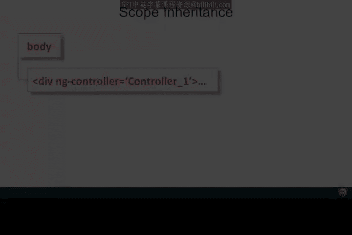
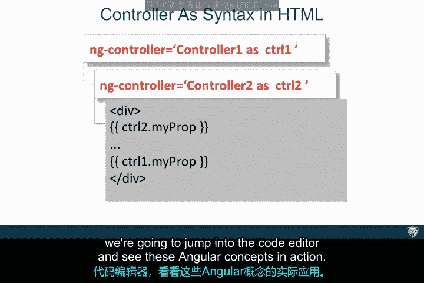

# 036：作用域继承

## 概述

在本节课中，我们将要学习 AngularJS 中的一个核心概念：作用域继承。我们将探讨控制器嵌套时作用域如何工作，以及如何利用 `controller as` 语法来避免常见的作用域属性遮蔽问题，从而编写出更清晰、更易维护的代码。

## 原型继承回顾

上一节我们介绍了 JavaScript 的原型继承机制。理解这个概念是掌握 AngularJS 作用域继承的基础。

## 作用域继承的概念

现在，让我们来讨论另一个称为“作用域继承”的概念。

在 AngularJS 应用中，让一个控制器处理页面中的所有功能既不常见，也不是好的实践。更好的做法是编写负责页面较小部分功能的、更小的代码模块。

众所周知，文档对象模型（DOM）是一个由嵌套的 HTML 元素和节点组成的树状结构。当你声明一个控制器负责页面的一部分时，控制器的自然嵌套就会发生。

因此，外部控制器的 `$scope` 服务（或简称为作用域）对于内部控制器是可用的。然而，AngularJS 使其变得更加优雅：内部控制器的作用域通过原型继承的方式从外部控制器的作用域继承而来。

既然你现在明白了原型继承的含义，你就能理解，声明在外部控制器作用域（在本例中是 `controller1`）上的属性，无需任何额外努力，就可以被内部控制器作用域（`controller2` 和 `controller3`）访问。当然，前提是内部控制器没有在其自身的作用域上声明相同的属性，从而遮蔽了外部父控制器作用域的属性。

## 属性遮蔽问题

如果我们声明一个名为 `prop` 的属性在第一个控制器的作用域上，并使其等于字符串 `CTRL1` 以表示它来自第一个控制器，然后尝试在继承自 `controller1` 的第二个和第三个控制器的作用域上访问该属性，JavaScript 引擎将沿着原型链向上查找，并在第一个控制器中找到该属性的值，即 `CTRL1`。

但是，如果我们在 `controller2` 内部，首先获取从 `$scope1` 继承的 `prop` 值，以某种方式对其进行求值，然后想要更改它，使得 `$scope1` 的 `prop` 值和 `$scope2` 的 `prop` 值相同，甚至希望它们指向相同的内存位置，会发生什么？

然而，如果不手动沿着原型链向上查找并获取 `$scope1` 对象的实例，我们无法通过原始类型实现这一点。每次我们在 `$scope2` 上设置 `prop` 属性，最终都会从 `scope2` 的视角遮蔽 `$scope1` 的 `prop` 属性。因此，在这种场景下，`$scope1.prop` 将保持不变，仍然等于 `CTRL1`。

但是，正如你可能从上一个视频中记得的，当我们处理通过原型继承的对象时，情况会非常不同。

原因在于，仅仅为了获取继承对象的属性，我们就必须沿着原型链向上查找。因此，当我们更改此类对象的属性时，我们是在其原始源处进行更改，所以所有控制器都会反映这一更改，并且不会发生遮蔽。

正如你在此案例中看到的，即使我们通过 `$scope2`（一个内部控制器作用域）的引用更改了对象属性 `prop`，拥有相同对象属性 `prop` 的 `$scope1` 也改变了它的值。所以你可以看到，当我们拥有作用域继承时，使用作为作用域属性的对象，而不是直接位于作用域本身的原始属性，是非常有利的。

## `controller as` 语法

这正是 `controller as` 语法能给我们带来很大帮助的地方。`controller as` 语法为我们提供了一个非常方便的对象，我们可以将所有属性附加到该对象上，从而避免属性遮蔽问题。

它允许我们在 HTML 模板中指定一个标签。这个标签的名称作为属性附加到相应的 `$scope` 服务上。因此，在本例中，对于第一个控制器是 `$scope.ctrl1`，对于第二个控制器是 `$scope.ctrl2`。这些属性（在本例中是 `ctrl1` 和 `ctrl2`）指向控制器本身的实例对象。

换句话说，控制器实例作为属性附加在 `$scope` 上。

这意味着，当涉及到实现控制器函数（即负责实现控制器功能的函数）时，我们可以直接将属性附加到控制器函数内部的 `this` 关键字上，甚至无需将 `$scope` 注入到控制器中。因此，`this` 关键字就等同于我们在 HTML 模板中通过 `controller as` 语法给定的标签名称。

我们能够用不多的代码完成所有这些，是因为 AngularJS 在幕后为我们做了很多工作。

## AngularJS 的幕后工作

以下是它大致所做的事情。显然，AngularJS 实际所做的要复杂得多，所以这只是幕后发生事情的一个粗略概念。

在我们的案例中，我们有两个嵌套的控制器：外部控制器 `controller1` 声明为 `ctrl1`，内部控制器 `controller2` 声明为 `ctrl2`。

AngularJS 为我们的 `controller1` 创建作用域（我们暂时称之为 `$scope1`）后，会附加一个名为 `ctrl1` 的属性（与我们的标签相同），然后使用我们的控制器函数作为函数构造器来实例化它。这意味着 `ctrl1` 现在等同于我们指定为控制器函数的那个函数构造器内部的 `this` 关键字。

由于内部作用域 `$scope2` 将通过原型继承基于外部作用域 `$scope1` 创建，然后我们将经历一个类似的过程：我们将为 `$scope2` 创建一个属性，其名称是我们分配给 `controller2` 的标签（即 `ctrl2`），并使用 `new` 关键字创建的 `controller2` 函数实例来初始化它（因此将 `controller2` 函数用作函数构造器）。所以，`ctrl2` 将再次指向与 `controller2` 函数构造器内部的 `this` 关键字所指向的相同的东西。

## 代码可读性的提升

但事情不仅在 JavaScript 内部变得更好、更简单。`controller as` 语法也使 HTML 模板变得更简单。它不仅允许我访问来自父作用域的同名属性而不会遮蔽任何属性，还使代码更具可读性。

所以现在，当我看到插值表达式 `{{ ctrl2.myProp }}` 时，我知道这个属性是在 `controller2` 上实例化和归属的；而 `{{ ctrl1.myProp }}` 则是在 `controller1` 上实例化和归属的属性。

## 总结

本节课中，我们一起学习了 AngularJS 中的作用域继承机制。我们了解到，嵌套控制器的作用域通过原型链连接，这可能导致内部作用域遮蔽外部作用域的原始类型属性。为了解决这个问题，我们引入了 `controller as` 语法，它允许我们将控制器实例直接绑定到作用域的一个属性上，从而通过对象引用来共享数据，避免了属性遮蔽，并显著提升了代码的清晰度和可维护性。

好的，理论部分暂时介绍到这里。在本讲座的第四部分，我们将跳转到代码编辑器中，亲眼看看这些 AngularJS 概念的实际应用。