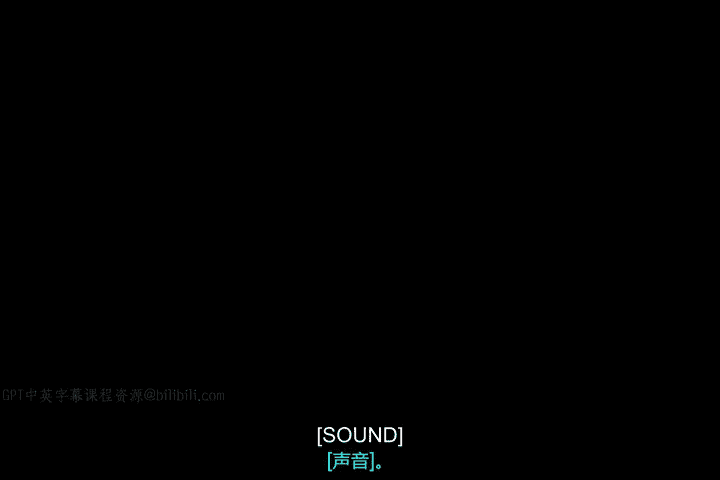
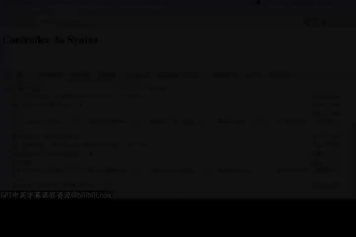
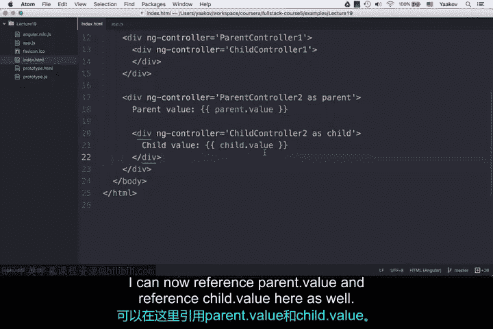
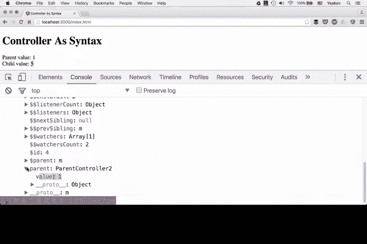
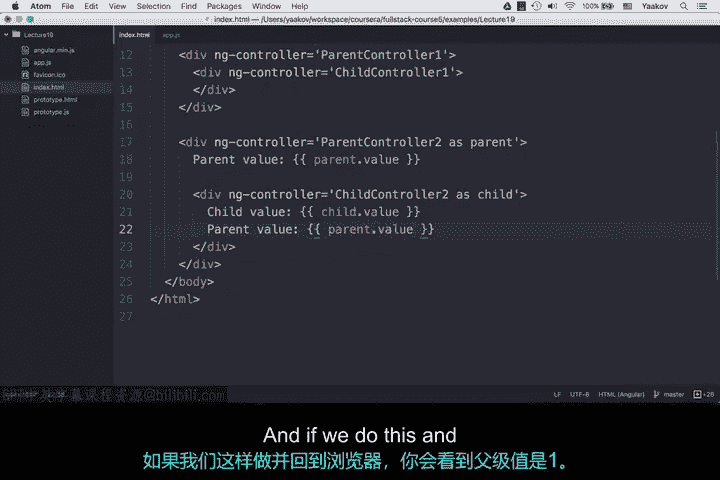
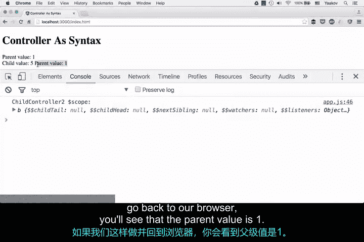
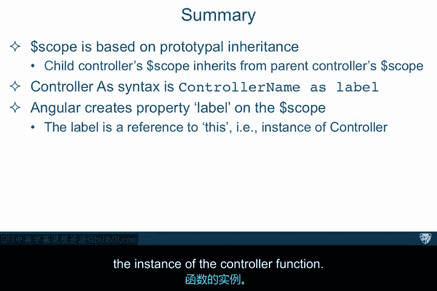
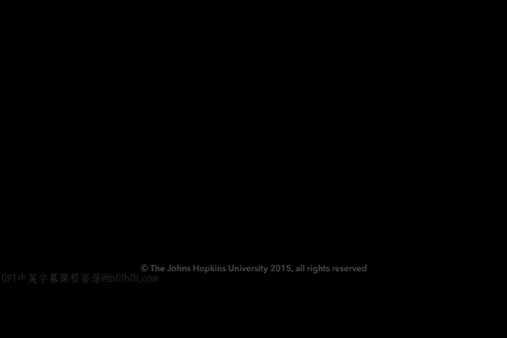

# 038：Controller As 语法 🎯





在本节课中，我们将要学习 AngularJS 中的 **Controller As** 语法。这是一种替代传统 `$scope` 使用方式的方法，它能让代码更清晰、更易于理解，并避免原型继承可能带来的属性遮蔽问题。我们将通过一个具体的代码示例来演示其用法和优势。

---

上一节我们介绍了 `$scope` 的原型继承机制。本节中，我们来看看如何使用 **Controller As** 语法来简化代码并避免继承带来的复杂性。

首先，我们回到代码编辑器。为了避免日志输出造成混淆，我们将注释掉之前的代码。这次，我们将在 `index.html` 文件中启用两个使用 **Controller As** 语法的控制器。

以下是 `index.html` 中的关键部分：

```html
<div ng-controller="ParentController2 as parent">
    <!-- 父控制器区域 -->
    <div ng-controller="ChildController2 as child">
        <!-- 子控制器区域 -->
    </div>
</div>
```

我们定义了两个控制器：`ParentController2` 和 `ChildController2`。通过 `as parent` 和 `as child` 的语法，我们为每个控制器实例指定了一个标签。这意味着，任何要添加到作用域上的属性，现在不是直接添加到 `$scope` 上，而是添加到 `$scope` 上以该标签命名的对象属性上。

因此，在 HTML 模板中，我们可以直接引用这些标签来访问属性。例如，我们可以使用 `parent.value` 来访问父控制器上的 `value` 属性，使用 `child.value` 来访问子控制器上的 `value` 属性。

---

接下来，让我们查看 `app.js` 文件，看看控制器是如何定义的。

首先是 `ParentController2`：

```javascript
app.controller('ParentController2', function() {
    var parent = this; // 最佳实践：变量名与HTML中的标签名一致
    parent.value = 1;
});
```

这里有一个最佳实践：将控制器函数内部的 `this` 赋值给一个局部变量（例如 `parent`），并且这个变量名最好与 HTML 模板中使用的标签名一致。这样做并非强制，有些人喜欢用 `vm`（代表 ViewModel），但保持名称一致能让代码更清晰。注意，我们甚至不需要注入 `$scope` 服务，因为属性是直接附加在控制器实例（即 `this`）上的。AngularJS 会在幕后将这个控制器实例赋值给 `$scope` 上对应的标签属性。

现在来看 `ChildController2`：

```javascript
app.controller('ChildController2', function($scope) {
    var child = this; // 变量名与HTML中的标签名一致
    child.value = 5;

    // 仅用于调试，查看作用域对象
    console.log($scope);
});
```

在子控制器中，我们同样将 `this` 赋值给 `child` 变量，并设置了一个同名的 `value` 属性，其值为 5。由于我们使用了不同的控制器实例（`parent` 和 `child`），子控制器的 `value` 属性不会遮蔽父控制器的 `value` 属性。我们注入了 `$scope` 主要是为了将其输出到控制台进行观察，在实际业务代码中，如果不需要直接操作 `$scope`，则不必注入它。



---

保存代码并刷新浏览器页面，我们可以看到显示结果：父控制器的值为 **1**，子控制器的值为 **5**。

如果打开浏览器的开发者工具，查看控制台输出的 `$scope` 对象，我们会发现：
*   `$scope` 对象上有一个 `child` 属性，它就是 `ChildController2` 的实例，其 `value` 属性为 5。
*   沿着原型链向上查找，在原型对象上可以找到一个 `parent` 属性，它就是 `ParentController2` 的实例，其 `value` 属性为 1。



这种结构使得属性来源非常清晰。

**Controller As** 语法还有一个巨大优势：在子控制器的模板或代码中，可以非常方便且明确地引用父控制器的属性。

例如，我们可以在子控制器对应的 HTML 模板中这样写：





```html
<p>Parent Value (accessed from child): {{ parent.value }}</p>
```


或者在子控制器的 JavaScript 代码中这样引用：

```javascript
// 在ChildController2内部
var parentValue = parent.value; // 前提是‘parent’变量在作用域链上可访问
```

因为 `parent` 对象通过原型链被继承了下来，所以我们可以直接通过 `parent.value` 来访问它。这样，代码的可读性和可调试性都大大增强，你能一目了然地知道每个属性属于哪个控制器。

---

现在，让我们对本节课的内容进行总结。

首先，需要明确，我们在本讲中学到的关于原型继承等概念，不仅适用于理解 **Controller As** 语法，它们贯穿于整个 AngularJS 框架乃至 JavaScript 语言本身。

我们来回顾几个核心点：

1.  **继承的目的**：继承通常用于代码复用，有时也用于表达实体之间的关系。
2.  **JavaScript 的原型继承**：它是基于对象实例而非类的。通常，原型继承比基于类的继承更简单，只需记住几条规则：
    *   子对象的属性继承自父对象，并通过原型链进行查找。这些属性并不直接存在于子对象自身上。
    *   如果子对象自身声明了与父对象同名的属性，则该属性会成为子对象的本地属性，并会**遮蔽**父对象的同名属性。
3.  **AngularJS 中的 `$scope`**：`$scope` 基于原型继承。这意味着，嵌套控制器中，子控制器的 `$scope` 会从父控制器的 `$scope` 原型继承。
4.  **Controller As 语法**：其用法非常简单，格式为 `ng-controller="ControllerName as labelName"`。AngularJS 会自动在对应控制器的 `$scope` 上创建一个以 `labelName` 命名的属性。这个标签名（`labelName`）就成为对控制器实例（即函数内部的 `this` 关键字）的引用。
    *   其原理是，AngularJS 的 `.controller` 方法将我们的控制器函数当作**构造函数**来调用。
    *   当你想在视图模型（控制器）和 HTML 模板之间共享属性时，你直接将属性附加到控制器实例（`this`）上，而不是 `$scope` 上。
    *   使用 **Controller As** 语法后，无论是 HTML 模板还是 JavaScript 代码，语法都变得更加简单直观。我们不再需要处理原型继承可能导致的属性遮蔽问题，使得代码更易于编写和维护。

---





本节课中，我们一起学习了 **Controller As** 语法的原理、优势和实践方式。通过将属性直接绑定到控制器实例，并通过明确的标签进行引用，我们能够写出更清晰、更模块化且不易出错的 AngularJS 代码。这是构建复杂单页应用时一个非常推荐的最佳实践。