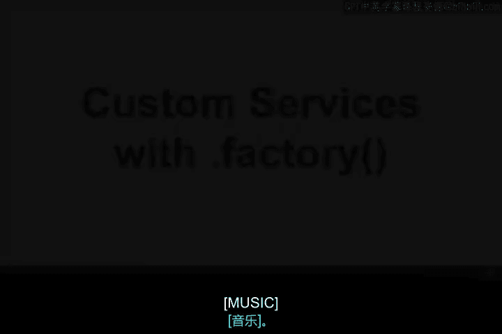
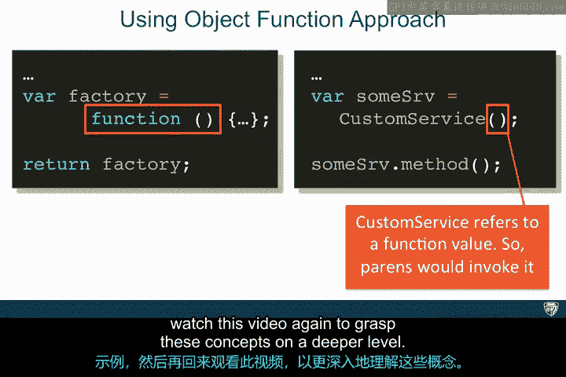

# 041：使用工厂创建自定义服务 🏭

在本节课中，我们将要学习如何使用 AngularJS 的 `factory` 方法来创建自定义服务。我们将探讨工厂设计模式的基本概念，比较 `factory` 方法与 `service` 方法的区别，并学习两种不同的工厂函数实现方式。

## 概述

工厂设计模式的核心是一个中心化的地方，用于生产新的对象或函数。在 AngularJS 中，`factory` 方法就是一个强大的工具，它不仅可以创建单例服务，还能生产任何类型的对象，并支持动态配置。这与 `service` 方法有显著区别，后者是一种功能更受限的工厂。

## 工厂设计模式回顾

首先，回顾一下工厂设计模式的特征是有益的。该模式的核心是一个中心化的地方，用于生产新的对象或函数。这不是工厂设计模式的官方定义，但它能清晰地传达其核心思想，而无需过多的计算机科学术语。

对于我们的目的而言，关键在于工厂可以生产任何类型的对象，而不仅仅是单例。它还可以用于生产可动态定制的服务，这正是我们本节课最终要实现的目标。

## Factory 与 Service 的对比

AngularJS 社区中关于 `factory` 与 `service` 的对比存在一些混淆。`factory` 方法有时被称为服务工厂，这是合理的，因为工厂就是用来生产服务的。

然而，`factory` 方法与 `service` 方法之间存在非常重要的区别。`factory` 方法不仅仅是创建与 `service` 方法相同服务的另一种方式。`service` 方法本身也是一种工厂，但与 `factory` 方法相比，它的功能要有限得多。

`service` 方法是一种总是生产同类型服务（单例）的工厂，并且没有简单的方法来配置其行为。`service` 方法通常用作不需要任何配置的快捷方式。

## 注册服务工厂函数

注册服务工厂函数的方式与我们注册服务和控制器的方式非常相似。你在模块上调用 `factory` 方法，指定工厂的名称（例如 `customService`），然后指定工厂函数。

工厂函数的作用是在执行时生产一个服务。请注意一个非常重要的区别：如果我们用 `service` 方法进行完全相同的调用，那么 `customService` 本身就会被期望是服务，而不是通过执行其方法之一来生产服务的结果。

另外请注意，在这个例子中，我们将工厂函数命名为 `customService`，并且我们注册到 `factory` 方法下的名称也是相同的 `customService`。但事实上，我们给函数起什么名字并不重要。重要的是我们注册该函数时使用的名称（即引号内的部分），这个名称才是我们注入到其他服务、控制器等中时使用的名称。所以，关键不是函数的名字，而是你通过 `factory` 方法注册该函数时使用的名字。

## 编写工厂函数

当涉及到编写工厂函数本身时（在本例中是 `customService` 函数），有几种不同的实现方式可以选择。

第一种实现方式如下所示，它返回一个函数作为我们工厂函数执行的结果。你可以看到，返回的局部变量 `factory` 实际上是一个函数值。我们最终的目标是创建一个名为 `someService` 的服务。

请注意，是我们自己调用了 `new` 关键字。换句话说，我们控制着如何创建以及创建什么。一旦我们创建了我们想要的东西，我们就可以将其作为 `customService` 函数执行的结果返回。换句话说，我们的工厂函数本身返回一个函数，因为返回的局部变量 `factory` 引用了一个函数。这是实现工厂函数的一种方式。

实现工厂函数的另一种方式是返回一个对象字面量。这里我们创建了一个带有属性 `getSomeService` 的对象字面量。属性 `getSomeService` 的值是一个函数。因此，`customService` 工厂函数执行后的返回值是一个对象字面量。然后，我们可以获取该对象字面量的 `getSomeService` 属性（其值是一个函数）并执行它，从而获得一个我们可以使用的 `someService` 实例。

即使使用这种实现方式，我们仍然负责实例化名为 `someService` 的服务。我们控制着它的创建方式，而这正是使用 `factory` 方法的最大意义所在。

## 两种实现方式的对比

为了突出两种同样有效的方法之间的区别，我们提取出了工厂函数的主体部分。

在左侧，你看到一种方法，它是一个带有属性方法的对象字面量，该方法会调用 `new SomeService()`。这个对象字面量是工厂函数执行后返回的一部分。

在右侧，我们返回一个函数，该函数返回对新 `SomeService` 的引用。该函数的值 `factory` 就是当你执行工厂函数本身时返回的东西。

根据你选择的实现方式，使用工厂的方式显然会有所不同。

如果你选择对象字面量方法，那么使用它的方式是通过引用 AngularJS 为你创建的工厂函数作为一个对象，然后访问其方法属性，即 `.getSomeService`。由于 `customService` 引用的是一个对象字面量，你将通过点符号访问其名为 `getSomeService` 的属性，就像访问任何对象字面量的属性一样。然而，`getSomeService` 属性是一个函数，因此为了执行该函数，你只需在其后加上括号 `()`。完成后，你就可以在由该属性引用的函数内部使用生产出来的服务，例如 `someService.someMethod()` 等等。

在使用函数作为工厂函数返回值的实现方式中，与对象字面量方法（其中 `customService` 工厂函数实际上引用一个对象字面量）不同，在这种情况下，`customService` 将引用一个函数。因此，我们需要做的就是在其后加上括号 `()` 并执行它，以获得我们创建的服务，然后像之前一样使用，例如 `someService.someMethod()` 等等。

## 下一步：查看代码示例

好了，现在我们理解了创建这些工厂的过程，让我们进入代码编辑器，看一个如何创建和使用这些工厂的示例。

如果你从未听说过工厂模式，这个概述可能第一次尝试时有点难以消化。我的建议是你继续学习第二部分，查看这些概念的编码示例，然后再回来看这个视频，以便在更深层次上掌握这些概念。

## 总结

在本节课中，我们一起学习了如何使用 AngularJS 的 `factory` 方法创建自定义服务。我们了解了工厂设计模式的核心思想，明确了 `factory` 与 `service` 方法的区别，并探讨了两种主要的工厂函数实现方式：返回对象字面量和返回函数。理解这些概念是构建灵活、可配置的 AngularJS 服务的关键。在接下来的部分，我们将通过实际代码来巩固这些知识。