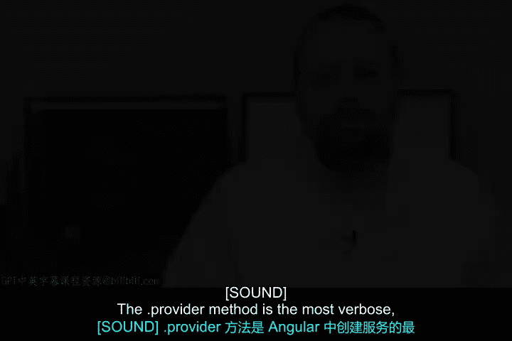
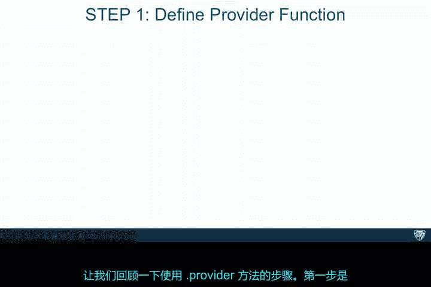
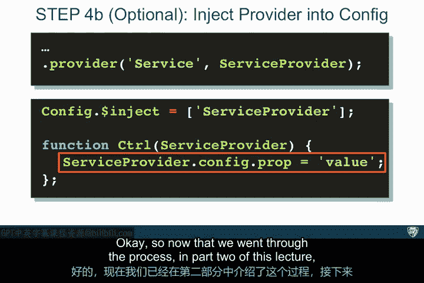

# 043：使用提供者创建自定义服务




## 概述

在本节课中，我们将要学习 AngularJS 中最灵活的服务创建方法——`.provider` 方法。我们将了解如何通过提供者创建可配置的服务，以及如何在应用启动前对其进行自定义配置。

---

## 什么是提供者方法

`.provider` 方法是 Angular 中创建服务最详细、最灵活的方法。使用提供者方法，你不仅可以创建一个工厂，还可以在整个应用启动时仅配置一次该工厂，然后在应用中使用带有自定义设置的工厂。换句话说，你可以在应用启动前配置这个工厂。

事实上，根据 Angular 官方文档，当我们使用 `.service` 或 `.factory` 方法配置服务时，真正在幕后执行的就是提供者方法。

上一节我们介绍了服务的基本概念，本节中我们来看看如何使用 `.provider` 方法。



---

## 使用提供者方法的步骤

以下是使用 `.provider` 方法创建和配置服务的详细步骤。

### 第一步：定义提供者函数

第一步是定义提供者函数。这是一个特殊的函数，在其实际实例上有一个特定的属性。你会看到 `var provider = this;`，因此 `provider.$get` 属性是一个直接附加到提供者实例的函数。

这个 `$get` 函数是一个工厂函数。换句话说，它就像我们提供给 `.factory` 方法的函数一样，你在这个函数中创建你的服务。在我们的例子中，我们创建了一个名为 `service` 的新服务。

正是这个作为函数的 `$get` 属性，使得该函数成为一个提供者。AngularJS 期望提供者有一个 `$get` 属性，其值是一个函数，Angular 会将其视为工厂函数。

但使整个设置非常特别的是，你可以在服务提供者内部提供一些配置对象，这些对象通常带有默认值，你可以在稍后配置整个应用的步骤中覆盖它们。

例如，我们可以这样定义：

```javascript
function ServiceProvider() {
  var provider = this;
  provider.config = {
    prop: 'default value'
  };
  provider.$get = function() {
    var service = {};
    // 使用 provider.config 中的配置
    service.someProperty = provider.config.prop;
    return service;
  };
}
```

### 第二步：向模块注册提供者函数

向模块注册提供者的方式与注册控制器、工厂和服务非常相似。你只需调用模块实例上的 `.provider` 方法，并提供提供者将产生的服务名称，以及拥有 `$get` 属性的服务提供者函数。

请注意，你在提供者函数中提供的名称是服务名称，它将被注入到其他服务、控制器等中。服务提供者函数本身的名称完全无关紧要。

```javascript
angular.module('myApp').provider('service', ServiceProvider);
```

### 第三步：像往常一样注入服务

第三步是像往常一样注入我们的服务。你会注意到，我们注入的是 `.provider` 定义的服务名称，而不是服务提供者函数。我们的 `.provider` 声明我们将拥有一个名为 `service` 的服务，因此我们注入的也叫 `service`。

```javascript
angular.module('myApp').controller('MyCtrl', function(service) {
  // 使用 service
});
```

到目前为止，我们还没有真正配置任何东西，所以接下来是可选的第四步。

### 第四步（可选）：配置服务

第四步是可选的，它分为两个子步骤：注册配置函数和定义配置函数。

#### 4A：注册配置函数

配置函数是可以在模块实例上调用的特殊函数，它保证在任何服务、工厂或控制器创建之前运行。这意味着这是我们能够在这些服务被创建之前对其进行配置的步骤。

它是可选的，因为你不必配置它，你可以只让默认值生效。然而，对于某些服务来说，拥有任何类型的默认值都没有意义，因此有时业务逻辑或特定服务要求必须进行配置。

#### 4B：定义配置函数

在定义配置函数时，我们将 `serviceProvider` 注入到配置函数中。我们不能将任何常规服务注入到配置函数中，因为它是在任何服务、工厂或控制器创建之前执行的。

因此，我们需要做的是获取特定服务的提供者函数。我们注入到配置函数中的是那个字符串加上 `Provider` 后缀。在我们的例子中，提供者是用 `service` 声明的，因此我们注入到配置函数中并在其中使用的是 `serviceProvider`。

同样，实际提供者函数的名称完全无关紧要。最后，我们可以使用 `serviceProvider` 实例来访问其属性（如 `config`），并继续为特定应用配置它。

```javascript
angular.module('myApp').config(function(serviceProvider) {
  // 配置提供者
  serviceProvider.config.prop = 'custom configured value';
});
```

---

## 代码实践

好的，现在我们已经在理论上了解了整个过程，在本讲的第二部分，让我们进入代码编辑器，看看它是如何实际运作的。

（*此处通常会展示实际的代码编辑器截图和代码示例，演示上述步骤的具体实现。*）

---

## 总结



本节课中我们一起学习了 AngularJS 中使用 `.provider` 方法创建自定义服务。我们了解了提供者是最灵活的服务创建方式，允许在应用启动前进行配置。我们逐步讲解了定义提供者函数、注册提供者、注入服务以及可选地通过配置函数自定义服务设置的完整流程。掌握提供者方法对于创建高度可配置和可重用的 AngularJS 服务至关重要。