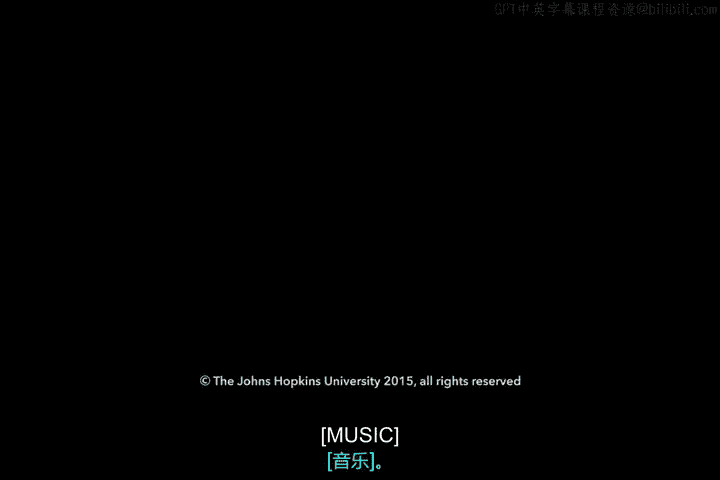

# 046：模块2总结

## 概述

在本节课中，我们将对模块2的学习内容进行回顾与总结，并展望后续的学习方向。

---

恭喜你完成了模块2的学习，现在可以进行一个简短的回顾。

如果你已经跟随我理解了本模块所教授功能背后的概念，那么你已经领先于许多仅仅是在使用 Angular 功能、却不理解其工作原理的 AngularJS 开发者。这并非微不足道的成就，你应该为此感到自豪。

快速回顾一下，现在仅仅是模块2，但你已经掌握了相当多的知识。所以请不要在此止步，继续学习模块3，我保证前方还有更多有趣的内容。

如果你还没有访问我们的 Facebook 页面（Facebook.com/courserawebdev），请点击视频下方的链接并为我们的页面点赞。

如果你听从了我关于饼干的建议，并且吃掉了整袋饼干，那么恭喜你，你在这个模块中获得的不仅仅是 AngularJS 的知识。

如果你在本模块开始时听从了我的建议，拿了一袋饼干，那么你获得的将不仅仅是 AngularJS 的知识，你还增加了一些体重。

我正在忙着录制。哦，你能把饼干加到购物清单上吗？我想我们快吃完了。哎，那个东西还在录吗？

---

## 总结

本节课中我们一起学习了模块2的总结。我们回顾了理解功能背后概念的重要性，并鼓励大家继续学习模块3的进阶内容。同时，我们也以一种轻松的方式提醒大家，学习与生活需要平衡。