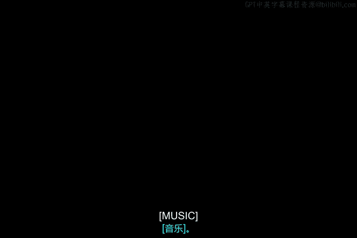
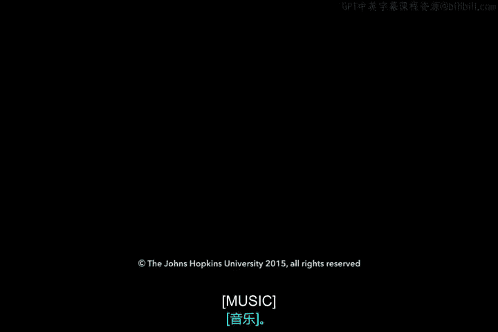

# 047：欢迎进入模块3

在本模块中，我们将学习 AngularJS 的许多核心功能。我们将从 Promise API 开始，然后学习如何使用 Angular 内置的 HTTP 服务与服务器通信，最后将花大量时间深入探讨 AngularJS 的皇冠特性——指令。

## 模块内容概述

上一节我们完成了模块2的学习，本节中我们来看看模块3的主要内容。

模块3将涵盖以下三个核心主题：

1.  **Promise API**：这是现代 JavaScript 开发中至关重要的概念，虽然对 Angular 至关重要，但其应用范围远超 Angular 本身。
2.  **HTTP 服务**：我们将学习如何使用 Angular 内置的 `$http` 服务向服务器发起调用。
3.  **指令**：我们将投入大量时间学习 AngularJS 框架的核心特性。指令不仅允许我们扩展现有 HTML 元素的功能，还允许我们创建具有自定义视图和行为的新元素。

以下是本模块学习路径的简要说明：

*   首先，我们将深入理解 **Promise**，这是处理异步操作的基础。
*   接着，我们将应用 Promise 知识，学习如何通过 **`$http` 服务**与后端服务器进行数据交互。
*   最后，我们将重点学习 **指令**，这是构建可复用组件和扩展 HTML 能力的关键。

## 总结

本节课中我们一起学习了模块3的总体安排。我们了解到，本模块将引导我们掌握 Promise API、HTTP 服务以及强大的指令系统。这些是深入理解和有效使用 AngularJS 进行单页应用开发的基石。接下来，让我们开始第一个主题——Promise 的学习。