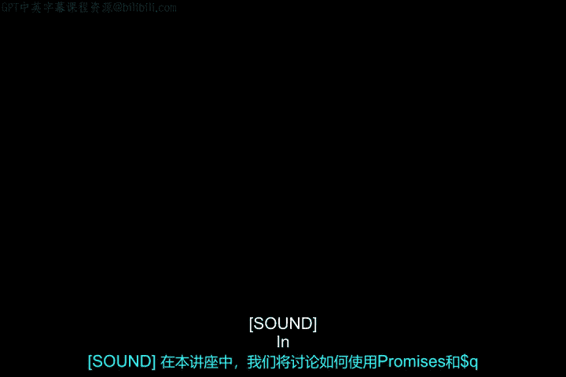
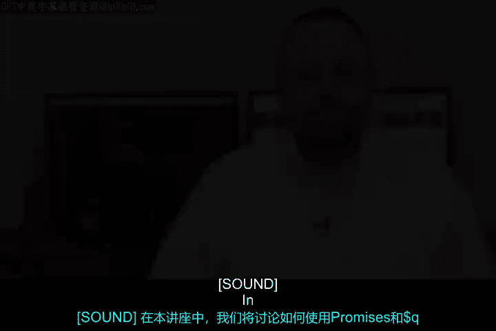
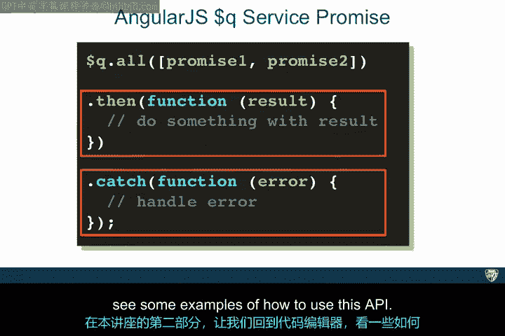

# 048：使用 Promise 和 $q 处理异步行为






在本节课中，我们将学习如何使用 Promise 和 `$q` 服务来编写和处理异步行为。

## 概述

在 Promise 出现之前，我们主要使用回调函数来处理异步操作，并且现在仍然可以使用。其基本模式是：调用一个异步函数，并传入一个函数作为参数，该函数会在异步行为完成后执行。这种模型的主要问题在于，没有一种简单直接的方式将异步函数的结果传递回调用者。特别是当结果的最终接收者距离异步函数调用处相隔多层时，例如一个服务调用另一个服务，而后者再调用异步函数，结果需要一直传递到最顶层的函数。使用回调方法很难实现这一点。

此外，如果需要将多个异步操作串联起来执行，例如当异步函数1完成后，不直接返回值，而是需要调用异步函数2，等它完成后再调用异步函数3，最后才处理所有结果的组合，代码会变得非常难以阅读。这还没有考虑错误处理，如果加上错误处理，代码会变得一团糟。

同样，如果我们希望所有异步函数并行执行，然后仅在全部成功时执行后续逻辑，但只要有一个失败就整体失败并执行错误处理，使用回调方法实现起来也非常复杂。然而，使用 Promise API，我们可以相当轻松地实现所有这些功能。

## 什么是 Promise？🤔

Promise API 实际上是新 ES6 标准的一部分。但是，并非所有浏览器都实现了 ES6 API，因此 Promise 对象可能不可用。不过，AngularJS 实现了自己的 Promise API，它与即将到来的 ES6 中的 Promise 非常相似。

那么，什么是 Promise？**Promise 是一个可以传递或返回的对象，它持有对异步行为结果的引用**。在 Angular 中，Promise 是通过一个名为 `$q` 的特殊服务创建的。

## 如何使用 `$q` 服务创建 Promise

让我们看一些关于如何创建 Promise 的模板代码。

首先，我们有一个异步函数。我们要做的第一件事是调用 `$q.defer()` 方法。

```javascript
var deferred = $q.defer();
```

该服务会创建一个代表异步环境及其所有钩子的对象，其中包括 Promise 对象。

然后，在我们实现了一些行为之后，该对象有一个特殊的方法叫做 `resolve`。这个方法标志着我们的执行成功完成，并将数据包装起来，供 Promise 稍后获取。

```javascript
deferred.resolve(someResultObject);
```

在这个例子中，我们将某个结果对象作为 `resolve` 方法的一部分进行包装。

如果出现问题，我们可以调用 `deferred.reject()`，这将标记为未成功完成，并且也会为 Promise 包装一些数据，通常可能是一个错误对象或错误消息。

```javascript
deferred.reject(someErrorObject);
```

最后但同样重要的是，我们必须将我们的 Promise 返回给这个函数的调用者。因此，我们会写：

```javascript
return deferred.promise;
```

这将 Promise 对象发送回调用者，它实际上是连接整个流程生命周期的钩子。

需要记住的是，尽管这段示例代码看起来是同步的（目前看可能是这样），但最终调用 `deferred.resolve` 和 `deferred.reject` 的部分，可以是真正异步运行代码的一部分。例如，如果我们想在这个例子中模拟异步，可以将高亮显示的代码行包装在一个 `setTimeout` 函数中。

## 调用者如何使用 Promise

下一步是调用者调用我们的异步函数，并获取对 Promise 对象的引用。

```javascript
var promise = someAsyncFunction();
```

你可以清楚地看到，Promise 是一个可以传递到应用程序中其他 API 的对象。

然后，在应用程序中任何合适的地方，我都可以在 Promise 上调用 `then` 函数来提取结果或处理错误。

```javascript
promise.then(
  function(result) {
    // 处理成功结果
  },
  function(error) {
    // 处理错误
  }
);
```

请注意，`then` 函数接受两个参数，这两个参数本身都是函数。Promise API 将发送给这些函数的参数，正是我们之前用 `resolve` 或 `reject` 包装 `deferred` 对象时传入的数据。显然，这里我指的是 `result` 对象和 `error` 对象，它们可以只是一个简单的字符串。

`then` 函数本身也是可链式调用的，因为它自身也返回一个 Promise。我们将在本讲座的第二部分通过示例演示这种链式调用的强大之处。

## 并行处理多个 Promise

`$q` 服务还具有异步解析多个 Promise 的能力，即多个 Promise 无需等待另一个完成就可以开始运行。

`$q.all()` 方法实现了这一点，同时还提供了在一个中心位置处理所有结果或处理来自任何 Promise 的错误的能力。

```javascript
$q.all([promise1, promise2, promise3])
  .then(function(results) {
    // 所有 Promise 都成功完成，results 是一个包含所有结果的数组
  })
  .catch(function(error) {
    // 任何一个 Promise 失败
  });
```

## 总结

在本节课中，我们一起学习了 Promise 的概念及其在 AngularJS 中通过 `$q` 服务的实现。我们了解了为什么 Promise 比传统的回调函数更强大，特别是在处理异步操作链、错误处理和并行执行方面。我们学习了如何创建 Promise（使用 `$q.defer()`），如何标记其完成状态（`resolve` 和 `reject`），以及调用者如何通过 `then` 方法处理成功和失败的结果。最后，我们还简要介绍了 `$q.all()` 用于并行处理多个 Promise。在下一部分，我们将回到代码编辑器，查看一些使用此 API 的具体示例。




