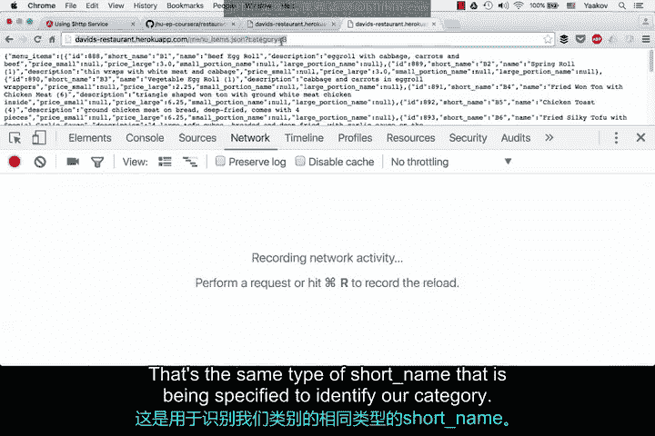
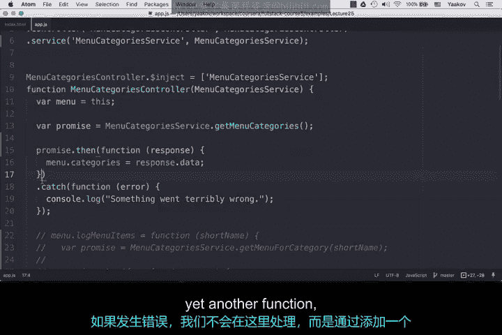
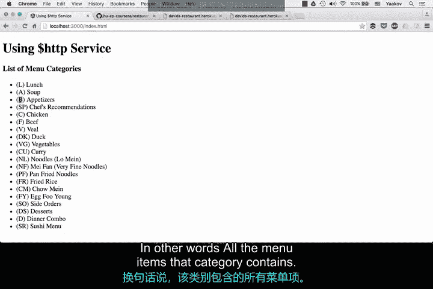
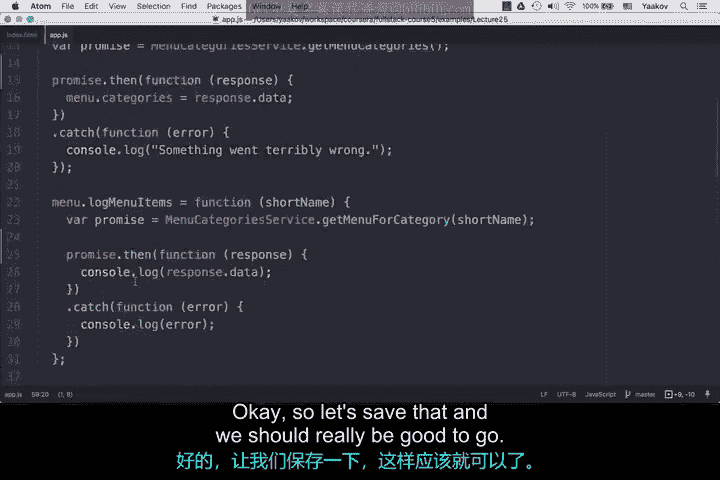
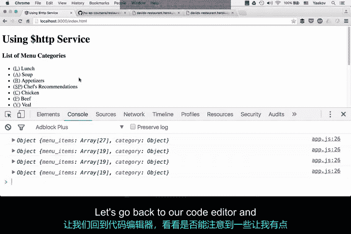
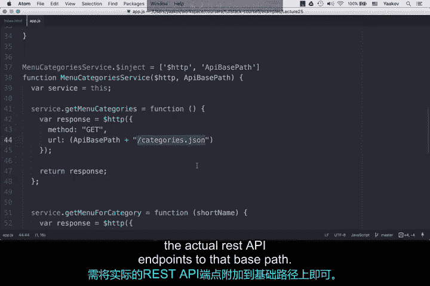
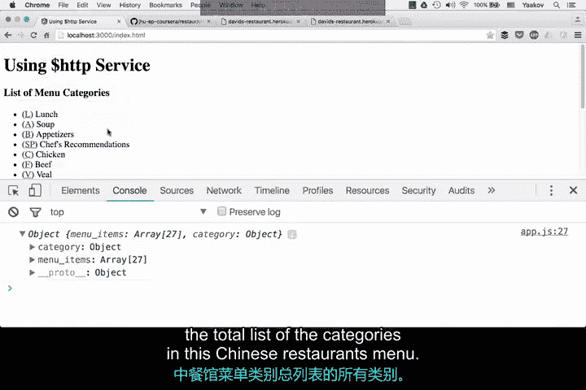
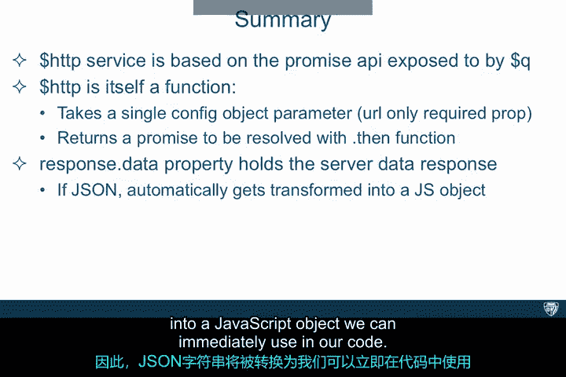

# 051：使用 $http 服务进行 Ajax


## 概述
在本节课中，我们将学习如何使用 AngularJS 中的 `$http` 服务来执行 Ajax 调用，从远程服务器获取数据。我们将通过重构一个餐厅菜单应用来实践这一过程。

---

## 准备远程服务器
在开始进行远程调用之前，我们需要一个已设置好的远程服务器。之前的课程构建了一个餐厅应用，我们将使用 AngularJS 重新实现它，而该服务器仍然可用并已部署在互联网上。

我们将使用该服务器作为数据源。关于服务器的部署地址及其支持的 API 的说明和 URL，可以在 GitHub 仓库 `jhuueppcosera/resrantmanu server` 中找到。

以下是该服务器支持的主要 URL 模式：
*   `/categories.json`：显示我们中餐厅菜单的所有类别。
*   `/menu_items.json`：显示所有菜单项。
*   `/menu_items.json?category={short_name}`：显示特定类别的所有菜单项及该类别信息。



对于本教程，我们将主要使用 `/categories.json` 和 `/menu_items.json?category={short_name}` 这两个端点。

---

## 构建应用：列出菜单类别
上一节我们介绍了服务器 API，本节中我们来看看如何构建一个列出所有菜单类别的应用。我们将使用 `$http` 服务来实现。

我们的应用名为 `Menu Categories App`，其 HTML 模板非常简单，主要包含一个控制器和一个无序列表，用于通过 `ng-repeat` 循环显示类别。

以下是控制器 `MenuCategoriesController` 的核心代码片段：
```javascript
angular.module(‘MenuCategoriesApp‘, [])
.controller(‘MenuCategoriesController‘, MenuCategoriesController);

MenuCategoriesController.$inject = [‘$scope‘, ‘MenuCategoriesService‘];
function MenuCategoriesController($scope, MenuCategoriesService) {
  var menu = this;
  menu.categories = [];

  MenuCategoriesService.getMenuCategories().then(function(response) {
    menu.categories = response.data;
  }).catch(function(error) {
    console.log(‘Something went wrong!‘, error);
  });
}
```

我们创建了一个服务 `MenuCategoriesService` 来处理数据获取。该服务注入了 `$http` 服务，并定义了一个 `getMenuCategories` 方法。

以下是服务中发起 `GET` 请求的核心代码：
```javascript
angular.module(‘MenuCategoriesApp‘)
.service(‘MenuCategoriesService‘, MenuCategoriesService);

MenuCategoriesService.$inject = [‘$http‘];
function MenuCategoriesService($http) {
  var service = this;

  service.getMenuCategories = function() {
    var response = $http({
      method: "GET",
      url: "https://coursera-jhu-default-rtdb.firebaseio.com/categories.json"
    });
    return response;
  };
}
```
在这个方法中，我们使用 `$http` 函数并传入一个配置对象，指定请求方法为 `GET` 以及目标 URL。`$http` 调用返回一个 Promise。



在控制器中，我们调用该服务方法，并在 Promise 成功解析后，将返回数据（`response.data`）赋值给控制器的 `categories` 属性，从而更新视图。

运行应用后，页面将成功列出所有菜单类别及其短名称。



---

## 增强功能：获取特定类别菜单项
现在我们已经能够列出所有类别，接下来我们增强功能，使每个类别的短名称成为一个可点击的链接，点击后获取并显示该特定类别的菜单项。

首先，我们需要修改 HTML 模板，将短名称包装在链接中，并添加 `ng-click` 指令来触发一个控制器方法。

修改后的列表项代码如下：
```html
<li ng-repeat="category in menu.categories">
  (<a href="" ng-click="menu.logMenuItems(category.short_name)">{{ category.short_name }}</a>)
  {{ category.name }}
</li>
```

当链接被点击时，会调用控制器上的 `logMenuItems` 方法，并传入该类别的 `short_name`。

在控制器中，我们定义 `logMenuItems` 方法。该方法将调用服务中的另一个方法 `getMenuForCategory` 来获取特定类别的数据。

控制器方法代码如下：
```javascript
menu.logMenuItems = function(shortName) {
  MenuCategoriesService.getMenuForCategory(shortName)
    .then(function(response) {
      console.log(response.data);
    })
    .catch(function(error) {
      console.log(‘Error:‘, error);
    });
};
```

在服务中，我们实现 `getMenuForCategory` 方法。这个方法与 `getMenuCategories` 类似，但 URL 需要包含查询参数。



以下是带参数请求的核心代码：
```javascript
service.getMenuForCategory = function(shortName) {
  var response = $http({
    method: "GET",
    url: "https://coursera-jhu-default-rtdb.firebaseio.com/menu_items.json",
    params: {
      category: shortName
    }
  });
  return response;
};
```
注意配置对象中的 `params` 属性。它是一个对象，其属性名（`category`）将成为 URL 的查询参数名，属性值（`shortName`）将成为参数值。AngularJS 会自动将其格式化为 `?category=C` 这样的形式并附加到请求 URL 上。

完成这些更改后，点击页面上的类别链接，浏览器控制台将成功输出对应类别的菜单项数据。

---



## 优化：使用常量定义基础 URL
观察之前的代码，我们发现每个 `$http` 调用中都硬编码了完整的基础 URL。如果服务器地址发生变化，我们需要修改多处代码，这既不高效也不便于维护。

为了解决这个问题，我们可以使用 AngularJS 模块的 `.constant` 方法来定义一个可注入的常量，用于存储基础 URL。

我们可以在模块定义后添加一个常量：
```javascript
angular.module(‘MenuCategoriesApp‘)
.constant(‘ApiBasePath‘, ‘https://coursera-jhu-default-rtdb.firebaseio.com‘);
```

然后，我们将这个常量注入到 `MenuCategoriesService` 中，并在构造 URL 时使用它。

更新后的服务方法示例如下：
```javascript
MenuCategoriesService.$inject = [‘$http‘, ‘ApiBasePath‘];
function MenuCategoriesService($http, ApiBasePath) {
  var service = this;

  service.getMenuCategories = function() {
    var response = $http({
      method: "GET",
      url: (ApiBasePath + "/categories.json")
    });
    return response;
  };

  service.getMenuForCategory = function(shortName) {
    var response = $http({
      method: "GET",
      url: (ApiBasePath + "/menu_items.json"),
      params: {
        category: shortName
      }
    });
    return response;
  };
}
```
现在，基础 URL 只在一个地方定义。如果未来需要更改，只需更新这个常量的值即可，所有依赖它的服务都会自动使用新的地址。





---


## 总结
本节课中我们一起学习了 AngularJS `$http` 服务的核心用法。

*   **`$http` 服务**：是基于 Promise API 的核心服务，用于发起 HTTP 请求。其基本形式是一个函数，接收一个**配置对象**作为参数，其中 `url` 属性是必需的，并返回一个 Promise。
    *   **公式/概念**：`$http(configObject) -> Promise`
*   **处理响应**：通过 Promise 的 `.then()` 方法处理成功响应。服务器返回的数据（响应体）位于 `response.data` 属性中。如果原始数据是 JSON 字符串，AngularJS 会自动将其转换为 JavaScript 对象。
*   **传递参数**：可以通过配置对象的 `params` 属性来设置 URL 查询字符串参数，AngularJS 会自动处理编码和拼接。
*   **使用常量**：通过 `module.constant()` 定义的**常量**，可以在整个应用中被注入和使用，是管理配置值（如 API 基础路径）的最佳实践。



通过本课的学习，你已经掌握了使用 AngularJS 与后端服务器进行数据交互的基本技能。