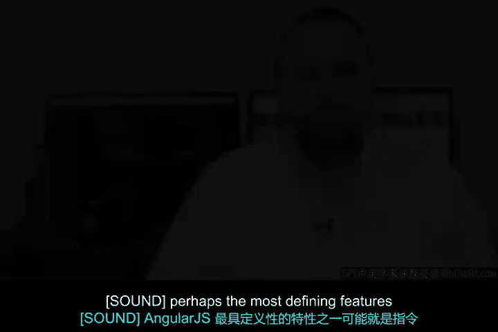
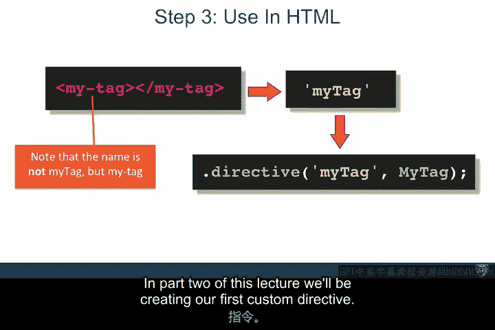

# 052：动态HTML




## 概述
在本节课中，我们将要学习 AngularJS 最核心的特性之一：指令。指令允许我们扩展标准的 HTML，创建自定义的、动态的视图组件。我们将了解指令是什么、AngularJS 如何编译和链接它们，并学习创建自定义指令的基本步骤。

## 什么是指令？
AngularJS 最显著的特性之一就是指令的概念。AngularJS 官网在回答“为什么选择 Angular”时，也暗示了指令的重要性。

官网的说明如下：HTML 非常适合声明静态文档，但在用于声明 Web 应用中的动态视图时，它就力不从心了。AngularJS 允许你为你的应用程序扩展 HTML 词汇表。由此产生的环境表达能力非凡、可读性强且开发迅速。

这段描述的关键词是“扩展”。Angular 允许你将标准 HTML 扩展为适合你特定应用程序的任何形式。这非常强大。

因此，在 Angular 的 HTML 和模板中，看到类似下面的代码并不奇怪：
```html
<div>
    <list-item></list-item>
</div>
```
你可以看到，一个名为 `list-item` 的标签出现在常规 HTML 代码中间。这就是一个 Angular 指令。它当然不是一个标准的 HTML 标签。

## Angular 如何处理指令？
那么，这段代码如何变成“常规”的 HTML 代码呢？回忆一下之前的课程，我们曾试图理解自定义 HTML 属性如何工作，从而揭开 Angular 如何在 HTML 中找到占位符的奥秘。

一旦 Angular 在某个元素上找到 `ng-app` 属性，它就获得了附加到该元素的整个文档对象模型的访问权限。然后，Angular 函数可以自由地操作那棵 HTML 节点树。它可以：
*   将双花括号 `{{ }}` 包围的变量替换为从 `$scope` 中查找到的值。
*   检查任何节点（无论是内容、标签还是属性），并决定是否应该用其他东西替换它，或者为其附加某些功能或行为。

在 Angular 中，这个过程被称为**编译**。

如果你以前做过编程，当你听到“编译”这个词时，它通常意味着将你的源代码翻译成机器可以理解的其他代码。通常，这发生在你实际执行代码之前。在 Angular 中，大部分编译发生在你加载页面或特定 HTML 模板的开始时，有时甚至更晚，但过程是相同的：Angular 编译并链接你的自定义 HTML 代码。

你还可以将指令组合在一起使用。在这里，你可以看到我们在这个自定义的 `list-item` 指令上使用了熟悉的 `ng-repeat`。

## 指令的定义
现在，让我们来定义什么是指令。指令实际上只是 DOM 元素上的一个标记，它告诉 Angular 的 HTML 编译器为该 DOM 元素附加指定的行为。编译器还可以转换或更改 DOM 元素及其子元素。

我们所说的这个“标记”本身可以是以下四种之一：
1.  一个属性。
2.  一个元素名。
3.  一个注释。
4.  一个 CSS 类。

然而，使用注释或 CSS 类来定义指令并不是最佳实践。因此，在大多数情况下，当你定义自定义指令时，你会坚持使用元素和属性。

## 创建自定义指令的步骤
上一节我们介绍了指令的基本概念，本节中我们来看看如何创建自己的自定义指令。以下是创建自定义指令的步骤。

### 第一步：在 Angular 模块中注册指令
第一步是在 Angular 模块中注册指令。如下所示，这种方式与注册控制器、服务、工厂等几乎完全相同。
```javascript
angular.module(‘myApp’, [])
    .directive(‘myTag’, function() {
        // 工厂函数
    });
```
这里我们使用了一个特殊的模块方法 `directive`。我们定义的指令名称（例如 `‘myTag’`）是一个将在 HTML 中出现的**规范化**名称。我稍后会解释“规范化”的含义。

第二个参数是一个工厂函数，它返回一个被称为 **DDO** 的对象，即指令定义对象。DDO 基本上是一个配置对象，它告诉 Angular 编译器当在 HTML 中找到这个标签或元素或属性时，这个指令应该如何行为。

在我们的示例中，这个工厂函数只会执行一次，而不是每次在 HTML 中找到我们的指令时都执行。由于它只会被执行一次，你可以使用该函数执行任何你需要的初始化操作，当然，最重要的是返回这个特殊的 DDO 对象。

### 第二步：定义工厂函数
第二步是定义我们的工厂函数。请注意，就像控制器和服务一样，我们可以将其他依赖项注入到这个指令中。我们可以注入其他服务、控制器等。

和往常一样，这个函数最重要的事情是返回我们的 DDO。指令定义对象由 AngularJS 文档中定义的多个属性组成。这里定义的 `template` 属性只是一个示例，它不是一个必需的属性。然而，在这个例子中，每次我们在 HTML 中使用 `my-tag` 时，都会向用户显示“Hello World”。
```javascript
angular.module(‘myApp’, [])
    .directive(‘myTag’, function() {
        return {
            template: ‘<h1>Hello World</h1>’
        };
    });
```

### 第三步：在 HTML 中使用指令
第三步，显然是在我们的 HTML 中使用这个标签。请注意，元素的名称不是 `myTag`，而是 `my-tag`。
```html
<my-tag></my-tag>
```
为了让 Angular 将你在 HTML 中找到的元素或属性与指令的名称匹配，它首先需要**规范化**在 HTML 中找到的名称。

它规范化名称的方式是：移除连字符 `-`，然后将下一个字母大写。换句话说，它将连字符分隔的表示法转换为**驼峰式**表示法。

如果你不熟悉驼峰式表示法，它其实很简单。它基本上是一种编程中的命名方式，你将多个单词连接在一起，第一个单词全部小写，随后的每个单词首字母大写。

所以，当 AngularJS 在我们的 HTML 中看到 `my-tag` 时，它会寻找一个以名称 `myTag`（`t` 大写）注册的指令。显然，它会找到我们声明的名为 `myTag` 的指令，从而将这两部分连接起来，并提供在 `myTag` 工厂函数中定义的功能。




## 总结
本节课中，我们一起学习了 AngularJS 的核心——指令。我们了解到指令是扩展 HTML 的强大工具，它允许我们创建自定义的动态组件。我们探讨了 Angular 编译和链接 HTML 的过程，并详细学习了创建自定义指令的三个步骤：在模块中注册、定义返回 DDO 的工厂函数，以及在 HTML 中使用规范化名称调用指令。在下一部分，我们将回到代码编辑器，实际创建我们的第一个自定义指令。