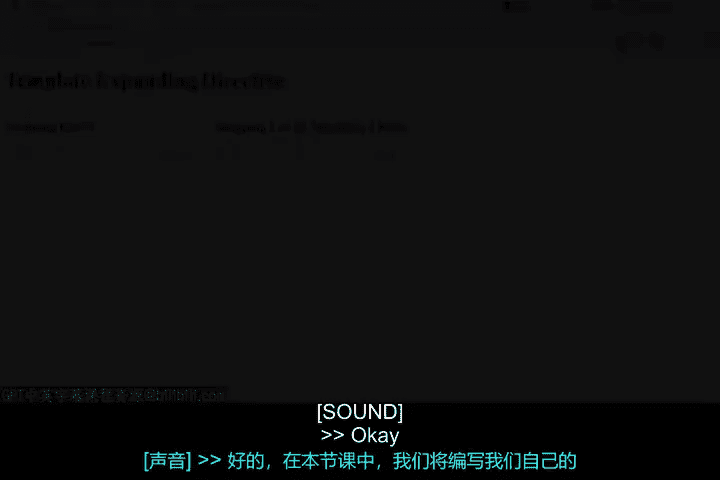
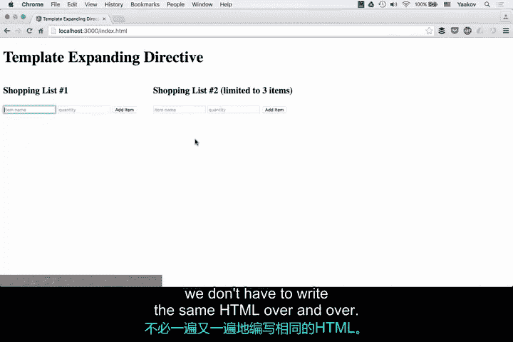
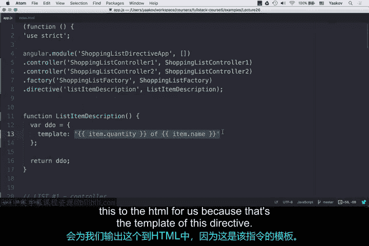
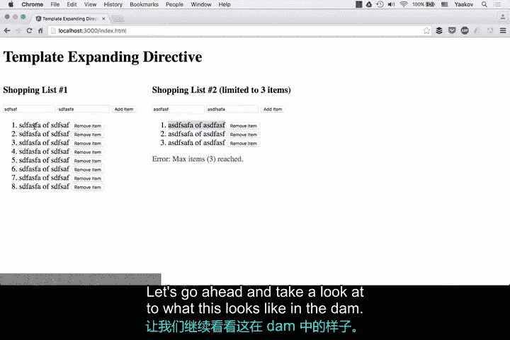
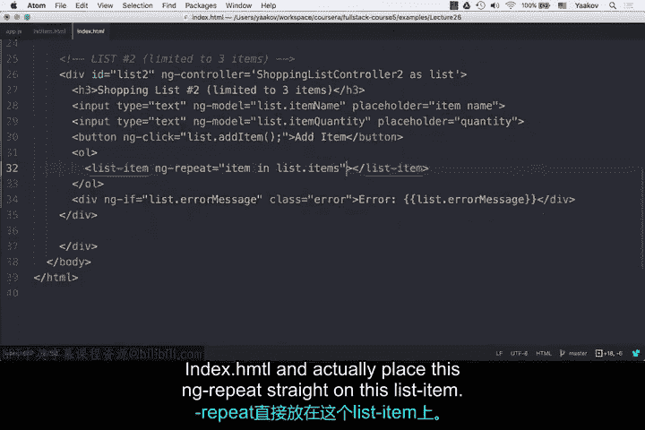
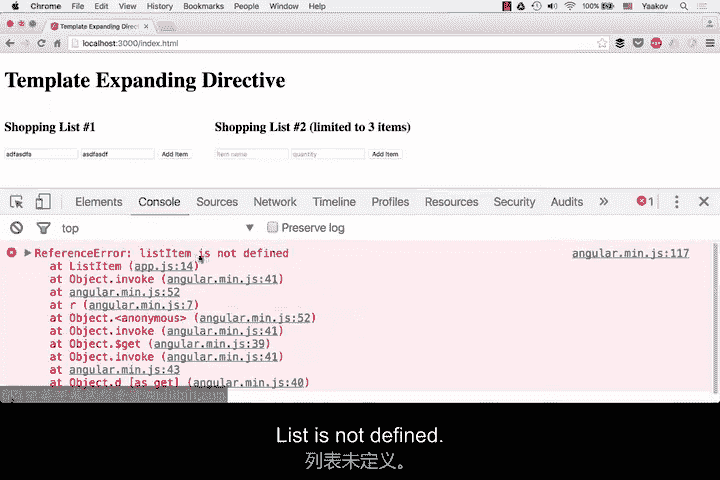
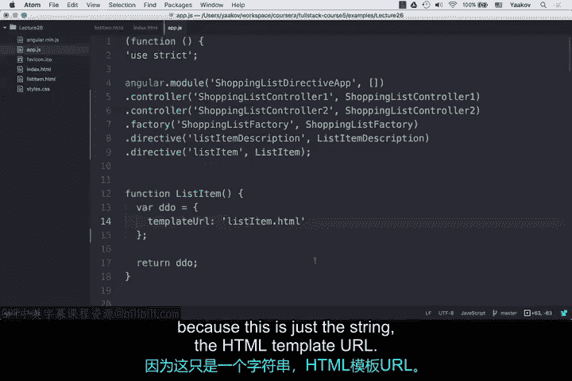
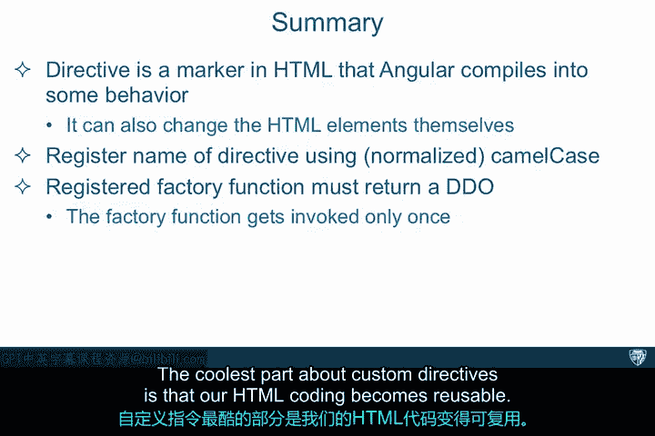

# 053：动态HTML（第二部分）




在本节课中，我们将编写第一个自定义指令。我们将复用之前编写的购物清单应用，并探索如何通过指令来重用 HTML 代码片段，避免重复编写。

## 概述



我们将从一个包含两个独立购物清单的应用开始。每个清单都有自己的服务实例，因此互不干扰。本节的目标是识别并提取可重用的 HTML 代码，将其封装成自定义指令，从而实现代码复用，并使 HTML 更具语义化。

## 应用回顾

首先，回顾一下现有的应用。它包含两个购物清单控制器，每个控制器管理自己的清单项。在 HTML 中，每个清单项都通过类似以下的结构渲染：

```html
<li>
  {{ item.quantity }} of {{ item.name }}
</li>
```

这段代码在两个清单中重复出现。我们的目标是将其封装成一个指令。

## 创建第一个指令：列表项描述

我们将创建一个名为 `listItemDescription` 的指令，用于渲染清单项的描述信息。

以下是创建该指令的步骤：

1.  在 AngularJS 模块中注册指令。
2.  定义指令的工厂函数，该函数返回一个**指令定义对象**。
3.  在 DDO 中指定 `template` 属性，即要插入的 HTML 字符串。

具体代码如下：





```javascript
app.directive('listItemDescription', function () {
  return {
    template: '{{ item.quantity }} of {{ item.name }}'
  };
});
```

指令注册后，我们可以在 HTML 中使用它。AngularJS 会将驼峰式命名的指令名（`listItemDescription`）转换为使用连字符的标签名（`list-item-description`）。

因此，原来的 HTML 可以替换为：

```html
<list-item-description></list-item-description>
```

## 指令的作用域

一个关键问题是：指令模板中的 `item.quantity` 和 `item.name` 是从哪里来的？

答案是，**默认情况下，指令会继承其所在控制器的作用域**。因为 `<list-item-description>` 标签位于 `ShoppingListController1` 的 `ng-controller` 指令内部，所以它可以访问该控制器作用域中的所有属性，包括 `ng-repeat` 循环中的当前 `item` 对象。

这使得指令能够无缝地使用外部数据。

## 创建第二个指令：完整的列表项

接下来，我们创建一个更复杂的指令来封装整个 `<li>` 元素，包括内部的描述指令。

由于模板内容较长且包含引号，使用 `template` 属性会显得笨拙。因此，我们使用 `templateUrl` 属性，将模板内容移到一个单独的 HTML 文件中。

首先，注册名为 `listItem` 的指令：

```javascript
app.directive('listItem', function () {
  return {
    templateUrl: 'listItem.html'
  };
});
```

然后，创建 `listItem.html` 文件，内容如下：



```html
<list-item-description></list-item-description>
```



最后，在主要的 `index.html` 中使用这个新指令。为了更清晰，我们将 `ng-repeat` 指令从模板内部移到自定义标签上：

```html
<list-item ng-repeat="item in list.items"></list-item>
```

这样做的好处是，HTML 结构一目了然：我们正在为列表中的每一项重复一个“列表项”组件。



## 指令的优势

通过以上步骤，我们实现了 HTML 代码的复用。现在，清单项的结构和样式只需在一个地方（指令模板）定义和维护。如果在 `listItem.html` 中修改了结构，所有使用该指令的地方都会自动更新。

此外，我们的 HTML 代码变得更加**语义化**。像 `<list-item>` 和 `<list-item-description>` 这样的标签，清晰地表达了它们在应用中的具体用途，而不仅仅是通用的 `<div>` 或 `<span>` 标签。这大大提高了代码的可读性和可维护性。

## 总结

本节课我们一起学习了 AngularJS 自定义指令的核心概念和实践：

1.  **指令的本质**：指令是 HTML 中的标记，AngularJS 编译器会将其编译为特定的行为或 DOM 结构。
2.  **创建指令**：通过 `module.directive(‘name‘, factoryFn)` 注册指令。工厂函数返回一个**指令定义对象**。
3.  **DDO 的模板**：可以使用 `template`（内联字符串）或 `templateUrl`（外部文件）来定义指令的 HTML 模板。
4.  **指令作用域**：默认情况下，指令继承其父控制器的作用域，从而可以访问相关数据。
5.  **命名规范**：注册时使用驼峰式名称（如 `listItem`），在 HTML 中使用连字符形式（如 `list-item`）。
6.  **核心价值**：自定义指令实现了 HTML 和行为的**代码复用**，并且让 HTML 结构具有了与应用逻辑相关的**语义化含义**，这是构建复杂、可维护单页应用的重要基石。




通过创建和使用自定义指令，我们能够构建出模块化、清晰且高效的前端代码结构。