# 054：restrict属性

在本节课中，我们将学习 AngularJS 指令定义对象（DDO）的另一个重要属性：`restrict`。我们将了解这个属性的作用、如何配置它，以及在不同场景下的最佳实践。

## 概述

上一节我们介绍了指令定义对象（DDO）的 `template` 和 `templateUrl` 属性。本节中，我们来看看另一个关键的 DDO 属性：`restrict`。这个属性决定了 AngularJS 编译器在何处查找和识别我们自定义的指令。

## `restrict` 属性的作用

`restrict` 属性用于告知 AngularJS 编译器如何检测你的自定义指令。它指定了指令在 HTML 中应该以何种形式出现。

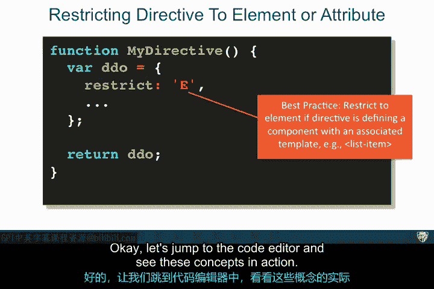

如果你不在 DDO 中指定 `restrict` 属性，AngularJS 会将其默认值设为 `‘AE’`。这里的 `‘A’` 代表属性（Attribute），`‘E’` 代表元素（Element）。这意味着，默认情况下，AngularJS 会同时尝试将你的指令识别为一个属性或一个元素。

如果你想将指令限制为仅能作为其他元素的属性使用，你需要在 `restrict` 属性中指定值 `‘A’`。

将指令限制为属性是一种最佳实践，特别是当该指令旨在扩展其他元素的行为时。例如，`ng-repeat` 指令本身没有内容，它只是扩展了你放置该属性的任何元素的行为。

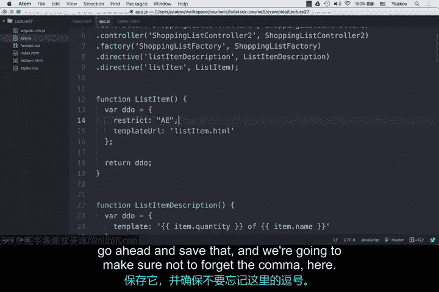

如果你想将指令限制为仅能作为一个独立的元素使用，你需要在 `restrict` 属性中指定值 `‘E’`。

将指令限制为元素是一种最佳实践，特别是当该指令定义了一个带有相关模板的组件时。例如，我们之前例子中的列表项指令，它有自己的内容和模板，因此将其定义为元素是合理的。

最佳实践是避免使用基于类（Class）和注释（Comment）的指令。因此，也不应将你的 DDO 限制为这些类型。

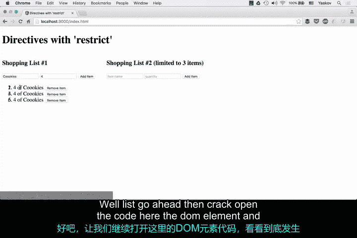

如果你将指令限制为一种类型，却在 HTML 中以另一种方式使用它，AngularJS 编译器将无法匹配该指令，并会像处理其他它不应处理的 HTML 内容一样，完全忽略它。例如，如果你指定指令为元素，却将其用作属性，AngularJS 会完全忽略它。

## 代码示例与实践

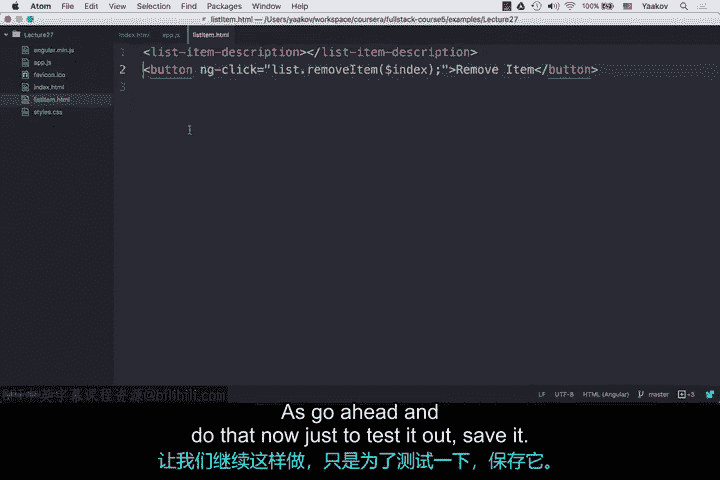

现在，让我们进入代码编辑器，通过实际操作来理解这些概念。

我们回到代码编辑器，位于 `lecture27` 文件夹中。这里有一个与上一讲完全相同的应用：购物清单指令应用。我们创建了几个自定义指令，其中之一是 `listItem` 指令。这个指令对应一个模板文件 `listItem.html`，其内容是一个包含按钮的列表项（`<li>`）。

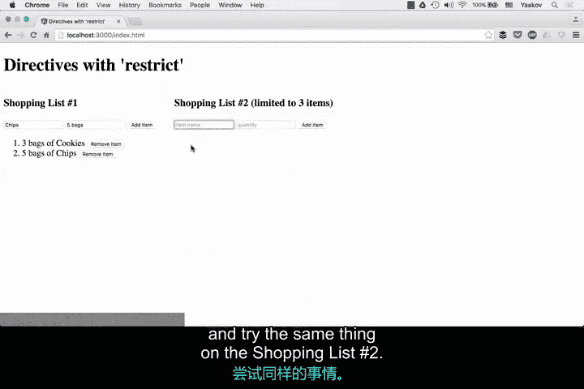

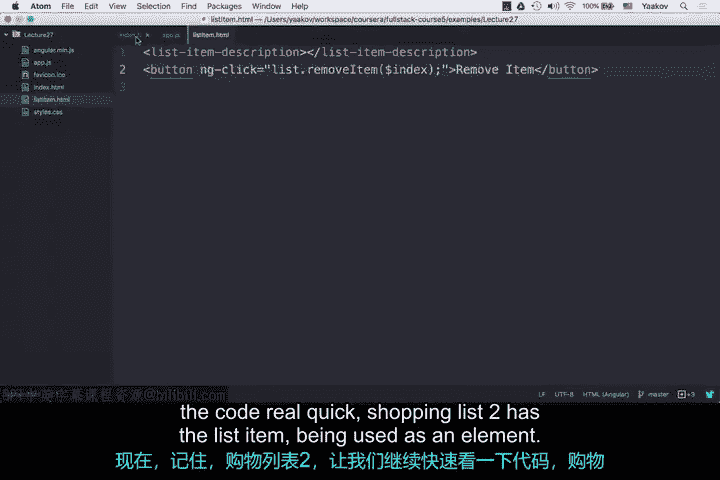

查看我们的 HTML，可以看到 `listItem` 被用作一个元素。查看 `app.js`，我们发现 `listItem` 指令没有指定 `restrict` 属性。这意味着我们可以将其用作属性或元素。现在，让我们为其添加 `restrict` 属性，并设置为 `‘AE’`，这样它既可以作为属性也可以作为元素使用。

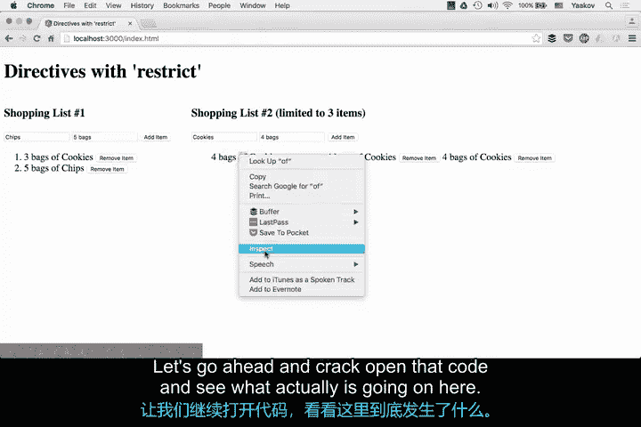

保存更改后，在浏览器中测试，添加项目功能仍然正常工作。

回到代码编辑器，让我们将第一个控制器中的 `listItem` 用法从元素改为属性，因为这是允许的。我们将 `<list-item>` 标签改为一个标准的 `<li>` 标签，并在其上添加 `list-item` 属性。

保存后，回到浏览器测试。添加一些项目后，你可能会发现列表的编号显示异常。打开开发者工具检查 DOM 元素，会发现出现了嵌套的 `<li>` 标签。

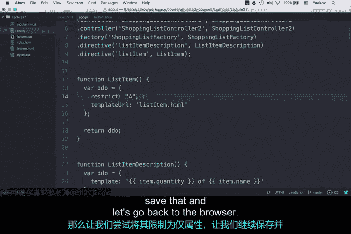

这是因为当我们将 `listItem` 指令作为属性应用在 `<li>` 元素上时，`listItem` 指令的模板（`listItem.html`）本身也包含一个 `<li>` 标签，这就导致了嵌套。为了让指令作为属性正常工作，我们需要从模板中移除外层的 `<li>` 标签。

修改模板后保存，刷新浏览器再次测试。现在，第一个列表（使用属性形式）可以正常工作了。我们检查 DOM 结构，可以看到 `<li>` 元素内部正确包含了指令模板生成的内容。

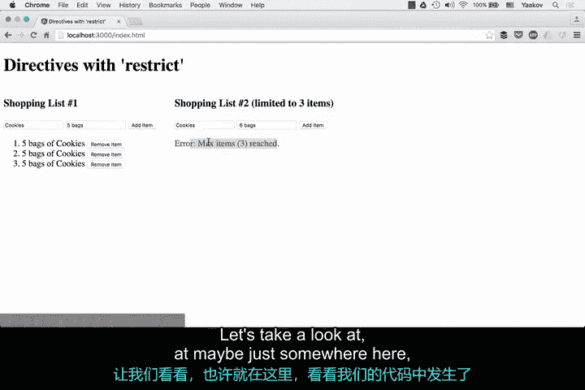

然而，第二个列表（仍然使用元素形式 `<list-item>`）现在却无法正常显示内容了。检查 DOM 会发现，`<list-item>` 元素内部是空的。这是因为我们从其模板中移除了 `<li>` 标签，导致作为元素使用时，它没有生成任何有效的包裹内容。

这引出了第一个要点：无论你将指令限制为属性还是元素，与该指令关联的模板必须在你的 HTML 上下文中具有意义。

目前，我们在 `app.js` 中将 `listItem` 限制为 `‘AE’`。现在，让我们尝试将其限制为仅能作为属性（`‘A’`）。保存后，第一个列表（属性形式）仍然正常工作。但第二个列表（元素形式）虽然点击按钮有功能响应（如项目数量限制），但页面上不显示任何内容。检查 DOM 会发现，AngularJS 编译器完全忽略了 `<list-item>` 这个元素，因为它被限制为仅能作为属性使用。

正如课程前面所说，带有模板的指令通常更适合作为元素。因此，让我们将其改回 `‘E’`（仅元素）。同时，为了让指令作为元素能正常工作，我们需要将 `<li>` 标签添加回 `listItem.html` 模板中。

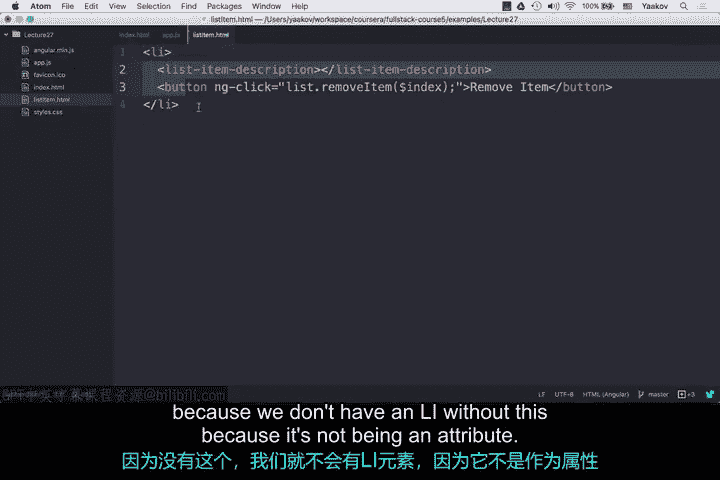

修改并保存后，第二个列表（元素形式）恢复正常。但第一个列表（属性形式）又无法显示内容了。检查 DOM 会发现，`<li>` 元素内部是空的。这是因为 AngularJS 编译器现在只将 `list-item` 识别为元素指令，而完全忽略了作为属性使用的 `list-item`。

## 总结

本节课我们一起学习了 `restrict` 属性的核心概念与应用。

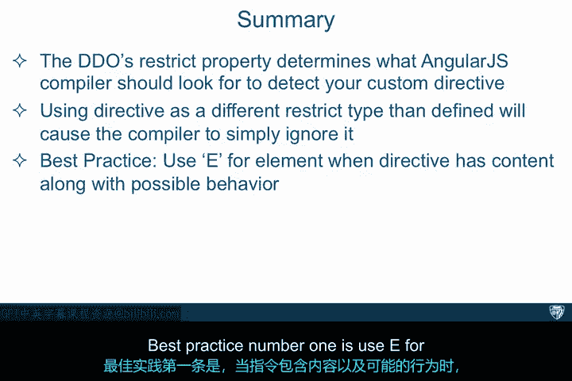

*   **作用**：DDO 的 `restrict` 属性决定了 AngularJS 编译器应查找何种形式的自定义指令。
*   **错误使用后果**：使用与定义不同的限制类型来调用指令，将导致编译器直接忽略它，从而使带有自定义行为的标签完全失效。
*   **最佳实践**：
    1.  当指令**拥有内容（模板）和可能的行为**时，使用 `‘E’`（元素）来限制它。
    2.  当指令**没有自身内容，仅用于扩展宿主元素的行为**时，使用 `‘A’`（属性）来限制它。
    3.  虽然技术上可以使用类（`‘C’`）和注释（`‘M’`）指令，但这主要是为了旧浏览器兼容性，现已不再常用，因此应避免定义这两种类型的自定义指令。