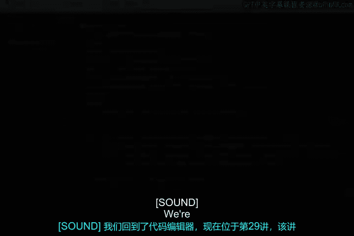
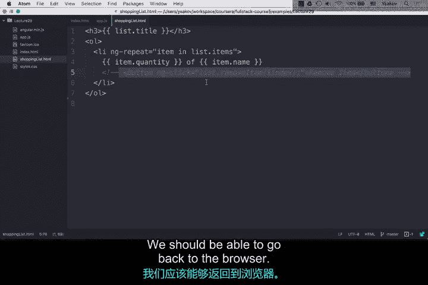
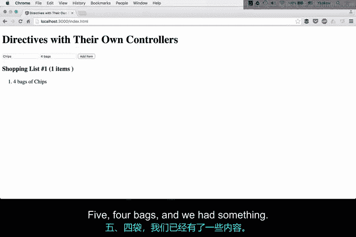
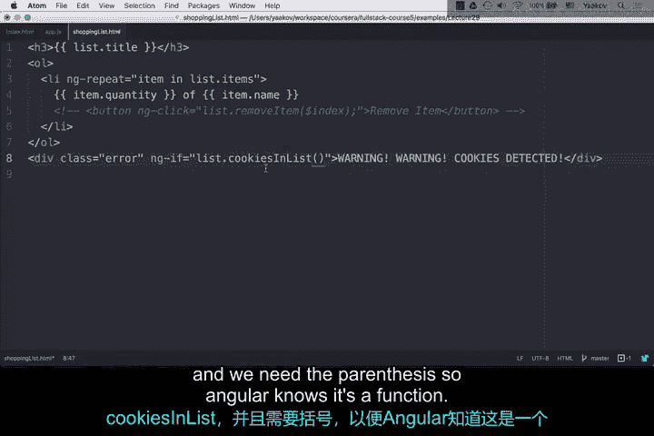
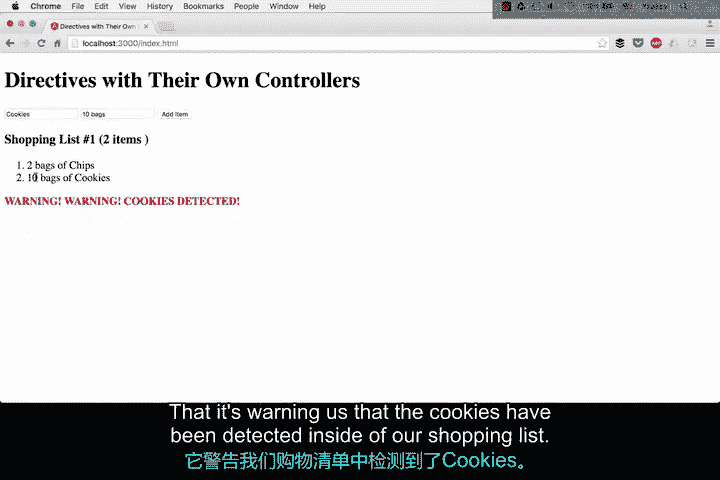
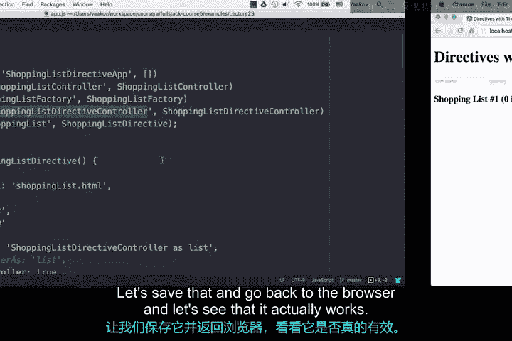
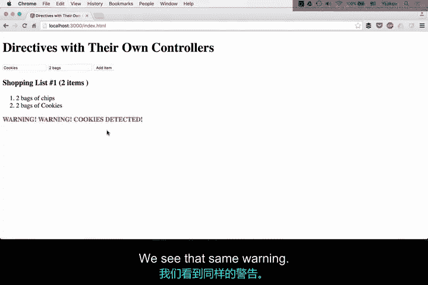
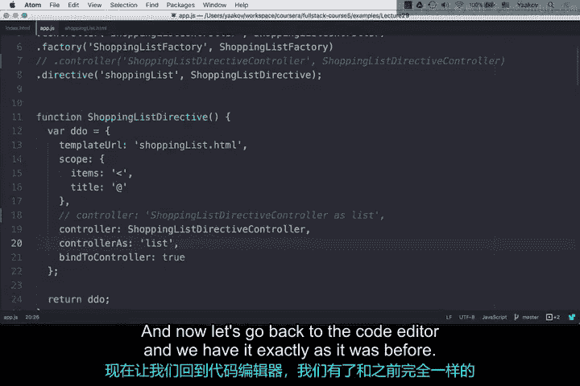
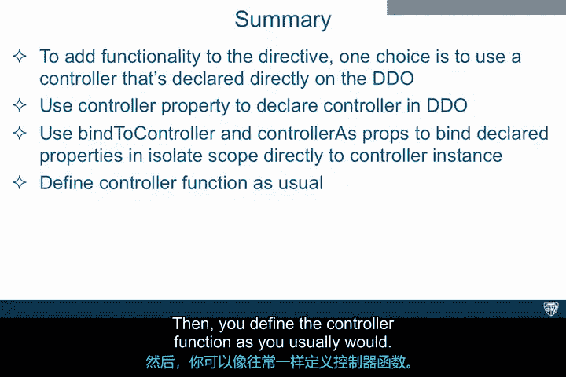

# 058：在指令内使用控制器 🎯




## 概述

在本节课中，我们将学习如何在 AngularJS 指令内部使用控制器。我们将通过修改一个购物清单应用，将错误提示功能从主页面移动到指令内部来实现。这有助于我们更好地理解指令的封装性和组件化设计。

---

## 代码环境与目标

我们回到代码编辑器，位于第29讲的示例文件夹中。这是我们一直在开发的购物清单应用。本次的目标是将错误提示功能整合到 `shoppingList` 指令内部。

之前，错误提示信息显示在指令外部的另一个 `div` 中。从组件化设计的角度思考，错误提示应该属于购物清单指令的一部分，因为指令本身了解清单中的项目，并能决定是否显示错误信息。

## 修改指令定义对象

首先，我们修改 `app.js` 文件中的指令定义。我们将 `items` 的绑定方式从双向绑定（`=`）改为单向绑定（`<`），因为我们不打算在指令内部修改传入的数组。

```javascript
.directive('shoppingList', function() {
  return {
    templateUrl: 'shoppingList.html',
    scope: {
      items: '<', // 改为单向绑定
      title: '@'
    },
    // 在DDO上声明控制器
    controller: 'ShoppingListDirectiveController',
    controllerAs: 'list',
    bindToController: true // 将scope属性绑定到控制器实例
  };
})
```

## 定义指令控制器

接下来，我们需要定义这个控制器。我们可以直接在指令函数下方定义，也可以将其注册到模块上以便复用。这里我们先展示直接定义的方式。

```javascript
// 方式一：作为局部函数定义
function ShoppingListDirectiveController() {
  var list = this;

  // 定义功能：检查列表中是否包含“饼干”
  list.cookiesInList = function () {
    for (var i = 0; i < list.items.length; i++) {
      var name = list.items[i].name;
      if (name.toLowerCase().indexOf("cookie") !== -1) {
        return true;
      }
    }
    return false;
  };
}
```

控制器的核心功能是 `cookiesInList` 方法。它遍历绑定到控制器的 `items` 数组，检查是否有项目名称包含“cookie”字符串，并返回布尔值。

## 修改指令模板

现在，我们需要在指令的模板文件 `shoppingList.html` 中使用这个控制器功能。





1.  首先，更新列表渲染部分，通过 `list` 别名访问控制器实例。
2.  然后，添加一个警告信息 `div`，并使用 `ng-if` 指令根据 `list.cookiesInList()` 方法的返回值来控制其显示。

```html
<!-- 使用 controllerAs 语法访问 items -->
<div ng-repeat="item in list.items">
  {{ item.quantity }} of {{ item.name }}
  <button ng-click="list.removeItem($index);">Remove Item</button>
</div>

<!-- 根据控制器逻辑显示警告 -->
<div class="error" ng-if="list.cookiesInList()">
  WARNING! WARNING! COOKIES DETECTED!
</div>
```



## 在模块上注册控制器（可选）



为了使控制器可在模块的其他地方复用，我们可以将其注册到 AngularJS 模块上，而不是定义为局部函数。

```javascript
// 方式二：在模块上注册控制器
.controller('ShoppingListDirectiveController', ShoppingListDirectiveController);

// 然后在指令的DDO中通过字符串名引用
controller: 'ShoppingListDirectiveController',
```

## 功能验证

保存所有修改后，我们回到浏览器进行测试。

*   添加“薯片”等普通商品，警告信息不会出现。
*   添加名称包含“cookie”的商品（如“饼干”）时，红色的警告信息会立即显示在购物清单下方。



这证明了我们成功将业务逻辑封装在了指令的控制器内部。



---



## 总结

本节课我们一起学习了如何在 AngularJS 指令内部使用控制器。



*   **核心目的**：为指令添加专属的业务逻辑，实现更好的封装性和组件化。
*   **实现步骤**：
    1.  在指令定义对象中，通过 `controller` 属性声明控制器。
    2.  配合使用 `controllerAs` 和 `bindToController: true`，将作用域属性绑定到控制器实例。
    3.  在控制器函数中，通过 `this` 关键字（或 `controllerAs` 指定的别名）定义属性和方法。
    4.  在指令模板中，通过控制器别名调用其方法或访问数据。
*   **绑定方式选择**：尽可能使用单向绑定（`<`）替代双向绑定（`=`），这不仅能提升性能，也符合“避免在指令内修改传入对象”的最佳架构实践。
*   **控制器注册**：控制器可以定义为指令的局部函数，也可以注册到模块上成为可复用的组件。


通过将错误检查逻辑内聚到 `shoppingList` 指令中，我们的代码结构变得更加清晰和可维护。