# 062：使用 link 操作 DOM

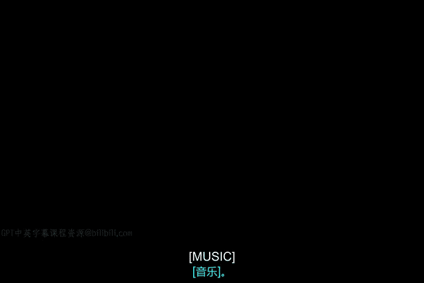


## 概述
在本节课程中，我们将学习如何在 AngularJS 指令的 `link` 函数中直接操作 DOM。我们将创建一个购物清单应用，当清单中包含“饼干”时，会显示一个警告信息。我们将首先使用 AngularJS 内置的 jqLite 实现，然后升级到使用完整的 jQuery 库来添加动画效果。

---

## 准备工作
我们位于 `lecture 31` 文件夹中，这是购物清单指令应用的一个版本。在之前的版本中，如果检测到清单中有“饼干”，我们使用 `ng-if` 在购物清单下方显示错误信息。在本版本中，我们将使用 DOM 操作来实现类似功能。

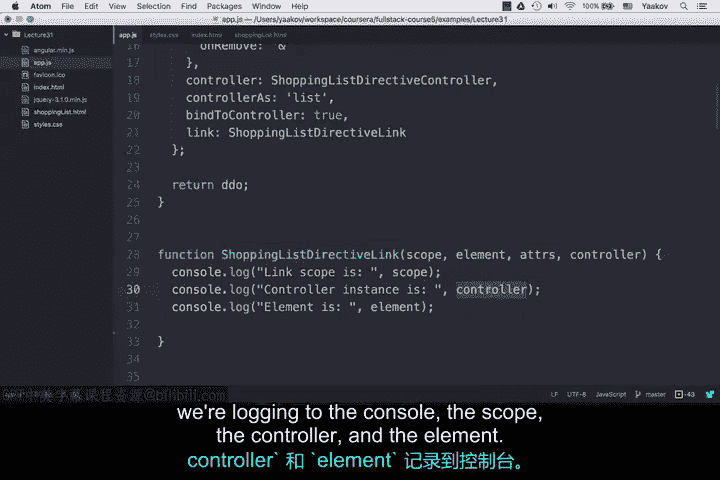

## 声明 Link 函数
首先，我们需要在指令定义对象中声明 `link` 函数，以便调用 DOM 操作方法。

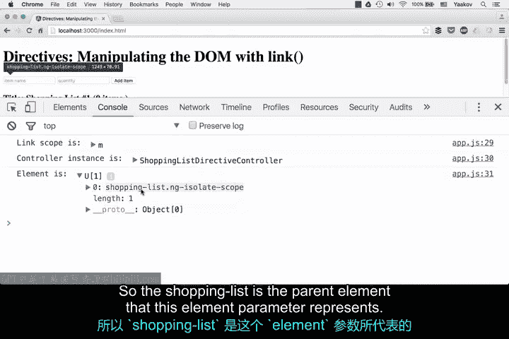

```javascript
link: ShoppingListDirectiveLink
```

接着，我们定义这个 `ShoppingListDirectiveLink` 函数。该函数接收 `scope`、`element`、`attributes` 和 `controller` 作为参数。

```javascript
function ShoppingListDirectiveLink(scope, element, attrs, controller) {
    console.log(scope);
    console.log(controller);
    console.log(element);
}
```

在浏览器控制台中，我们可以看到：
*   `link` 函数的 `scope` 与注入到指令控制器中的 `$scope` 完全相同。
*   `controller` 实例就是我们定义的 `ShoppingListDirectiveController`。
*   `element` 参数代表指令的顶级元素，即 `<shopping-list>`。

## 设置监视器
我们的目标是监视控制器中的 `cookiesInList` 函数。当该函数返回值发生变化时，我们需要显示或隐藏警告信息。

以下是设置监视器的代码：

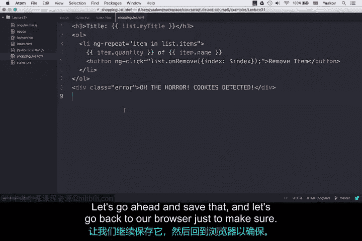

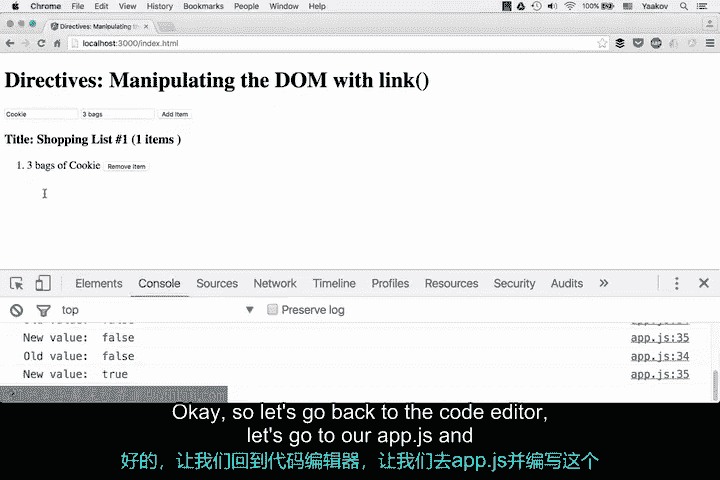

```javascript
scope.$watch(controller.cookiesInList, function(newValue, oldValue) {
    if (newValue === true) {
        displayCookieWarning();
    } else {
        removeCookieWarning();
    }
});
```

现在，我们需要定义 `displayCookieWarning` 和 `removeCookieWarning` 这两个函数。

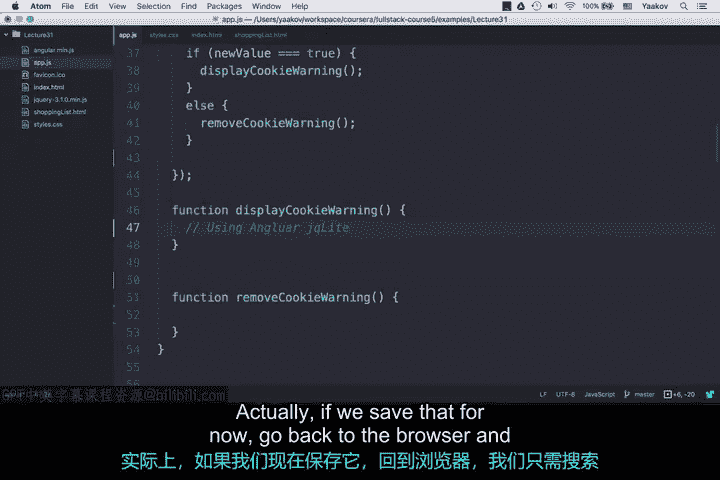

## 准备模板和样式
在显示警告之前，我们需要在指令模板中为其创建一个占位符。

```html
<div class="error">😊 Cookies detected.</div>
```

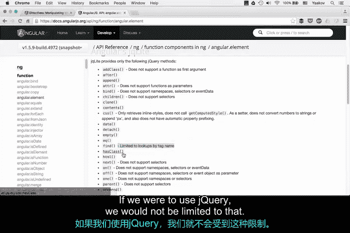

同时，在 CSS 中设置初始状态为不可见：

```css
.error {
    display: none;
}
```

## 使用 jqLite 操作 DOM
AngularJS 内置的 jqLite 提供了一组有限的 jQuery 方法。我们可以使用 `element.find()` 来查找元素，但注意它仅限于通过标签名进行查找。

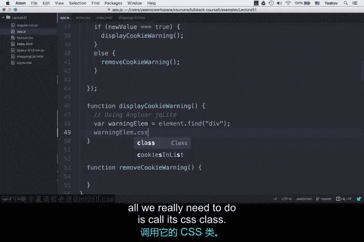

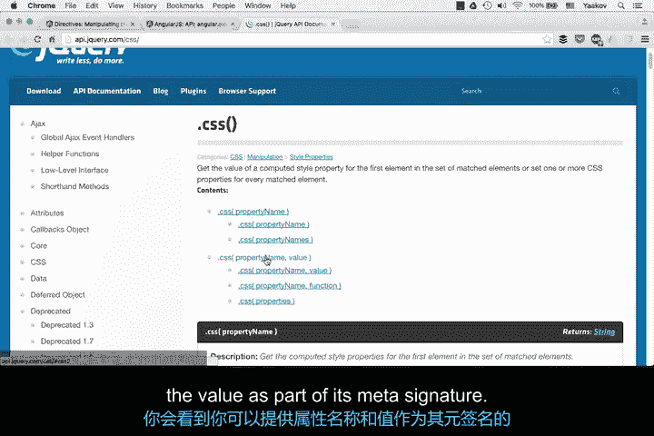

以下是使用 jqLite 显示和隐藏警告的函数：


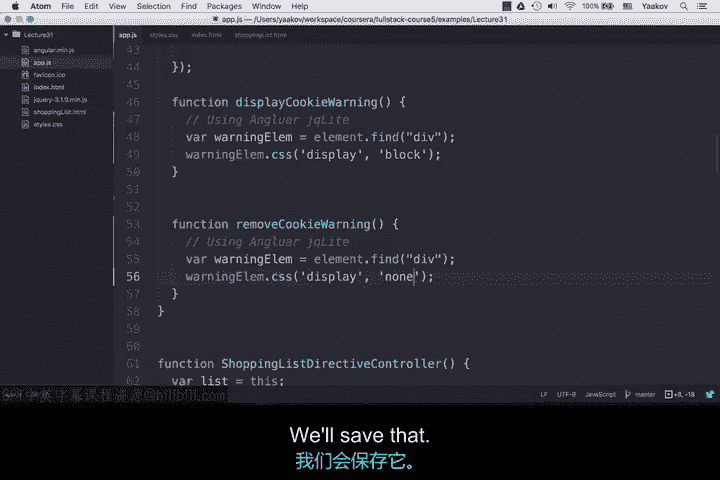

```javascript
function displayCookieWarning() {
    var warningElem = element.find('div');
    warningElem.css('display', 'block');
}
function removeCookieWarning() {
    var warningElem = element.find('div');
    warningElem.css('display', 'none');
}
```

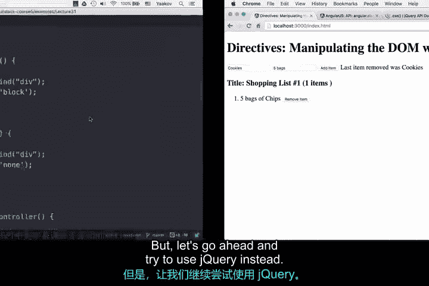

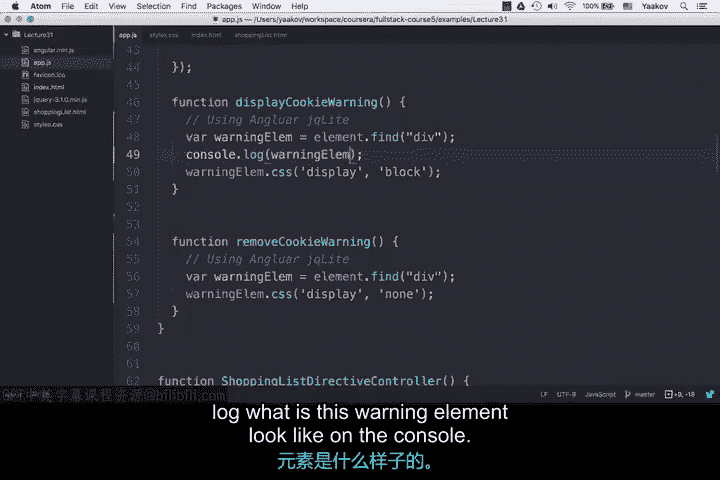

**重要提示**：`element.find()` 只会在指令元素内部的 DOM 中查找，这使得它在大型 HTML 页面中具有很高的性能。

现在，当我们在购物清单中添加“饼干”时，警告信息会显示；移除“饼干”时，警告信息会消失。

## 升级到使用 jQuery
为了获得更丰富的动画效果，我们可以引入完整的 jQuery 库。确保在引入 AngularJS 之前引入 jQuery。

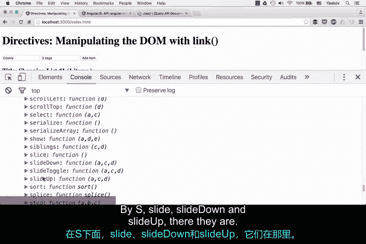

引入 jQuery 后，`element` 对象将拥有完整的 jQuery 方法集，包括 `slideDown` 和 `slideUp` 等动画方法。

我们可以更新函数，使用更精确的选择器和动画效果：


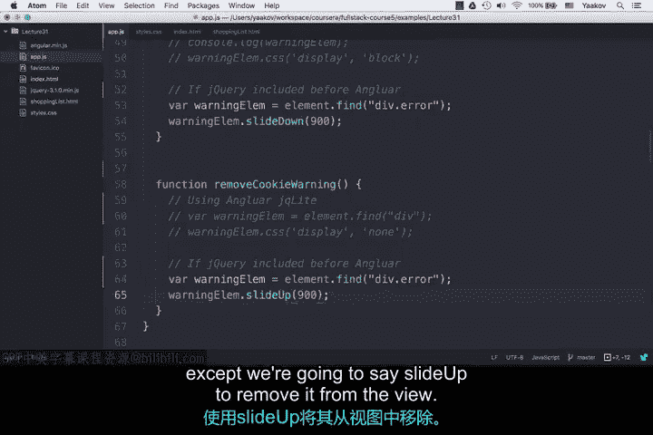

```javascript
function displayCookieWarning() {
    var warningElem = element.find('div.error');
    warningElem.slideDown(900);
}
function removeCookieWarning() {
    var warningElem = element.find('div.error');
    warningElem.slideUp(900);
}
```

现在，警告信息会以滑动动画的形式显示和隐藏，用户体验更加流畅。

## 总结
本节课我们一起学习了如何在 AngularJS 指令中使用 `link` 函数操作 DOM。

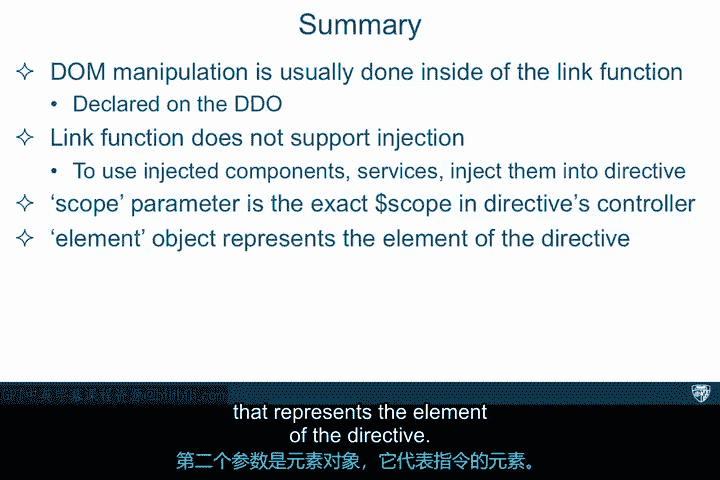


*   DOM 操作通常在指令定义对象的 `link` 函数中完成。
*   `link` 函数本身不支持依赖注入，但可以通过指令声明注入所需的组件、服务或控制器。
*   `link` 函数的第一个参数 `scope` 与指令控制器中的 `$scope` 是同一个对象。
*   第二个参数 `element` 代表指令的顶级元素。如果 jQuery 在 AngularJS 之前引入，`element` 是一个完整的 jQuery 对象；否则，它是一个 AngularJS 提供的简化版 jqLite 对象。
*   使用 `element.find()` 可以在指令内部高效地查找 DOM 元素。
*   通过集成像 jQuery 这样的第三方库，我们可以在指令内部直接使用丰富的 DOM 操作和动画方法，使代码模块化且易于维护。