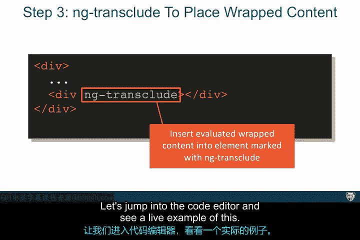

AngularJS 单页应用开发：P63：使用指令的 transclude 包装其他元素


在本节课中，我们将学习 AngularJS 指令中一个名为 `transclude` 的强大功能。它允许指令包装任意的 HTML 内容，包括表达式和函数调用，并且这些内容将在父作用域而非指令的独立作用域中进行求值。

---

### 概述

上一节我们介绍了如何向指令的独立作用域传递字符串、插值字符串、对象和函数引用。然而，有时我们需要传递整个模板，而不仅仅是简单的数据。本节中，我们来看看如何使用 `transclude` 属性来实现这一需求。

一个常见的用例是，当你将对话框编码为一个指令时。这个对话框需要具备对话框的行为（例如能够关闭、提供确定和取消按钮），但同时它必须足够通用，以允许使用者提供对话框实际要显示的内容。这正是指令定义对象（DDO）中的 `transclude` 属性所能实现的功能。

---

### 核心概念与步骤

使用 `transclude` 允许你用指令包装任意内容，包括 HTML 模板中的表达式和函数调用。最关键的一点是，被包装的表达式是在父作用域中求值的，而不是在指令的独立作用域中。

以下是实现此功能的三个步骤：

**步骤一：在指令定义中启用 transclude**
在指令的 DDO 中，将 `transclude` 属性设置为 `true`。

```javascript
transclude: true
```

**步骤二：在模板中使用指令并包装内容**
在 HTML 模板中使用你的指令，并在其开始和结束标签之间放入需要包装的内容。请注意，此处的任何插值表达式等，都将在父控制器的作用域中进行求值。

**步骤三：在指令模板中指定插入位置**
在指令自身的模板中，使用 `ng-transclude` 属性来标记一个位置。AngularJS 会将步骤二中包装的、已经过求值的内容，插入到这个指定位置。

---

### 总结




本节课中，我们一起学习了 AngularJS 指令的 `transclude` 功能。我们了解到，通过三个简单的步骤——在 DDO 中启用 `transclude`、在父模板中包装内容、在指令模板中使用 `ng-transclude` 指定插入点——即可创建能够灵活包装和显示外部内容的指令。这个功能既简单又强大，是构建可复用组件（如对话框、卡片等）的关键技术。