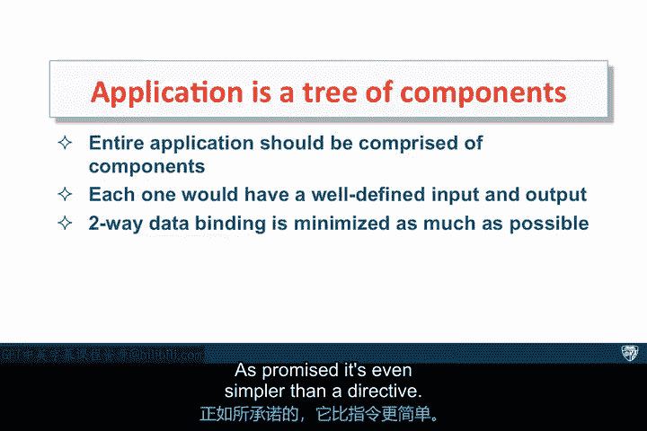
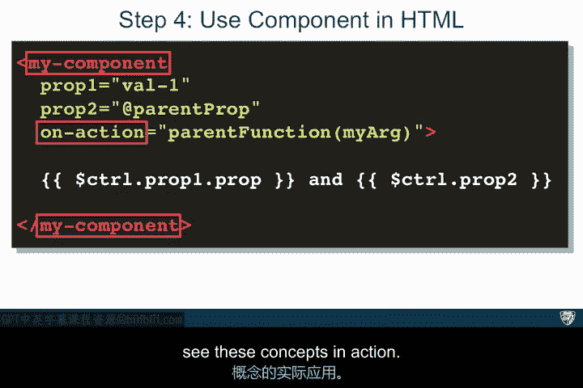

# 067：基于组件的架构（第1部分）🏗️


在本节课中，我们将要学习 Angular 1.5 引入的“组件”概念。这是一种实现指令的新方式，它采用简化的配置，并预设了一些最佳实践。我们将探讨基于组件的架构原则，以及如何在 Angular 中创建和使用组件。

## 概述

Angular 1.5 引入了一种实现指令的新方法：组件。组件是一种特殊的指令，它使用简化的配置，并预设了一些默认值，这些默认值本身就是最佳实践。虽然组件并不强制你使用基于组件的架构，但使用组件可以更轻松、更自然地以这种方式组织你的应用程序代码。使用组件编写应用程序也能让你更接近 Angular 2 的编程风格。

## 基于组件的架构原则

首先，我们来了解基于组件的架构原则，以及它如何通过 Angular 组件体现出来。

### 原则一：组件仅控制自己的视图和数据

组件只控制自己的视图和数据。它们从不修改自身范围之外的数据或 DOM。由于原型继承，你的代码有可能修改应用程序中几乎任何地方的数据。虽然这有时看起来非常方便，但它会迅速导致混乱，因为应用程序中的任何代码都无法确保其数据免受副作用的影响，这些副作用它既不了解，也无法控制。这就是为什么 Angular 组件总是使用**隔离作用域**。

### 原则二：组件具有明确定义的公共 API

公共 API 指的是**输入到组件的数据**和**从组件输出的数据**。为了贯彻这一原则，忠于基于组件的架构，组件代码应遵循一些简单的约定。这些约定旨在进一步阻止操作不属于组件直接所有的数据，即使在隔离作用域下也可能发生这种情况。

例如，如果你使用等号（`=`）通过双向绑定传递一个值，那么你在组件中对数据所做的任何更改也会反映在父级中。因此，组件的“输入”应仅使用**单向绑定**（`<`）和**属性值绑定**（`@`）来定义。

即使使用单向绑定，如果绑定的值是一个对象，更改该对象的属性值也会影响到组件外部的该对象。这仅仅是因为 JavaScript 中的对象是通过引用传递的。虽然你没有修改对象的实际引用，但你正在修改附加到该引用的值。因此，另一个约定是：**永远不要更改传入的对象或数组的属性值**。

这就是为什么我们强调“明确定义的 API”。API 是一种契约：你期望提供特定的输入，并期望接收特定的输出。在基于组件的架构中，如果我是一个带有 API 的组件的使用者，我必须向 API 提供某些数据，并确保我的数据不会被修改，然后期望 API 产生一些定义好的输出。

组件的输出通过 `&` 符号定义为**回调函数**。数据通过一个键值映射对象传递回调用者，该对象将调用者的参数名与映射中的键对应起来。我们在指令中已经见过这种形式。

### 原则三：组件具有明确定义的生命周期

这意味着组件有许多预定义的方法，我们可以在组件生命周期的不同阶段介入。这些方法包括：
*   **`$onInit`**：该方法用于初始化控制器的功能。
*   **`$onChanges`**：每当单向绑定更新时调用此方法，它会接收一个包含 `currentValue` 和 `previousValue` 等属性的 `changeObj` 对象，你可以据此查看值如何变化并做出响应。
*   **`$postLink`**：该方法与指令中的 `link` 方法非常相似。
*   **`$onDestroy`**：当作用域即将被销毁（即从内存中卸载）时调用此方法。你可以使用这个钩子来释放在其他方法中设置的外部资源、监视器和事件处理程序。

此列表中未展示所有方法，你可以随时在线查阅组件 API 生命周期方法的文档。

### 原则四：应用程序应被视为组件树

这意味着整个应用程序应该由组件构成。正如我们所说，每个组件都有明确定义的输入和输出。通过最小化双向数据绑定，可以更容易地预测数据何时何地发生变化，从而对组件的状态更有信心。

## 在 Angular 中创建组件

现在，让我们来看看在 Angular 中创建组件的步骤。正如所承诺的，它比创建指令更简单。

### 第一步：在模块中注册组件

你会注意到格式非常相似。首先，你给出组件的名称（使用驼峰命名法），在 HTML 中，它将被视为连字符形式（例如，`myComponent` 在 HTML 中为 `<my-component>`）。



然而，与提供函数或工厂函数作为指令的实现不同，你为组件提供一个简单的**配置对象**。

```javascript
angular.module(‘myApp‘, [])
  .component(‘myComponent‘, {
    // 配置属性将放在这里
  });
```

### 第二步：配置组件

以下是组件最常见的配置属性：

*   **`template` 或 `templateUrl`**：大多数组件都有一个与之关联的模板。
*   **`controller`**：你并非必须为组件提供控制器。只有当你确实需要添加一些功能时才在此指定。否则，Angular 会自动提供一个空对象，并自动将其实例放置在隔离作用域上，标签为 `$ctrl`。
*   **`bindings`**：在组件中，作用域始终是隔离的，我们无法更改它。我们使用一个名为 `bindings` 的属性来定义隔离作用域的参数映射。它实际上与我们之前使用的 `scope` 属性完全相同，但现在属性名是 `bindings`，因为我们始终假设是隔离作用域。

```javascript
angular.module(‘myApp‘, [])
  .component(‘myComponent‘, {
    templateUrl: ‘my-component.html‘,
    controller: ‘MyComponentController‘,
    bindings: {
      inputData: ‘<‘, // 单向绑定输入
      onAction: ‘&‘   // 回调函数输出
    }
  });
```

在组件模板中，我们将使用传入组件的属性。注意，我们使用的是 Angular 自动生成的标签 `$ctrl`，它指向为组件配置的控制器。

```html
<!-- my-component.html -->
<div>
  <p>接收到的数据：{{ $ctrl.inputData }}</p>
  <button ng-click=“$ctrl.onAction({value: ‘clicked!‘})“>触发动作</button>
</div>
```

在使用该组件的 HTML 中，其用法与你之前编码的自定义指令完全相同。再次注意，在 `bindings` 中声明的驼峰命名法标签名和属性名，现在应转换为全部小写并用连字符连接。

```html
<my-component input-data=“someParentData“ on-action=“parentCallback(value)“></my-component>
```

## 总结




本节课中，我们一起学习了 Angular 1.5 中引入的组件概念。我们探讨了基于组件架构的四个核心原则：组件仅控制自身数据与视图、拥有明确定义的公共 API、具有明确定义的生命周期，以及应用程序应被视为组件树。我们还详细介绍了在 Angular 中创建组件的两个步骤：在模块中注册组件和配置组件的关键属性（如 `templateUrl`、`controller` 和 `bindings`）。组件通过其简化的配置和预设的最佳实践，使得构建可预测、可维护的单页应用变得更加容易和自然。在下一部分，我们将进入代码编辑器，亲眼看看这些概念的实际应用。