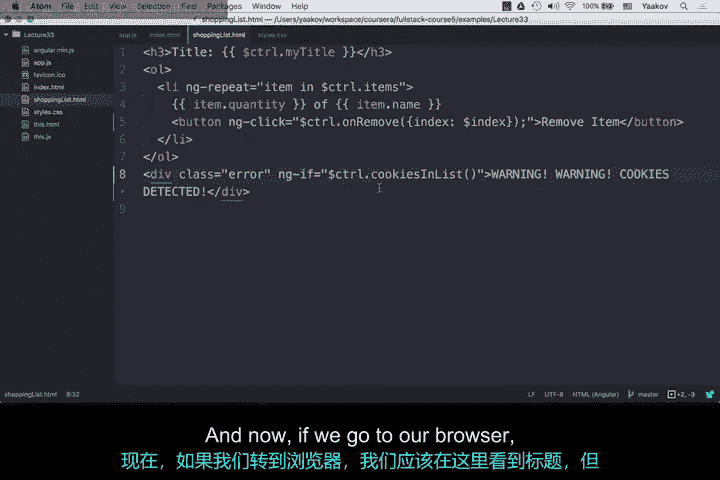
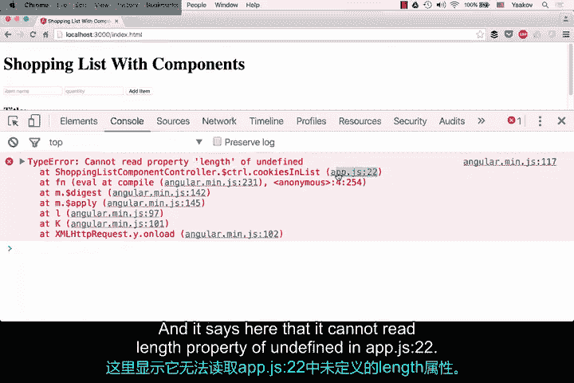
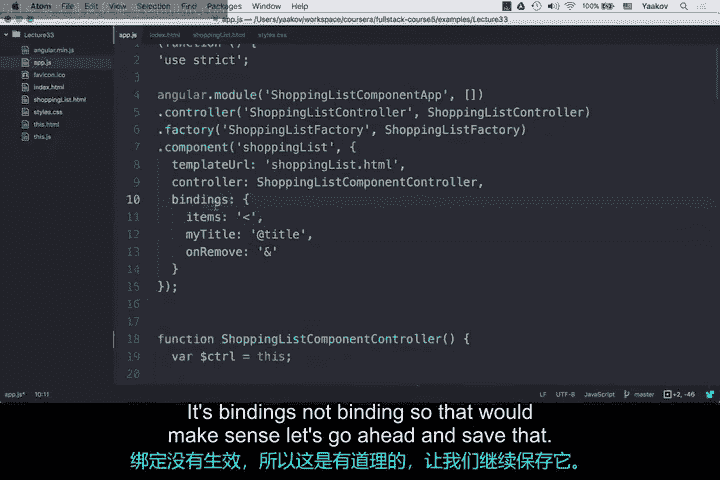
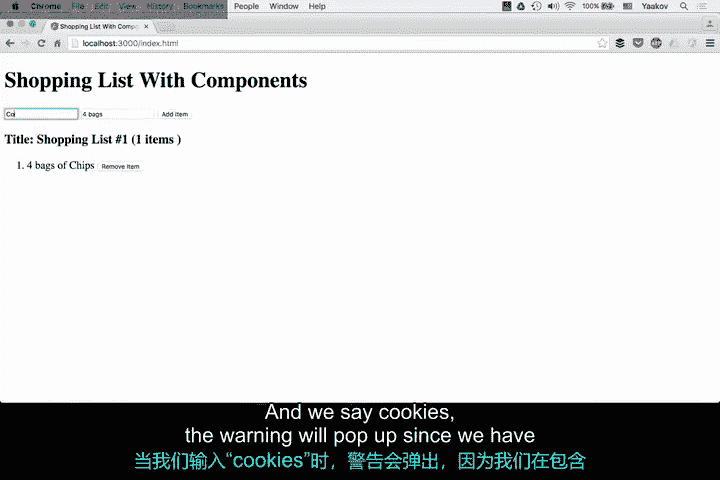
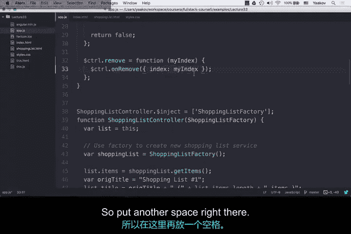
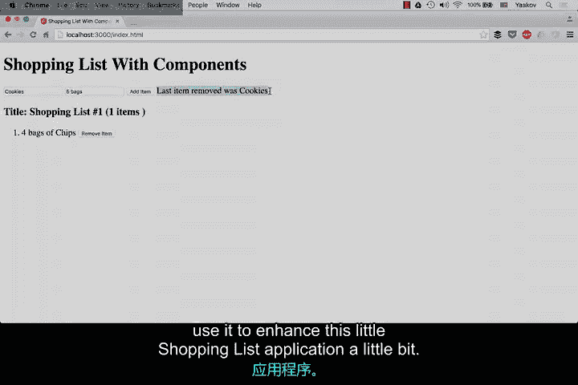

# 068：基于组件的架构 🧩


在本节课中，我们将学习如何将一个 AngularJS 指令（Directive）重构为一个组件（Component）。我们将通过一个购物清单应用的例子，详细讲解组件的配置、控制器、模板以及输入/输出绑定。

---

## 概述

上一节我们介绍了组件化架构的基本概念。本节中，我们将动手实践，把之前用指令实现的购物清单功能，转换成一个更现代、更易维护的 AngularJS 组件。我们将重点关注如何定义组件、设置其绑定属性，并重构控制器逻辑。

## 初始代码结构

我们从一个名为 `shopping list component app` 的应用开始。它基本上是第30讲代码的清理版本。

以下是应用的主视图（`index.html`）结构：

```html
<div ng-controller="ShoppingListController as listCtrl">
  <h3>{{ listCtrl.title }}</h3>
  <shopping-list items="listCtrl.items"
                 title="listCtrl.title"
                 on-remove="listCtrl.removeItem(index)">
  </shopping-list>
  <div ng-if="listCtrl.lastRemoved">
    Last removed item: {{ listCtrl.lastRemoved }}
  </div>
</div>
```

可以看到，我们使用了一个名为 `shopping-list` 的指令（目前还是指令），并向其传递了 `items`、`title` 和 `on-remove` 属性。

## 将指令转换为组件

现在，让我们进入 `app.js` 文件，开始将 `shopping-list` 指令转换为组件。

以下是转换步骤：

### 1. 更改注册方法

首先，我们需要将 `.directive` 注册方法改为 `.component`。

```javascript
// 之前是指令
// app.directive('shoppingList', ShoppingListDirective);

// 现在是组件
app.component('shoppingList', {
  // 组件配置对象将放在这里
});
```

### 2. 定义组件配置对象

组件使用一个简单的配置对象来定义，这比指令的函数形式更清晰。我们需要配置模板、控制器和绑定属性。

```javascript
app.component('shoppingList', {
  templateUrl: 'shoppingList.template.html',
  controller: 'ShoppingListComponentController',
  bindings: {
    items: '<',     // 单向绑定输入
    title: '@',     // DOM 属性字符串绑定
    onRemove: '&'   // 回调函数输出
  }
});
```



*   **`templateUrl`**: 指定组件模板的路径。
*   **`controller`**: 指定组件控制器的名称。
*   **`bindings`**: 定义组件的输入和输出，替代了指令中的 `scope` 配置。
    *   `items: ‘<‘` 表示单向数据绑定。
    *   `title: ‘@’` 表示绑定 DOM 属性的字符串值。
    *   `onRemove: ‘&’` 表示绑定一个父作用域中的函数，用于回调。

### 3. 重构组件控制器

接下来，我们需要定义 `ShoppingListComponentController`。我们将复用之前指令控制器的逻辑，但需要进行一些调整。







```javascript
app.controller('ShoppingListComponentController', ShoppingListComponentController);

function ShoppingListComponentController() {
  var $ctrl = this;

  // 检查清单中是否有包含“cookie”的项
  $ctrl.cookiesInList = function () {
    for (var i = 0; i < $ctrl.items.length; i++) {
      var name = $ctrl.items[i].name;
      if (name.toLowerCase().indexOf("cookie") !== -1) {
        return true;
      }
    }
    return false;
  };

  // 新的移除方法，用于调用父组件传递的回调
  $ctrl.remove = function (myIndex) {
    // 调用通过绑定传入的 onRemove 函数，并传递索引参数
    $ctrl.onRemove({ index: myIndex });
  };
}
```

关键变化：
*   控制器函数内部，我们使用 `var $ctrl = this;` 来引用组件控制器实例。在模板中也将使用 `$ctrl`。
*   我们添加了一个新的 `$ctrl.remove` 方法。它接收一个索引，然后调用绑定进来的 `$ctrl.onRemove` 回调函数，并将索引包装在对象 `{ index: myIndex }` 中传递出去。这里的 `index` 键名必须与 `bindings` 中定义的回调参数名匹配。

### 4. 更新组件模板

最后，我们需要更新组件模板 `shoppingList.template.html`，将之前引用控制器实例变量 `list` 的地方改为 `$ctrl`，并使用新的 `remove` 方法。

```html
<h3>{{ $ctrl.title }}</h3>
<ul>
  <li ng-repeat="item in $ctrl.items">
    {{ item.quantity }} of {{ item.name }}
    <button ng-click="$ctrl.remove($index);">Remove Item</button>
  </li>
</ul>
<div ng-if="$ctrl.cookiesInList()">
  <h4>WARNING! WARNING! COOKIES DETECTED!</h4>
</div>
```

*   将 `list.title` 改为 `$ctrl.title`。
*   将 `list.items` 改为 `$ctrl.items`。
*   将 `list.cookiesInList()` 改为 `$ctrl.cookiesInList()`。
*   按钮的 `ng-click` 事件从复杂的表达式 `on-remove({index: $index})` 简化为直接调用控制器方法 `$ctrl.remove($index)`，这样模板更清晰。

## 测试组件功能

完成以上步骤后，保存所有文件并刷新浏览器。

1.  **添加项目**：在输入框中输入“chips”并添加，它会正常显示在列表中。
2.  **触发警告**：输入“cookies”并添加。由于控制器中的 `cookiesInList` 方法检测到列表中存在“cookie”，警告信息会立即显示。
3.  **移除项目**：点击“cookies”旁边的“Remove Item”按钮。该项目会从列表中移除，警告信息随之消失。同时，被移除的“cookies”项会通过 `onRemove` 回调传递到父控制器，并显示在页面下方的“Last removed item”区域。



## 总结

本节课中我们一起学习了如何将 AngularJS 指令转换为组件。我们完成了以下关键操作：
1.  使用 `.component()` 方法注册组件，并配置 `templateUrl`、`controller` 和 `bindings`。
2.  重构控制器，使用 `$ctrl` 别名，并添加方法来处理内部逻辑和调用父级回调。
3.  更新模板，使其引用 `$ctrl` 并简化事件处理。



通过这次转换，我们的代码结构变得更加清晰和模块化。组件的 `bindings` 属性明确区分了输入和输出，使得数据流更容易理解。在下一部分，我们将探讨组件生命周期方法，并利用它们来进一步增强这个购物清单应用的功能。