# 069：基于组件的架构（第3部分）


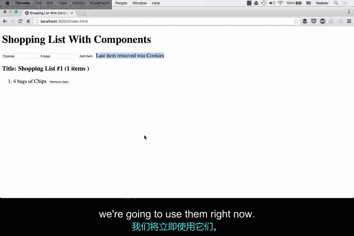

在本节课中，我们将继续学习 AngularJS 组件，重点探讨组件控制器中的生命周期方法。我们将学习如何使用这些方法来响应组件状态的变化，并执行 DOM 操作。

---

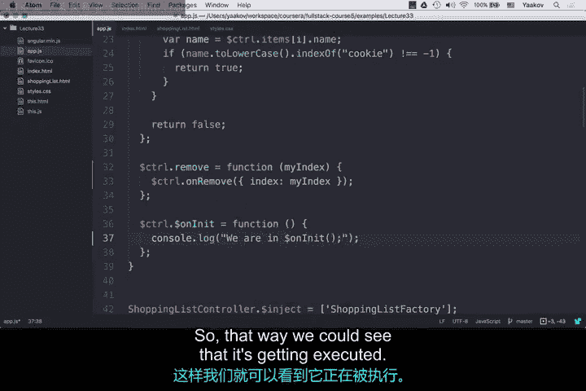

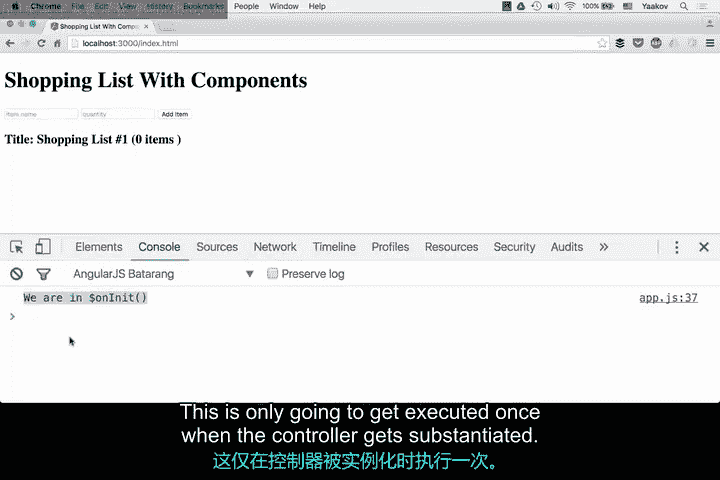

在上一讲中，我们将之前编写的指令转换为了组件，并看到了组件配置的简洁性。本节中，我们将深入组件的控制器，了解并应用其生命周期方法。

## 生命周期方法简介

组件的控制器可以定义一些特定的方法，AngularJS 框架会在特定时机自动调用它们。这些方法被称为生命周期方法。

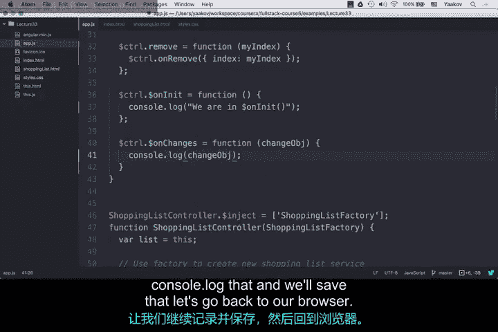

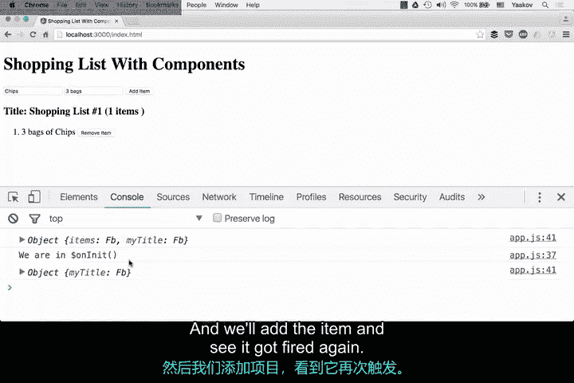

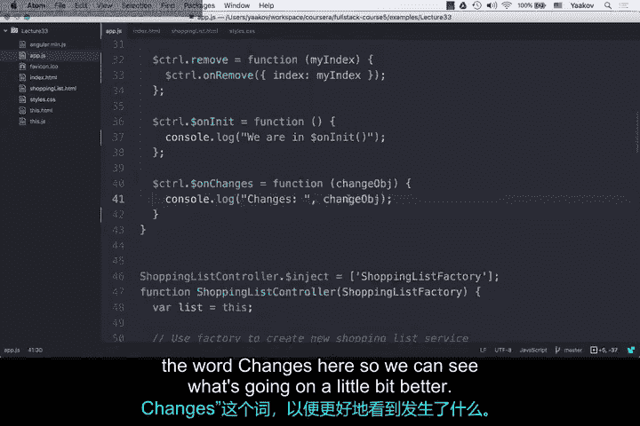

以下是几个关键的生命周期方法：

*   **`$onInit`**: 在控制器初始化后执行一次。
*   **`$onChanges`**: 当组件绑定的输入属性发生变化时执行。
*   **`$postLink`**: 在组件模板链接到 DOM 后执行，类似于指令中的 `link` 函数。

## 使用 `$onInit` 和 `$onChanges`

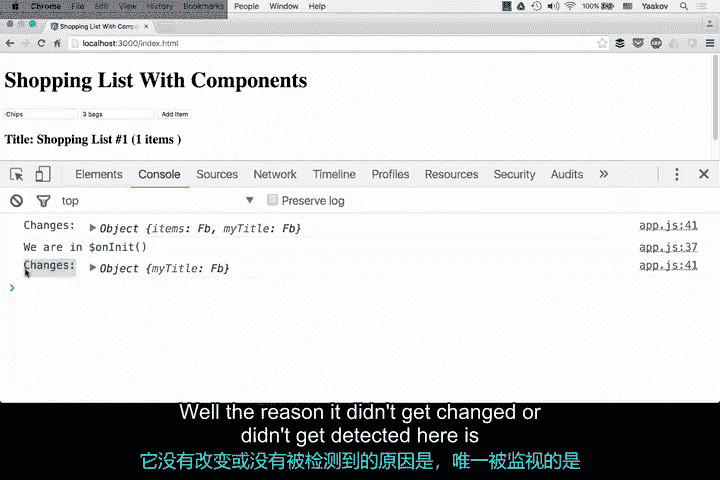

我们首先在购物清单组件的控制器中添加 `$onInit` 和 `$onChanges` 方法。

```javascript
controller: function ($scope, $element) {
    var ctrl = this;

    // 生命周期方法：初始化
    ctrl.$onInit = function () {
        console.log("$onInit executed.");
    };

    // 生命周期方法：响应绑定变化
    ctrl.$onChanges = function (changesObj) {
        console.log("$onChanges fired.", changesObj);
    };

    // ... 其他控制器逻辑
}
```

保存代码并在浏览器中打开控制台，可以看到 `$onInit` 在页面加载时执行了一次。当我们修改组件绑定的属性（例如标题）时，`$onChanges` 方法会被触发，并传入一个包含变化信息的对象。

**注意**：`$onChanges` 默认只监视绑定属性的**引用**是否改变。对于数组，如果只是向其中添加或删除元素（引用未变），则不会触发 `$onChanges`。只有为数组赋予一个新数组（新引用）时，才会触发。

## 使用 `$postLink` 进行 DOM 操作

接下来，我们使用 `$postLink` 方法来实现一个动画效果：当购物清单中包含“cookies”时，显示一个警告信息并滑入视图。

首先，我们需要调整 HTML 模板和 CSS，让警告信息默认隐藏。

```html
<!-- 修改前，使用 ng-if -->
<div class="error" ng-if="ctrl.cookiesInList()">WARNING! Cookies detected.</div>

<!-- 修改后，移除 ng-if -->
<div class="error">WARNING! Cookies detected.</div>
```

```css
.error {
    /* ... 其他样式 ... */
    display: none; /* 默认隐藏 */
}
```

然后，在控制器中实现 `$postLink` 方法。我们需要注入 `$scope` 和 `$element` 服务。`$element` 是一个 jQuery（或 jqLite）对象，代表组件的最外层元素。

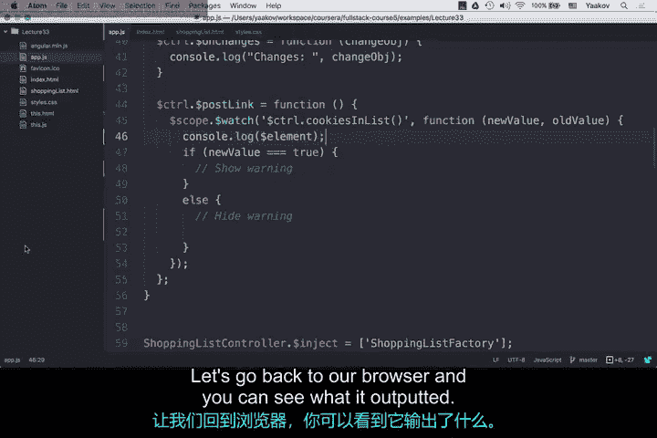

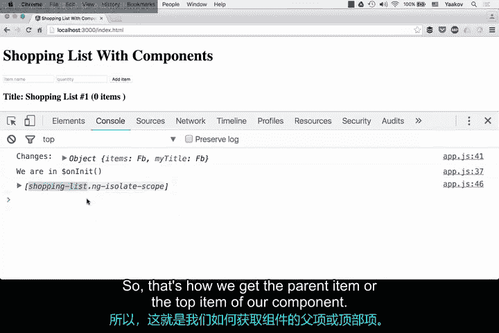

```javascript
controller: ['$scope', '$element', function ($scope, $element) {
    var ctrl = this;

    ctrl.$postLink = function () {
        // 监视 cookiesInList 函数的结果
        $scope.$watch(
            function () {
                return ctrl.cookiesInList();
            },
            function (newValue, oldValue) {
                // 找到组件模板内的 .error 元素
                var warningEl = $element.find('div.error');
                if (newValue === true) {
                    // 如果检测到 cookies，滑下显示警告
                    warningEl.slideDown(900);
                } else {
                    // 否则，滑上隐藏警告
                    warningEl.slideUp(900);
                }
            }
        );
    };

    // ... 其他控制器逻辑
}]
```

**重要提示**：为了使用 jQuery 的 `slideDown` 和 `slideUp` 动画，需要在 AngularJS 之前引入 jQuery 库。

```html
<script src="jquery-3.1.0.min.js"></script>
<script src="angular.min.js"></script>
```

完成以上步骤后，当在购物清单中添加包含“cookies”的商品时，警告信息会平滑地滑出显示；移除后，警告信息会滑上隐藏。

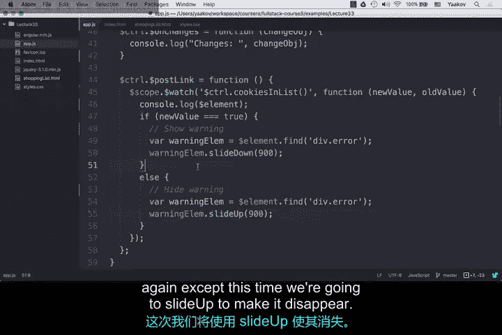

---

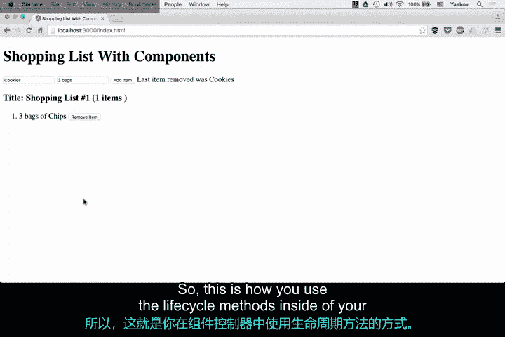


本节课中，我们一起学习了 AngularJS 组件的三个核心生命周期方法：`$onInit`、`$onChanges` 和 `$postLink`。我们了解了它们各自的调用时机和用途，并通过实例演示了如何使用 `$postLink` 方法在组件链接到 DOM 后执行 jQuery 动画来操作组件模板内的元素。掌握这些生命周期方法能帮助你更精准地控制组件的行为和交互。