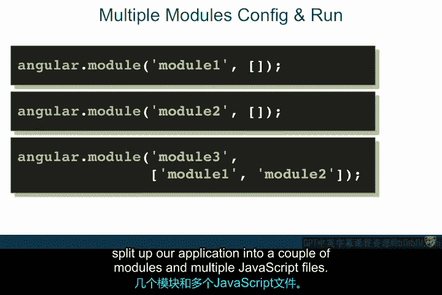

# 073：模块 🧩


在本节课中，我们将要学习 AngularJS 中模块的概念。我们将了解什么是模块、为什么使用模块、如何声明和创建模块，以及如何将应用程序拆分为多个模块和文件。通过模块化，我们可以更好地组织代码，提高项目的可维护性和可复用性。

## 概述

无论你是否意识到，实际上我们从课程一开始就在使用模块。然而，我们并未深入讨论它们，因此也尚未充分利用其能力。使用模块最大的优势在于，它允许我们将应用程序**模块化**。换句话说，模块让我们能够将应用拆分成更小的部分，然后再将它们组合起来。这是一个巨大的优势，因为它允许我们独立地处理应用程序的不同部分。

此外，它促使我们将软件项目视为一个整体的各个小部分来思考。编写小而简单的代码总是比一次性处理整个开发工作要容易得多。

使用模块，我们还可以封装我们的控制器、组件、指令等，并将其提供给其他开发者在他们的应用中使用。

## 模块的声明与语法

与拥有一个主方法作为一切起点的常规应用程序不同，Angular 中没有主方法。相反，我们使用模块 API 来声明我们应用程序的构件（如组件、控制器等）。让我们来看看声明模块的语法。

### 第一步：声明或创建模块

你通过调用 `angular` 对象本身的 `module` 方法来声明一个模块。你赋予模块的字符串名称在整个应用程序中应该是唯一的。另一个重要的注意事项是，如果你在 `module` 方法中指定了第二个参数，你实际上是在**创建**模块，而不仅仅是检索一个已存在的模块。

以下是创建模块的代码示例：

```javascript
// 创建不依赖其他模块的模块
var module1 = angular.module('module1', []);
var module2 = angular.module('module2', []);

// 创建依赖其他模块的模块
var module3 = angular.module('module3', ['module1', 'module2']);
```

请注意，你可以创建一个不依赖任何其他模块的模块（如 `module1` 和 `module2` 的情况），也可以声明一个模块依赖于一个或多个其他模块（如 `module3` 依赖于 `module1` 和 `module2`）。

### 第二步：声明模块构件

这一步我们在几乎每一讲中都做过，所以你应该非常熟悉。然而，请注意创建模块和检索模块实例以附加控制器或其他构件之间的关键区别：检索时省略了 `module` 方法的第二个参数。

以下是检索模块并声明控制器的代码示例：

```javascript
// 检索已创建的 module1，并为其附加一个控制器
angular.module('module1')
  .controller('MyController', function() {
    // 控制器逻辑
  });
```

这假设我们之前已经创建了 `module1`。如果没有，检索 `module1` 的调用将导致错误。

### 第三步：在 HTML 中关联主模块

最后一步是使用 `ng-app` 指令将主模块的名称关联到我们的 HTML 中。

```html
<html ng-app="module3">
```

以上就是模块的基本用法。

## 文件组织与最佳实践

就像在实际开发中处理包含相关组件的独立模块更容易一样，将所有 JavaScript 代码放在一个文件中也不是最佳实践。最佳实践是将一个构件（如一个控制器）放在一个单独的 JavaScript 文件中。

有时，当代码量很小，并且将几个构件放在同一个文件中更容易理解时，可以打破这个最佳实践规则。通常，我们会在自己的 JavaScript 文件中声明或创建一个模块。

以下是文件组织的示例：

*   **module1.js**：在此文件中创建和声明 `module1`。这通过使用带有第二个参数（空数组或模块依赖数组）的 `angular.module` 方法来完成。
*   **controller.js**：在此文件中，通过使用不带第二个参数的相同 `angular.module` 方法来检索你创建的 `module1`，并调用其上的 `controller` 方法来声明一个控制器。

如果你不习惯看到 JavaScript 代码这样拆分，只需想想它在浏览器中是如何工作的，你就会更适应。因为浏览器按顺序处理 HTML，这意味着从概念上讲，浏览器会将你所有的 JS 文件合并成一个 JS 文件。该文件的内容将是你 HTML 中声明的文件内容一个接一个地组合。

在这种情况下，你可以想象创建一个新的 JavaScript 文件，然后将 `module1.js` 的内容粘贴进去，接着将 `controller.js` 的内容粘贴到该文件之后，依此类推。

请注意，在 HTML 或 JavaScript 文件中声明模块的顺序并不重要。如果你将整个设置视为由较小文件组成的一个巨大 JavaScript 文件，Angular 在读取所有模块声明后，会找出哪个模块依赖于哪个其他模块，并以正确的顺序实例化它们。

然而，你绝对不能做的是在创建模块之前为该模块声明构件。这样做的原因是，按那种顺序粘贴这两个文件的内容大致会产生如下所示的代码，这显然会导致错误，因为我们在第一行代码中尝试检索 `module2` 的实例并声明组件时，模块本身甚至还没有在第二行代码中被创建。

```javascript
// 错误示例：先声明构件，后创建模块
angular.module('module2').component('myComponent', {...}); // 错误：module2 尚未创建
angular.module('module2', []); // 创建 module2 的代码在后面
```

## 模块的特殊方法

模块有几个特殊的方法，我们已经见过其中一个：`config` 方法。`config` 方法在模块的任何其他方法之前运行。传入 `config` 方法的函数值可以注入 `provider` 或 `constant`。由于 `provider` 用于配置服务，因此不能将服务注入 `config` 方法的限制是有道理的，因为我们不希望在我们有机会配置服务如何实例化之前就实例化它。

另一个方法是 `run` 方法，它在模块上执行。`run` 方法在 `config` 方法之后立即执行。你只能将实例和常量注入 `run` 方法，而不能注入 `provider`，因为我们希望防止系统在运行时被重新配置。

对于一个依赖于其他模块的模块，所有依赖项的 `config` 方法会首先执行。然后，这些模块的 `run` 方法会以相同的模式重复执行：先执行依赖模块的 `run` 方法，再执行本模块的 `run` 方法。

## 总结




本节课中，我们一起学习了 AngularJS 模块的核心概念。我们了解了模块如何帮助我们将应用拆分为更小、更易管理的部分，并支持独立开发和代码复用。我们掌握了使用 `angular.module(‘name‘, [dependencies])` 创建模块，以及使用 `angular.module(‘name‘)` 检索模块并声明控制器等构件的方法。我们还探讨了将代码拆分到多个文件的最佳实践，以及模块生命周期中的 `config` 和 `run` 方法。最后，我们理解了模块依赖的加载顺序规则。掌握模块是构建结构清晰、可维护的 AngularJS 应用的基础。