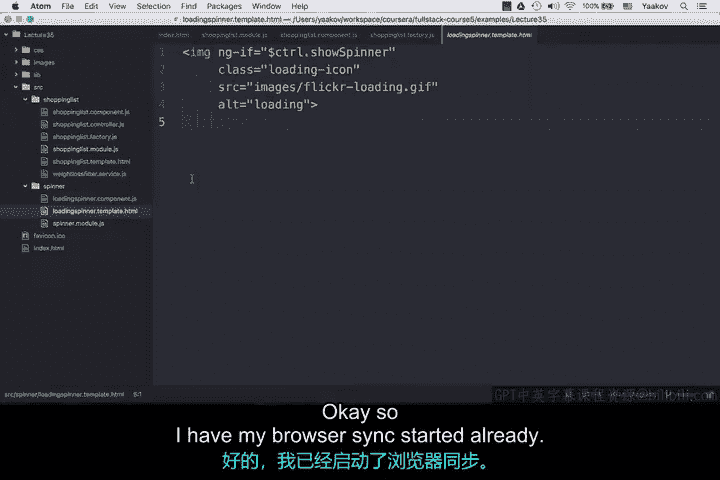
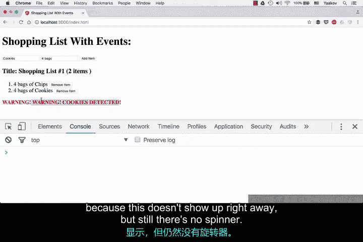
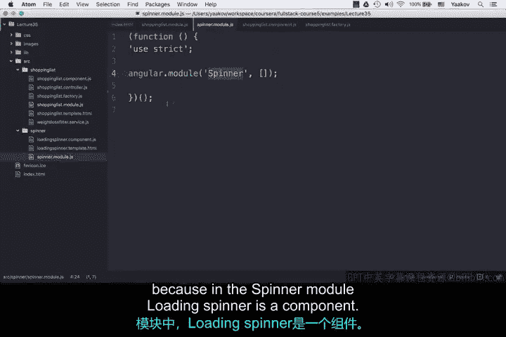
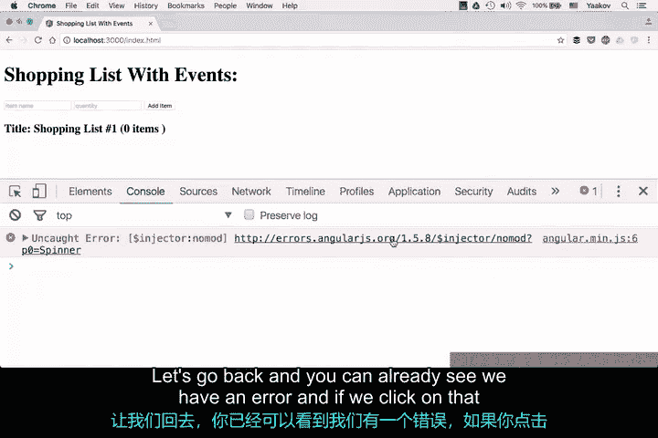
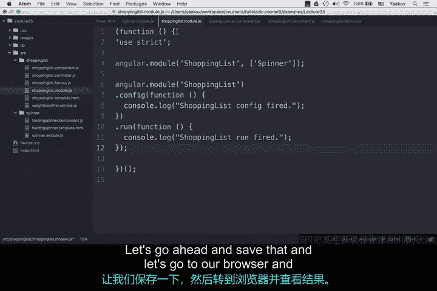
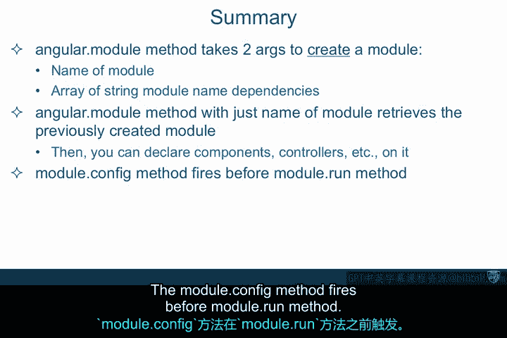

# 074：模块（第2部分）


## 概述
在本节课中，我们将学习 AngularJS 模块的组织方式、模块间的依赖关系，以及 `config` 和 `run` 方法的执行顺序。我们将通过一个重构后的购物清单应用示例来演示这些概念。

---

## 项目结构与模块化组织

我们回到了代码编辑器，位于 `lecture35` 文件夹中。这是我们的购物清单应用，但这次我们对其进行了重构，使其结构更加清晰。

`index.html` 文件与之前一样简单。`ng-app` 指令指向名为 `shoppingList` 的模块。这意味着我们有一个名为 `shoppingList` 的模块。

```html
<!DOCTYPE html>
<html ng-app="shoppingList">
<!-- ... 其他内容 ... -->
</html>
```

在文件末尾，我们有一个加载指示器（spinner），这是我们本节课将重点关注的部分。

我们通过单独的 `<script>` 标签引入项目文件。我们将 jQuery 和 AngularJS 库文件放在 `lib` 文件夹中，并首先加载它们。然后，我们加载各个模块。

```html
<script src="lib/jquery.min.js"></script>
<script src="lib/angular.min.js"></script>
<script src="src/spinner/spinner.module.js"></script>
<script src="src/shoppingList/shoppingList.module.js"></script>
<!-- ... 加载其他组件和服务的脚本 ... -->
```

查看 `src` 目录，可以看到我们有一个 `shoppingList` 文件夹和一个 `spinner` 文件夹。`shoppingList` 文件夹包含了购物清单应用的所有组件、控制器、工厂和服务。这是一种最佳实践，即按功能模块组织文件。

---

## 模块的声明与获取

上一节我们看到了项目结构，本节中我们来看看模块是如何定义和使用的。

`shoppingList.module.js` 文件负责创建和声明我们的模块。

```javascript
// shoppingList.module.js
angular.module('shoppingList', []);
```

这段代码创建了一个名为 `'shoppingList'` 的模块，并暂时没有指定任何依赖项。

在其他文件中，我们通过只传递一个参数（模块名）来获取这个已创建的模块，而不是重新声明它。

```javascript
// shoppingList.component.js
angular.module('shoppingList')
       .component('shoppingList', {
           templateUrl: 'src/shoppingList/shoppingList.template.html',
           controller: ShoppingListComponentController
       });
```

请注意，这里没有第二个参数（依赖数组）。如果提供了第二个参数，将会重新声明（即覆盖）该模块，导致之前添加到该模块的所有内容丢失。因此，我们在这里是**获取**模块，然后在其上调用 `.component` 方法来添加组件。

`spinner` 模块也是以同样的方式组织的。它有自己的模块文件、组件文件以及 HTML 模板。

---

## 模块间的依赖关系

现在，我们的购物清单应用还没有显示加载指示器。这是因为 `shoppingList` 模块目前并不依赖于 `spinner` 模块。





为了让 AngularJS 能够识别并使用 `<loading-spinner>` 这个自定义元素，我们需要在 `shoppingList` 模块的依赖列表中声明 `spinner` 模块。

修改 `shoppingList.module.js` 文件：

```javascript
// 修改前
angular.module('shhoppingList', []);

// 修改后
angular.module('shoppingList', ['spinner']);
```



一旦建立了依赖关系，AngularJS 就会知道如何处理 `<loading-spinner>` 元素，因为它在 `spinner` 模块中被定义为一个组件。现在，加载指示器就能正常工作了。

---

## `config` 与 `run` 方法块

接下来，我们探讨模块生命周期的两个重要方法：`config` 和 `run`。

我们可以在模块上定义 `config` 和 `run` 块。`config` 块在模块启动时、任何服务被实例化之前执行，通常用于提供者（Provider）的配置。`run` 块在模块启动后、所有服务实例化之后执行，通常用于初始化代码。

以下是向 `spinner` 和 `shoppingList` 模块添加 `config` 和 `run` 块的示例：



```javascript
// spinner.module.js
angular.module('spinner', [])
       .config(function() {
           console.log('Spinner config fired.');
       })
       .run(function() {
           console.log('Spinner run fired.');
       });

// shoppingList.module.js
angular.module('shoppingList', ['spinner'])
       .config(function() {
           console.log('Shopping List config fired.');
       })
       .run(function() {
           console.log('Shopping List run fired.');
       });
```

当应用加载时，控制台会按特定顺序打印这些信息。**依赖模块的 `config` 和 `run` 块会先于依赖它们的模块执行**。无论模块在 HTML 中被引用的顺序如何，这个顺序都不会改变。

---

## 模块加载顺序的重要性



最后，我们来理解模块声明的顺序规则。

模块的**创建**（即调用 `angular.module(‘name‘, [])`）必须在该模块的任何**使用**（如添加组件、控制器）之前。换句话说，模块必须先存在，才能向它添加东西。

例如，以下顺序是**错误**的，会导致 “module spinner is not available” 错误：

```html
<!-- 错误顺序：先尝试使用模块，后创建模块 -->
<script src="src/spinner/spinner.component.js"></script> <!-- 这里尝试获取‘spinner‘模块 -->
<script src="src/spinner/spinner.module.js"></script> <!-- 这里才创建‘spinner‘模块 -->
```

正确的顺序应该是先创建模块，再使用模块：

```html
<!-- 正确顺序：先创建模块，后使用模块 -->
<script src="src/spinner/spinner.module.js"></script> <!-- 创建‘spinner‘模块 -->
<script src="src/spinner/spinner.component.js"></script> <!-- 在已存在的模块上添加组件 -->
```

只要遵循“先声明，后使用”的原则，各个模块在 HTML 中被列出的先后顺序本身并不重要。

---

## 总结

本节课中我们一起学习了：

1.  **模块化组织**：将应用按功能拆分为不同模块，使代码结构更清晰。
2.  **模块声明与获取**：
    *   使用 `angular.module(‘name‘, [dependencies])` **创建**模块。
    *   使用 `angular.module(‘name‘)` **获取**已创建的模块以添加组件、服务等。
3.  **模块依赖**：通过在依赖数组中声明其他模块的名称，使一个模块能够使用另一个模块的功能。
4.  **`config` 与 `run` 块**：
    *   `config` 块用于模块配置，优先执行。
    *   `run` 块用于模块初始化，在 `config` 之后执行。
    *   依赖模块的 `config` 和 `run` 块总在父模块之前执行。
5.  **加载顺序规则**：模块的**声明文件**必须在其**使用文件**之前加载，以确保模块在使用前已被创建。




掌握这些概念对于构建大型、可维护的 AngularJS 单页应用至关重要。