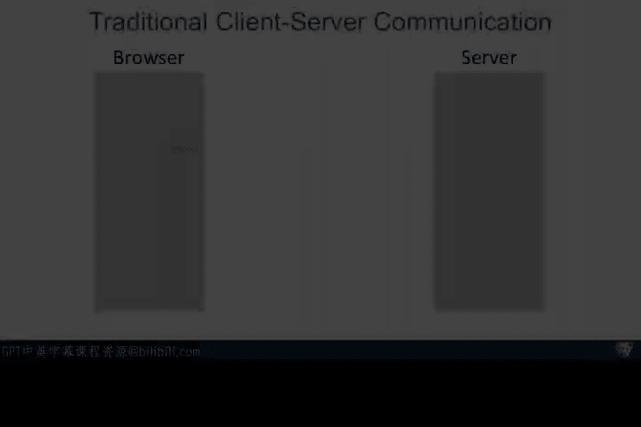
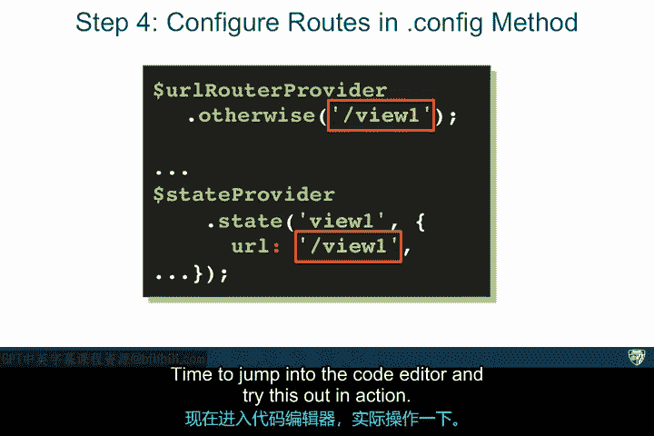

# 075：路由 🧭


在本节课中，我们将要学习单页应用（SPA）的核心概念——路由。我们将探讨传统Web应用与单页应用在处理页面视图切换时的不同方式，并重点介绍如何在AngularJS应用中使用UI Router来实现路由功能。

## 概述：从传统应用到单页应用

在传统Web应用中，每次视图切换都需要向服务器请求完整的HTML页面。这种方式被称为**粗粒度更新**，因为即使是很小的内容变化，也需要传输整个页面的数据。其流程可以概括为：

**传统请求流程：**
```
浏览器请求 `/page1.html` -> 服务器处理并返回 `page1.html` 内容 -> 浏览器渲染
用户点击链接 -> 浏览器请求 `/page2.html` -> 服务器处理并返回 `page2.html` 内容 -> 浏览器重新渲染
```



随着Ajax技术的引入，情况得到了改善。浏览器可以在不刷新页面的情况下，通过后台请求向服务器获取少量数据，然后动态更新页面内容。这被称为**细粒度更新**。然而，这种方法存在一个主要缺点：浏览器的**后退**和**前进**按钮会失效，因为视图切换的逻辑由JavaScript控制，并未反映在浏览器的历史记录中。

上一节我们介绍了传统Web应用与Ajax应用的导航方式，本节中我们来看看单页应用是如何解决这些问题的。

## 单页应用（SPA）的路由原理

在单页应用模型中，初始交互与传统方式相同：浏览器请求 `index.html`，服务器返回包含CSS和JavaScript的页面内容。之后的关键在于，视图切换由客户端（浏览器中的JavaScript）处理，而不是服务器。

其核心机制是利用URL中的**哈希片段**。当用户点击一个指向新视图的链接时，URL会变为类似 `index.html#/view1` 的形式。`#` 符号（哈希）之后的部分不会导致浏览器向服务器发起新请求，但可以被JavaScript检测并处理。

**SPA路由示例：**
```javascript
// 哈希 URL 示例
http://example.com/index.html#/products
http://example.com/index.html#/products/3
```

JavaScript（具体来说是路由库）会监听URL中哈希部分的变化。当哈希变化时，路由库会执行相应的操作，例如：
1.  可能发起一个Ajax请求来获取对应视图的HTML模板。
2.  将获取到的模板内容插入到页面中指定的容器内。

由于哈希变化会更新浏览器地址栏的URL，因此它会**自动被添加到浏览器的历史记录中**。这使得浏览器的后退和前进按钮可以正常工作。

此外，通过配置服务器（HTML5模式），现代SPA甚至可以去掉URL中的 `#` 符号，使用更简洁的URL，但本课程中我们将继续使用哈希模式。

## 视图状态与UI Router

除了基于URL的路由，还有一种更通用的导航方式：**基于状态**。在这种方式中，每个视图被表示为一个**视图状态**，即一个JavaScript对象，它包含了重现该视图所需的所有数据。

以下是两种路由方式的对比：

**基于URL的路由：**
*   状态通过唯一的URL字符串编码。
*   导航通过改变URL触发。

**基于状态的路由（如UI Router）：**
*   状态通过JavaScript对象编码。
*   导航通过改变程序内部的状态对象触发。
*   URL可以不更新，或者作为状态的一个可选属性。

对于AngularJS应用，有两个常用的路由包：`ngRoute` 和 `UI Router`。

*   **`ngRoute`**：由Google和社区开发，是AngularJS的一个独立模块。它**必须**为每个路由配置一个URL，且**不支持嵌套视图**。适合用于原型或简单项目。
*   **`UI Router`**：由社区开发的开源项目。它以**UI状态**为核心概念，URL路由是其支持的功能之一。它**支持嵌套视图**和更灵活的状态管理，是构建复杂单页应用的更好选择。

鉴于 `UI Router` 功能更强大，本课程将重点讲解它。一旦掌握了 `UI Router`，使用 `ngRoute` 也会非常容易。

## 使用UI Router的基本步骤

现在，让我们来看看在AngularJS应用中使用 `UI Router` 的基本步骤。

### 步骤1：引入脚本文件

首先，需要在HTML文件中引用 `UI Router` 的JavaScript库。由于它依赖于AngularJS核心库，所以必须在AngularJS核心库之后引入。

```html
<script src="angular.js"></script>
<script src="angular-ui-router.js"></script>
```

### 步骤2：设置视图容器

接下来，在HTML页面中指定一个位置，作为动态加载视图的容器。这是通过 `UI Router` 提供的自定义指令 `ui-view` 实现的。

```html
<div ui-view></div>
<!-- 当某个状态被激活时，其对应的模板内容将插入到这个 div 中 -->
```

### 步骤3：声明模块依赖

在创建AngularJS应用模块时，需要将 `ui.router` 声明为依赖项。注意模块名是 `ui.router`（使用点号），而项目名是 `ui-router`（使用连字符）。

```javascript
angular.module('myApp', ['ui.router']);
```

### 步骤4：配置状态与路由

`UI Router` 通过 `$stateProvider` 和 `$urlRouterProvider` 这两个服务来管理状态和URL路由。在使用它们之前，需要在 `config` 函数中进行配置。

以下是配置一个简单状态的方法：

```javascript
angular.module('myApp').config(function($stateProvider, $urlRouterProvider) {

  // 配置状态
  $stateProvider
    .state('view1', { // 状态名称
      url: '/view1', // 关联的URL（可选）
      template: '<h1>这是视图1的内容</h1>' // 状态的HTML模板
    })
    .state('view2', {
      url: '/view2',
      templateUrl: 'templates/view2.html' // 通过URL指定外部模板文件
    });

  // 配置默认路由（当没有匹配的URL时）
  $urlRouterProvider.otherwise('/view1');
});
```

*   **`.state()`** 方法用于定义应用中的各个状态。每个状态有一个唯一的名字，并可选择性地关联一个URL和一个模板。
*   **`.otherwise()`** 方法用于定义默认路由。当用户输入的URL无法匹配任何已定义的状态时，应用将重定向到这个默认URL。

## 总结

本节课中我们一起学习了单页应用路由的核心知识。我们首先回顾了传统多页应用和Ajax应用在导航上的局限性，然后深入探讨了单页应用如何利用**哈希URL**来实现无刷新视图切换，并保持浏览器历史记录的正常工作。

我们比较了 `ngRoute` 和 `UI Router` 两个路由库，并解释了为什么 `UI Router` 因其**以状态为中心**的设计和对**嵌套视图**的支持而成为更强大、更灵活的选择。

最后，我们一步步讲解了在AngularJS项目中集成和使用 `UI Router` 的四个基本步骤：
1.  引入脚本文件。
2.  在HTML中使用 `ui-view` 指令设置视图容器。
3.  将 `ui.router` 声明为应用模块的依赖。
4.  使用 `$stateProvider` 配置应用状态，并使用 `$urlRouterProvider` 配置默认路由。




掌握这些基础知识后，你就可以开始构建具有多个视图并能流畅切换的单页Web应用了。在接下来的课程中，我们将通过实际编码来巩固这些概念。