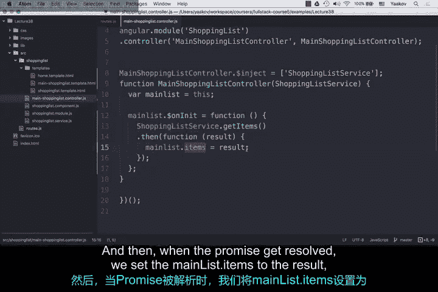
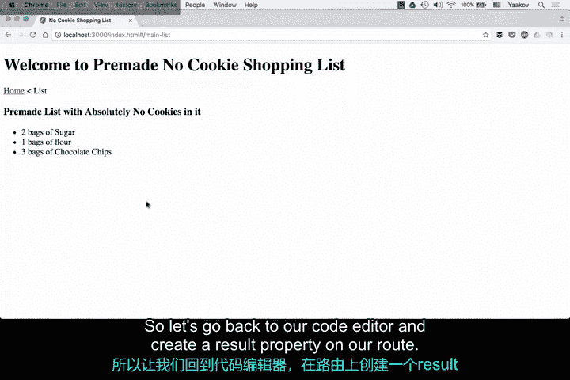
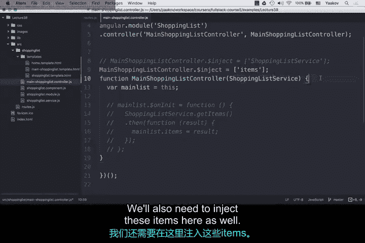
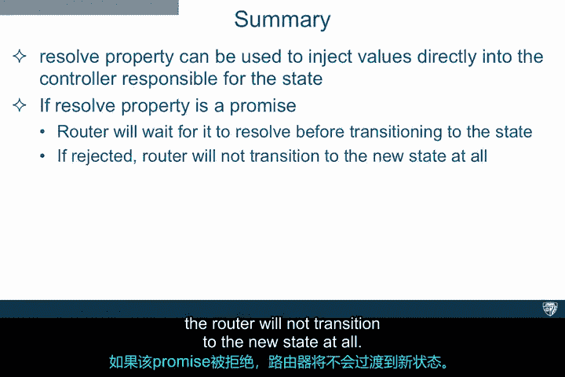

# 080：带resolve的路由状态

在本节课中，我们将学习如何在 AngularJS 的 UI-Router 中使用 `resolve` 属性。`resolve` 允许我们在路由状态切换之前预先获取数据，确保控制器在初始化时就已经拥有所需的数据，从而避免视图加载后数据才延迟到达的尴尬情况。

上一节我们介绍了异步服务在控制器中的基本用法，本节中我们来看看如何使用 `resolve` 来优化数据加载流程。

## 初始状态分析

我们当前的应用与第37讲结束时完全相同。在 `mainList` 状态中，我们有一个名为 `MainShoppingListController` 的控制器。如果现在查看这个控制器，可以看到在 `$onInit` 生命周期钩子中，我们调用了 `ShoppingListService` 这个异步服务。当 Promise 被解析后，我们将返回的数组结果赋值给 `mainList.items`。

在浏览器中测试此行为时，点击链接跳转到 `mainList` 状态，你会看到视图立即加载，但列表数据大约在800毫秒后才出现。这是因为我们先切换了视图，然后再去获取数据。

这种方式不仅视觉效果不佳，而且在视图加载时我们并不清楚其中是否包含任何数据。

## 配置 resolve 属性

让我们回到代码编辑器，在路由状态上创建一个 `resolve` 属性。

我们回到 `routes.js` 文件。除了声明 `MainShoppingListController` 作为 `mainList` 状态的控制器，我们还需要添加一个 `resolve` 属性。

`resolve` 属性将包含一个名为 `items` 的项。`items` 属性的值是一个函数，该函数返回由 `ShoppingListService.getItems()` 方法提供的 Promise。

以下是配置 `resolve` 的步骤：

1.  首先，我们需要注入 `ShoppingListService` 以保护其不被篡改。
2.  然后，定义一个函数，在该函数中调用服务并返回 Promise。

配置完成后，UI-Router 会等待 `items` 属性对应的 Promise 被解析，然后才会将我们切换到 `mainList` UI 状态。

## 修改控制器

现在数据已经在状态转换时预先获取，我们需要修改控制器。

我们不再需要在控制器的 `$onInit` 中调用服务。相反，我们需要注入由 `resolve` 解析得到的 `items` 数据。

修改后的控制器只需将传入的 `items` 直接赋值给 `mainList.items` 即可。

## 测试与验证

保存所有更改后，返回浏览器进行测试。

现在，当你点击链接时，页面不会立即跳转。UI-Router 会等待数据获取完成（大约800毫秒），然后整个视图和数据会同时立即显示出来。这意味着异步通信发生在你点击链接的瞬间，而不是点击之后。当控制器被调用时，它已经拥有了全部数据，因此可以立即渲染。

我们还顺便修正了一个变量名大小写不一致的问题，以确保代码风格统一。

## resolve 属性总结

本节课中我们一起学习了 `resolve` 属性的核心用法，现在让我们来总结一下要点：

*   `resolve` 属性用于将值直接注入到负责该状态的控制器中，它在状态配置中声明。
*   如果 `resolve` 属性是一个 Promise，路由器会等待该 Promise 解析成功后才切换到新状态。
*   如果 Promise 被拒绝，路由器将完全不会切换到新状态。
*   `resolve` 属性对象中的键名，就是将要注入到对应控制器函数中的参数名。
*   虽然 `resolve` 常用于在状态切换前解析 Promise，但它实际上可以包含任何类型的值，例如对象、字符串等。

通过使用 `resolve`，我们确保了视图和数据同步加载，提供了更流畅的用户体验。