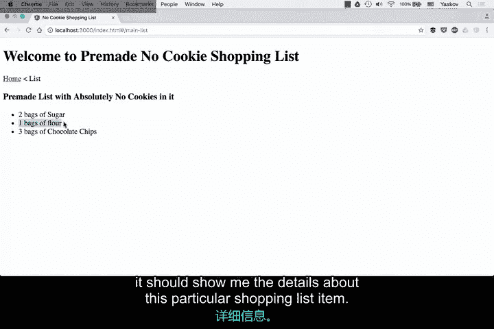
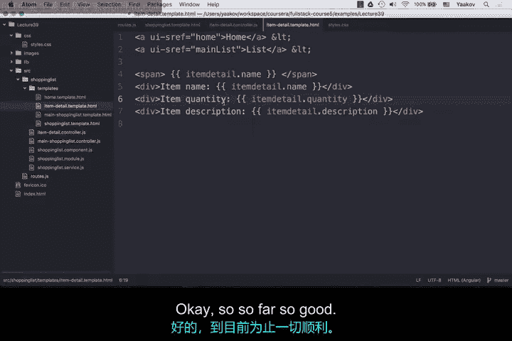
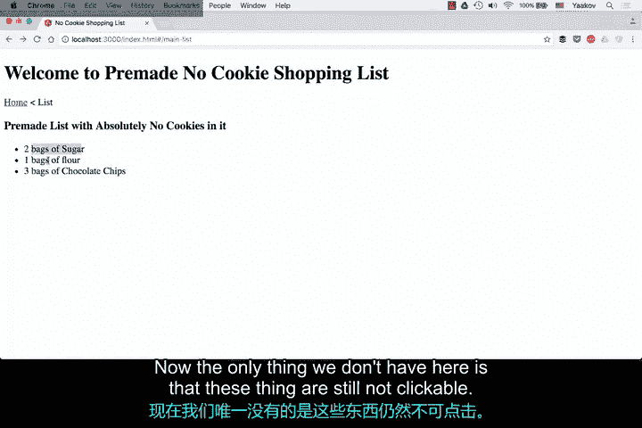
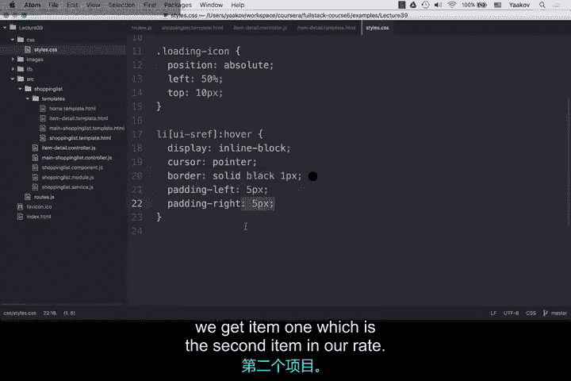
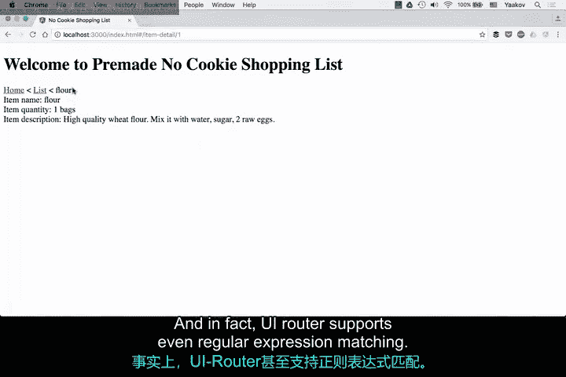
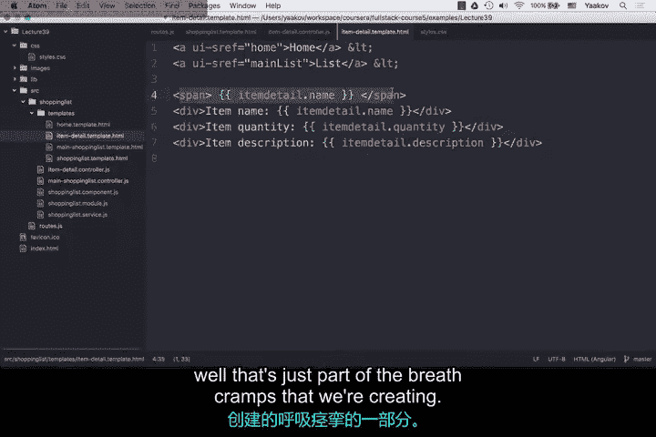
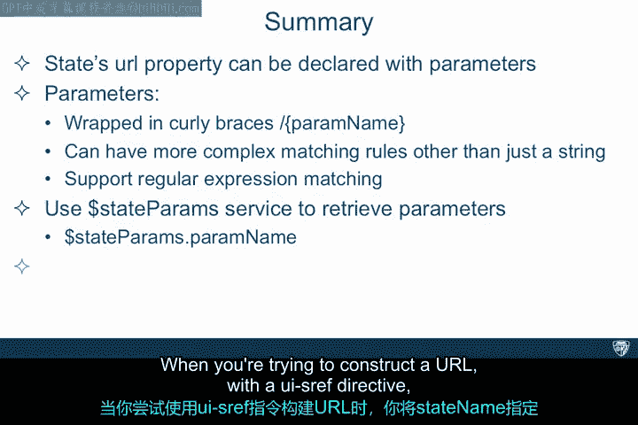
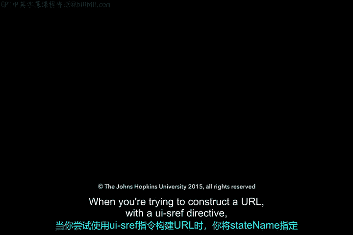

# 082：带URL参数的路由状态 🧭


在本节课中，我们将学习如何在 AngularJS 应用中配置和使用带参数的路由状态。我们将通过一个购物清单应用的例子，实现点击列表项查看其详细内容的功能。

---



## 项目初始状态

上一节我们介绍了基本的应用结构。本节中我们来看看如何为列表项添加详情页面。

当前应用是第38讲内容的副本。在浏览器中，我们有一个“预制的无饼干购物清单”。点击它，列表会显示出来。我们的目标是让列表中的每一项都可以点击，点击后显示该购物清单项的详细信息。

在 `shoppingListService.js` 服务中，除了名称和数量，每个项还有一个描述字段。我们需要能够逐一访问这些描述。

---

## 配置详情页路由状态

首先，我们需要在 `routes.js` 文件中添加一个显示项详情的新状态。

以下是添加新状态的步骤：

1.  在文件底部，添加一个名为 `itemDetail` 的新状态。
2.  配置状态的 `url` 属性为 `/item-detail/{itemId}`。这里的 `{itemId}` 是一个参数，用于标识我们要查看的项在数组中的索引（0、1 或 2）。
3.  设置 `templateUrl` 指向一个已存在的模板文件：`src/shoppinglist/templates/itemdetail.template.html`。这个模板会显示项的名称、数量和描述。
4.  指定控制器为 `ItemDetailController`。
5.  添加一个 `resolve` 属性。这个属性用于在状态激活前解析数据。我们将注入 `$stateParams` 服务来获取 URL 参数，并注入 `ShoppingListService` 来获取数据。

以下是 `resolve` 属性的配置代码：

```javascript
resolve: {
    item: ['$stateParams', 'ShoppingListService',
        function ($stateParams, ShoppingListService) {
            return ShoppingListService.getItems().then(function (items) {
                return items[$stateParams.itemId];
            });
        }]
}
```

这段代码的作用是：首先调用服务获取所有项，然后根据 `$stateParams.itemId` 参数的值，从返回的项数组中取出对应的单个项。这个解析出的 `item` 对象随后会被注入到控制器中。

---

## 设置详情页控制器

接下来，我们需要设置 `ItemDetailController` 来接收并使用解析出的数据。

以下是控制器的设置步骤：

1.  使用 `$inject` 属性数组来保护控制器代码，防止压缩后出错。
2.  将解析出的 `item` 对象注入到控制器中。
3.  将 `item` 对象的属性（`name`, `quantity`, `description`）赋值给控制器实例（`$scope` 或 `this` 的别名），以便模板可以访问它们。

以下是控制器代码示例：

```javascript
(function () {
    'use strict';

    angular.module('ShoppingList')
        .controller('ItemDetailController', ItemDetailController);

    ItemDetailController.$inject = ['item'];
    function ItemDetailController(item) {
        var itemDetail = this;
        itemDetail.name = item.name;
        itemDetail.quantity = item.quantity;
        itemDetail.description = item.description;
    }
})();
```

---

## 使列表项可点击

现在，我们需要修改主列表的模板，让每个列表项都能链接到其详情页。

在主列表模板（例如 `shoppinglist.template.html`）中，我们使用 `ng-repeat` 循环显示项。我们需要为每个列表项添加一个可点击的链接。

使用 `ui-sref` 指令来创建指向 `itemDetail` 状态的链接，并传递当前项的索引作为 `itemId` 参数。





以下是列表项链接的代码示例：

```html
<li ng-repeat="item in $ctrl.items">
    <a ui-sref="itemDetail({itemId: $index})">
        {{ item.quantity }} of {{ item.name }}
    </a>
</li>
```

这里，`$index` 是 `ng-repeat` 提供的当前项的索引。

此外，我们还通过 CSS 为这些链接添加了悬停效果（例如，光标变为手形、添加边框等），以提供更好的用户体验。

---

## 测试功能

完成以上步骤后，保存所有文件并刷新浏览器。



现在，当你将鼠标悬停在购物清单的某个项上时，光标会变成指针，表明它是可点击的。点击任意一项，浏览器地址栏的 URL 会变为类似 `#/item-detail/1` 的格式，并跳转到该商品的详情页面，显示其名称、数量和描述。

你可以通过页面上的导航链接（如“返回列表”）或浏览器的后退按钮，返回到主列表页面。

---





## 总结

本节课中我们一起学习了如何配置和使用带 URL 参数的路由状态。

*   **定义带参数的路由**：在状态的 `url` 属性中，使用花括号 `{}` 包裹参数名，例如 `/item-detail/{itemId}`。
*   **获取路由参数**：在 `resolve` 函数或控制器中，通过注入 `$stateParams` 服务来获取 URL 中的参数值，例如 `$stateParams.itemId`。
*   **生成带参数的链接**：使用 `ui-sref` 指令，将状态名作为函数调用，并传入一个对象来指定参数值，例如 `ui-sref="itemDetail({itemId: $index})"`。
*   **数据预解析**：利用状态的 `resolve` 属性，在进入路由前异步获取所需数据，确保控制器能立即使用。





通过结合这些技术，我们成功构建了一个交互式的单页应用，用户可以从列表导航到任何项目的详细视图。