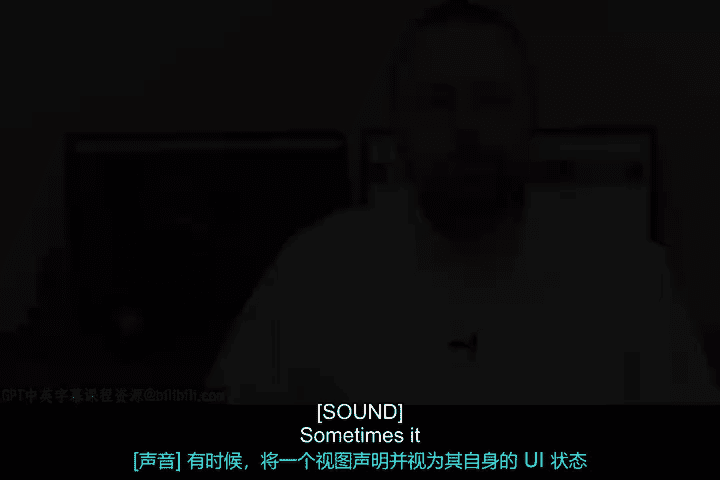
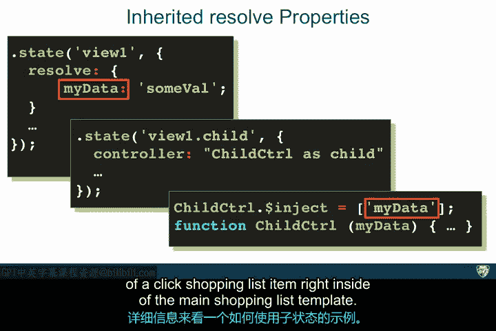

# 083：带嵌套视图的路由状态 🧭


在本节课中，我们将要学习如何使用 AngularJS UI-Router 创建嵌套的视图状态，特别是掌握“主从视图”模式。这种模式允许我们在不离开主视图的情况下，显示某个项目的详细信息，从而提升用户体验并优化数据加载。



---

有时，将一个视图声明并作为独立的 UI 状态来处理并不合理。

例如，我们经常有一个项目列表。当用户点击列表中的某个项目时，用户希望在不离开显示整个列表的视图的情况下，看到该项目的详细信息。

这两个视图——一个是完整的项目列表，另一个是特定项目的详细信息——通常被称为“主从视图对”。

并非所有的主从视图对都适合同时显示在用户屏幕上，但有些情况确实如此。UI-Router 一个非常有用的特性是：子状态会继承父状态的 `resolves` 和自定义数据属性。

这意味着，如果父状态已经向服务器发起调用并获取了数据，子状态就无需重复这个过程。它可以直接使用父状态已有的数据，而无需再次调用服务器。

---

上一节我们介绍了嵌套状态的概念，本节中我们来看看如何声明一个子状态。

子状态通常使用点符号来声明，以指定父状态名称和子状态名称。

```javascript
.state('parentState', {
  // 父状态配置
})
.state('parentState.childState', {
  // 子状态配置
})
```

当以这种方式设置，并且子状态分配了自己的 URL 时，其 URL 会拼接在父状态声明的 URL 之后。

例如，如果父状态的 URL 是 `/view1`，那么这个子状态的 URL 将是 `/view1/detail/:param1`。

拥有子状态还意味着，在父状态的模板中某个位置，需要声明一个 `ui-view` 指令，子状态的模板可以插入到这个视图中。

这种设置与直接放在主 HTML 页面中的 `ui-view` 指令没有本质区别。

---

关于继承的 `resolve` 属性，其工作方式如下。

假设父状态声明了一个名为 `myData` 的 `resolve` 属性。如果声明了一个控制器名为 `childCtrl` 的子状态，这意味着我们可以直接将 `myData` 属性注入到子控制器的函数中。

```javascript
.state('parentState', {
  resolve: {
    myData: function(SomeService) {
      return SomeService.getData();
    }
  }
})
.state('parentState.childState', {
  controller: 'childCtrl'
})

// 在子控制器中
app.controller('childCtrl', function(myData) {
  // 可以直接使用父状态获取的 myData
});
```

在许多场景中，这种设置允许我们避免额外的服务器端调用，因为我们可以重用父状态激活时预取的数据。

---

让我们通过一个示例，来看看如何使用子状态，在主要的购物清单模板内部显示被点击的购物清单项目的详细信息。

以下是实现此功能的关键步骤：

1.  **定义父状态**：首先，定义一个显示购物清单列表的父状态。
2.  **定义子状态**：然后，定义一个子状态来处理显示单个项目的详细信息。其 URL 可能包含项目 ID 作为参数。
3.  **在父模板中添加 `ui-view`**：在父状态（列表）的模板中，添加一个 `ui-view` 指令容器，用于承载子状态（详情）的模板。
4.  **利用数据继承**：确保父状态的 `resolve` 获取了列表数据。子状态可以直接使用这些数据来查找和显示特定项目的详细信息，无需再次请求整个列表。

通过这种方式，当用户点击列表中的项目时，URL 会更新，子状态被激活，其模板被渲染到父模板预留的 `ui-view` 区域中，从而实现流畅的主从视图体验。



---


本节课中我们一起学习了 UI-Router 的嵌套状态功能。我们了解到，通过创建子状态并利用其继承父状态数据和 `resolve` 的特性，可以高效地构建“主从视图”界面。这种方法不仅提升了应用的交互流畅度，还通过避免重复的数据请求优化了性能。在接下来的课程中，我们将继续探索更多高级的路由技巧。