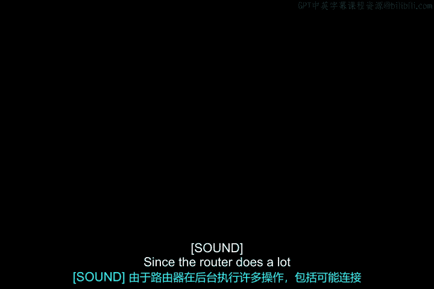
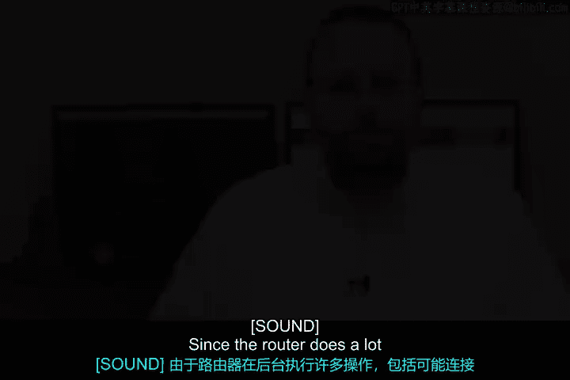
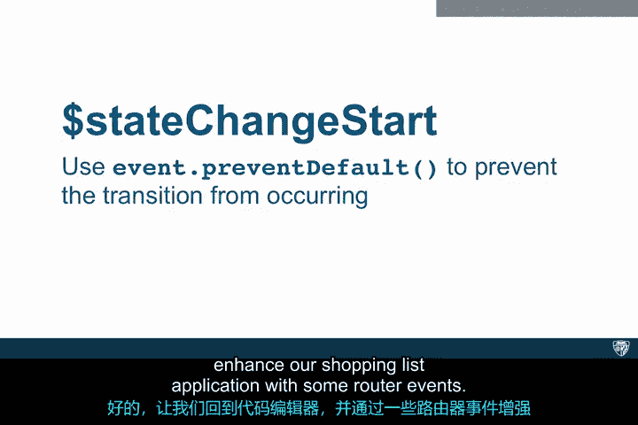

# 085：路由器状态转换事件

## 概述

在本节课中，我们将学习 AngularJS UI-Router 提供的路由器状态转换事件。路由器在后台执行许多操作，包括可能向服务器请求数据。因此，能够监听路由器执行功能时触发的不同事件非常有用。我们将了解如何利用这些事件来增强应用的用户体验，例如显示加载指示器或处理错误。

## 事件广播机制

所有路由器事件都在 `$rootScope` 级别触发。这意味着所有事件都会沿着文档对象模型树向下广播，任何节点都可以响应这些事件。

虽然 UI-Router 提供了许多事件，但我们不会逐一介绍。接下来，我们将重点看几个在示例中会用到的关键事件。如需完整的事件列表及其触发时机，请参阅 UI-Router 官方文档。

## 核心状态转换事件

以下是几个重要的状态转换事件及其用途。

### 状态转换开始事件

第一个事件是 `$stateChangeStart`。该事件在状态转换过渡开始时触发。如果你知道某个操作可能需要较长时间，或者需要等待服务器响应，此时通常是启动某种加载指示器（如旋转图标）的好时机，以告知用户系统正在处理。

### 状态转换成功与错误事件

当状态转换成功完成时，会触发 `$stateChangeSuccess` 事件。如果你在 `$stateChangeStart` 事件中启动了加载指示器，现在就是关闭它的时候，因为转换已经完成。

同样，如果在转换过程中发生错误，则会触发 `$stateChangeError` 事件。UI-Router 文档指出了一个重要点：如果在你的 `resolve` 函数中发生任何错误，它们不会以传统方式抛出。换句话说，你在控制台中将看不到任何错误，一切看起来都正常，但实际上存在错误。你必须监听 `$stateChangeError` 事件，才能捕获状态更改期间发生的所有错误。

### 阻止状态转换

如果你想在转换开始时根据某些数据评估来捕获并阻止转换发生，可以在事件对象上调用 `preventDefault()` 方法。这将阻止转换继续进行，本质上取消了它。

## 过渡到实践

上一节我们介绍了路由器状态转换事件的核心概念，本节中我们来看看如何将它们应用到代码中。

现在，让我们回到代码编辑器，使用一些路由器事件来增强我们的购物清单应用程序。