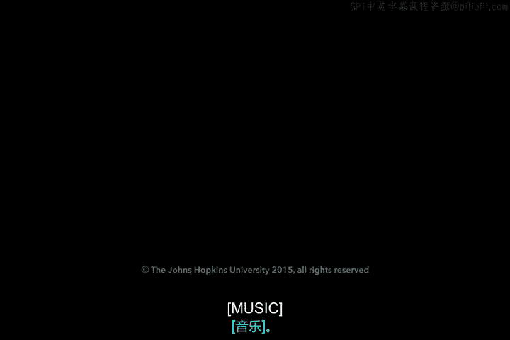

**AngularJS 单页应用开发：模块4：模块四总结**

在本节中，我们将对模块四的学习内容进行回顾与总结，并展望接下来的学习旅程。

恭喜你完成了模块四的学习。你现在掌握的技能，已经足以开发出设计精良、优雅的单页Web应用。剩下的就是多加练习。

在下一个模块中，我们将暂时离开课堂，进入真实世界。你将和我一起进行一次有趣的实地考察，拜访真实的客户并了解他们的业务。

然后，你将坐在我旁边，亲眼目睹我编写一个真实的、将被真实用户使用的AngularJS应用程序。

虽然代码仍将由我来编写，但你将能够近距离、一步步地观察一个真实AngularJS Web应用的完整创建过程。

我们下一个模块再见。

---

本节课中，我们一起回顾了模块四的成就，并预告了下一模块将进入实战环节，通过观察真实项目的开发过程来深化对AngularJS的理解。