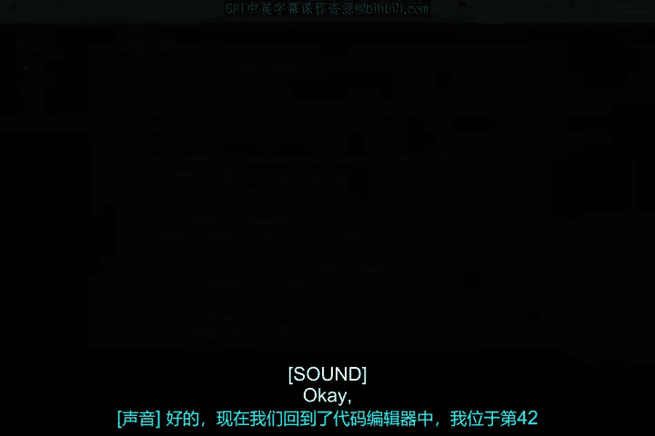
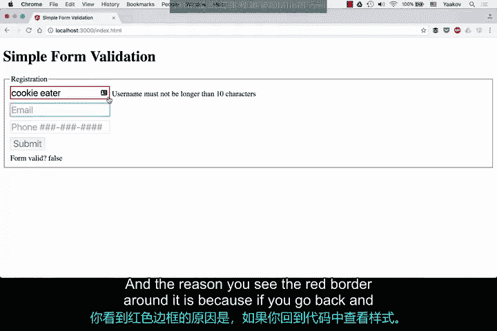
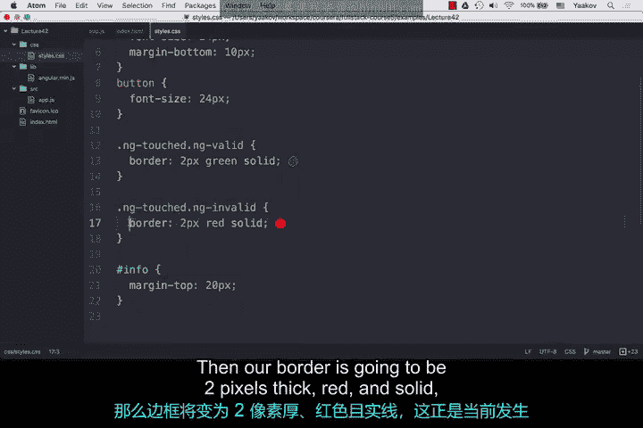
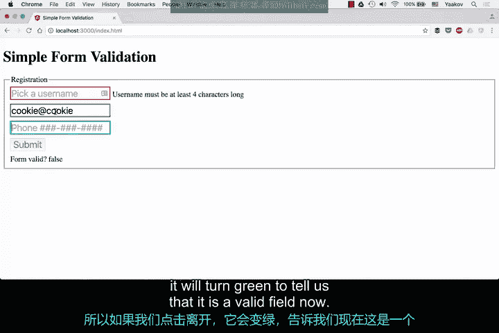
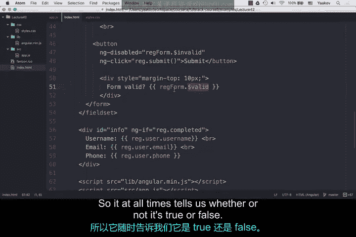
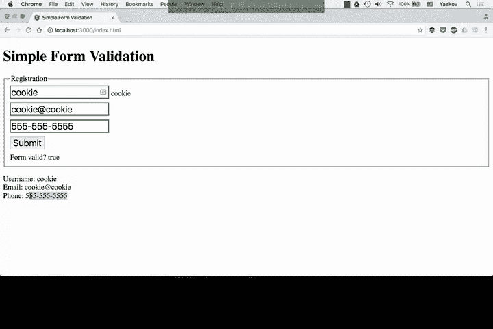

# 090：表单验证




在本节课中，我们将学习如何在 AngularJS 应用中进行表单验证。我们将通过一个简单的注册表单示例，了解如何为输入字段添加验证规则，如何根据验证状态显示错误信息，以及如何控制表单的整体提交状态。

---

## 项目结构与表单概览

我们位于课程第42讲的示例文件夹中，项目名为 `simple forms app`。该应用包含一个名为 `registration controller` 的控制器，以及一个用于用户注册的简单表单。表单包含三个输入字段：用户名、邮箱地址和电话号码。

## 绑定输入字段与模型

首先，我们需要将表单中的输入字段绑定到控制器中的数据模型上。这通过 `ng-model` 指令实现。

以下是用户名输入字段的代码示例：
```html
<input type="text" name="username" ng-model="reg.user.username" required minlength="4" ng-maxlength="10" />
```
我们使用 `reg.user.username` 作为模型路径，目的是将所有注册信息都组织在控制器实例的 `user` 对象下。这样，邮箱和电话号码字段可以分别绑定到 `reg.user.email` 和 `reg.user.phone`。

## 添加验证规则

在输入字段上，我们通过 HTML5 属性或 AngularJS 指令声明验证规则。

*   **`required`**： 表示该字段不能为空。
*   **`minlength="4"`**： 表示输入内容至少需要4个字符。
*   **`ng-maxlength="10"`**： 这是 AngularJS 的指令，表示输入内容最多不能超过10个字符。

为了禁用浏览器的原生表单验证，我们在 `<form>` 标签上添加了 `novalidate` 属性。

## 显示验证错误信息

验证状态发生变化时，我们需要向用户提供清晰的反馈。AngularJS 的表单控制器会为每个字段维护一个 `$error` 对象。

以下是如何为用户名字段显示错误信息的示例：
```html
<span ng-if="regForm.username.$error.minlength || regForm.username.$error.required">
  用户名必须至少包含4个字符。
</span>
<span ng-if="regForm.username.$error.maxlength">
  用户名不能超过10个字符。
</span>
```
*   `regForm.username.$error.minlength` 在输入字符数少于 `minlength` 时变为 `true`。
*   `regForm.username.$error.required` 在字段为空时变为 `true`。
*   `regForm.username.$error.maxlength` 在输入字符数超过 `ng-maxlength` 时变为 `true`。

我们使用 `ng-if` 指令来控制错误信息的显示。注意，`minlength` 验证仅在字段有输入时触发，而 `required` 验证检查字段是否为空。因此，我们使用逻辑或 (`||`) 来确保在用户未输入任何内容时也能显示“至少4个字符”的提示。

此外，错误信息只在用户与字段交互（“触碰”过）后才显示。这是通过检查 `regForm.username.$touched` 属性实现的。完整的条件如下：
```html
<span ng-if="(regForm.username.$error.minlength || regForm.username.$error.required) && regForm.username.$touched">
```

## 理解模型更新与验证状态

一个关键行为是：**只有当字段通过所有验证后，输入框中的值才会更新到 `ng-model` 绑定的模型属性中**。

例如，在用户名输入框中键入“CO”（仅2个字符），由于未满足 `minlength=4` 的规则，字段处于无效状态。此时，`reg.user.username` 的值不会被更新，因此页面上用于实时显示该值的插值表达式 `{{reg.user.username}}` 也不会显示内容。只有当输入满足所有规则（如“Cookie”）后，模型才会更新，插值表达式也随之显示。

## 通过样式提供视觉反馈

我们可以通过 CSS 为不同验证状态的输入框添加样式，提供更直观的视觉反馈。

以下是一个样式规则示例：
```css
input.ng-touched.ng-invalid {
  border: 2px solid red;
}
input.ng-valid {
  border: 2px solid green;
}
```
*   `ng-touched`： 当用户点击过该输入框并离开后，AngularJS 会自动添加此类名。
*   `ng-invalid` / `ng-valid`： 分别表示字段的验证状态为无效或有效。





当用户与一个无效的字段交互后，该输入框会获得红色边框。当字段内容有效时，边框会变为绿色。

## 验证邮箱与电话号码字段

上一节我们介绍了用户名字段的验证，本节我们来看看邮箱和电话号码字段的验证有何不同。

**邮箱字段验证：**
邮箱字段的输入类型被设置为 `type="email"`。浏览器和 AngularJS 会基于此类型提供一个内置的邮箱格式验证。我们只需添加 `required` 属性即可。
错误信息通过检查 `regForm.email.$invalid` 状态来显示。

**电话号码字段验证：**
电话号码字段使用了 `ng-pattern` 指令进行基于正则表达式的验证。
```html
<input type="text" ... ng-pattern="/^\d{3}-\d{3}-\d{4}$/" />
```
这里的正则表达式 `/^\d{3}-\d{3}-\d{4}$/` 要求输入格式必须为“三位数字-三位数字-四位数字”（例如 123-456-7890）。如果输入不符合该模式，`regForm.phone.$error.pattern` 将变为 `true`。

## 控制表单提交按钮

最后，我们需要根据整个表单的验证状态来控制提交按钮。



以下是提交按钮的代码：
```html
<button ng-disabled="regForm.$invalid" ng-click="reg.submit()">提交</button>
```
*   `ng-disabled="regForm.$invalid"`： 当表单中存在任何无效字段时（即 `regForm.$invalid` 为 `true`），按钮将被禁用。
*   `ng-click="reg.submit()"`： 当按钮可点击时，点击会触发控制器中定义的 `submit` 方法。

在控制器中，`submit` 方法可以设置一个标志（例如 `reg.completed = true`），用于在页面上显示注册成功的摘要信息。

## 实时监控表单整体状态

在开发过程中，我们可以通过插值表达式 `{{regForm.$valid}}` 在页面上实时显示表单的整体有效状态（`true` 或 `false`），这有助于调试和理解验证逻辑。



例如，当所有字段都有效时，`{{regForm.$valid}}` 会显示 `true`，提交按钮随之启用。如果任一字段无效，则显示 `false`，按钮保持禁用状态。

---




本节课中我们一起学习了 AngularJS 表单验证的核心机制。我们掌握了如何将输入字段绑定到数据模型，如何为字段添加各种验证规则（必填、长度、格式等），以及如何利用 AngularJS 提供的 `$error`、`$touched`、`$invalid` 等状态属性来显示错误信息、添加视觉反馈并控制表单的提交流程。通过本讲的学习，你将能够为你的 AngularJS 应用构建出交互友好、健壮可靠的表单。