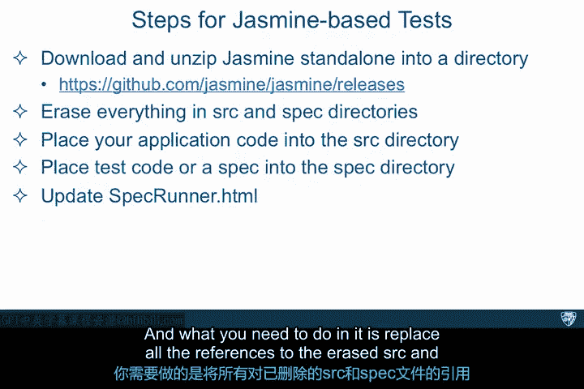
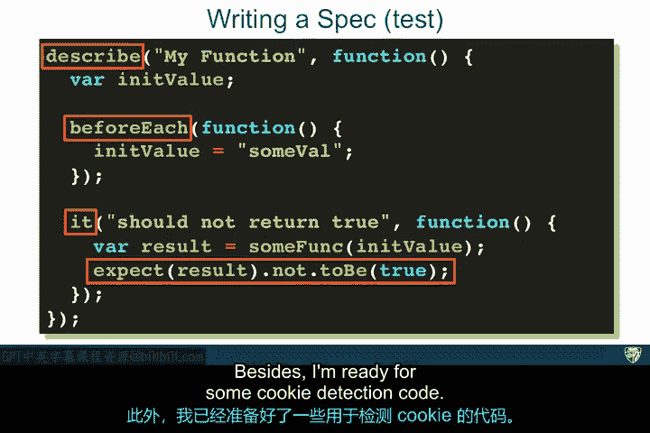

# 091：使用Jasmine测试JavaScript 🧪

## 概述
在本节课中，我们将要学习JavaScript单元测试的重要性，并介绍如何使用Jasmine测试框架来编写和运行测试。我们将从单元测试的基本概念开始，逐步深入到Jasmine的具体使用方法。

## 单元测试的重要性
由于JavaScript的动态类型特性，只要你知道JavaScript如何工作，编写代码可以是一种不受约束的体验。

但这种自由是以牺牲强类型语言（如Java）中存在的即时错误报告特性为代价的。这就是为什么在将JavaScript代码交付给用户之前进行测试非常重要。你不希望等到用户打电话告诉你某些功能损坏了，才发现仅仅是因为某个地方变量名拼写错误。如果在完成前就执行了代码，这类错误本可以避免。

现代软件开发很少在不编写单元测试的情况下完成。这已经是流程的一部分。

## 什么是单元测试？
单元测试是对应用程序中最小可测试部分的独立检查，以确保其正常运行。

单元测试是一个非常强大的概念。这个定义包含了很多内容。让我们逐步分解它。

首先，它是独立的。尽可能将你正在测试的小功能片段与应用程序的其余部分隔离开来非常重要。你需要确保只测试那一小部分，而不是整个系统。整个系统测试有其位置，但那不是单元测试。在单元测试中，我们只想验证这一小部分是否按预期运行。系统的其余部分无关紧要。

试想测试汽车轮胎在高温环境下保持胎压的能力。你不会为了测试这个而组装整辆汽车。这不仅非常耗时，还会将其他与胎压无关的问题引入测试。

定义中“最小可测试部分”也暗示你，将单元测试纳入开发过程会彻底改变你处理软件开发其余部分的方式。换句话说，你不能编写一个做20件不同事情的函数，然后期望它小而可测。

你测试的每个函数或组件都必须专注于单一功能或小结果。将整个应用程序包装成一个做所有事情的函数会使单元测试变得不可能，因为“单元”意味着小而专注。无论你是否接受测试驱动开发的最纯粹方法，这一点都成立。

## 单元测试的特性
单元测试还应编写成可重复的。这意味着，当你向代码库添加更多功能时，重新运行现有的单元测试并看到它们全部通过，应该能让你确信新添加的代码没有破坏某些现有功能。

但是，如果你的小单元代码有一个相当大且复杂的依赖项怎么办？你仍然需要在不依赖该依赖项的情况下测试那个小单元代码。这个问题的答案是**模拟**。

模拟是一种模仿依赖项及其行为，或者只是使用已知假对象的技术。模拟可以直接由开发人员完成，也可以使用模拟库。模拟库通常会提供更复杂或更通用的方式来与你试图模拟的某些功能进行交互。

例如，如果你的组件依赖于进行AJAX调用的`$http`服务，你将需要模拟`$http`服务，以便在单元测试中伪造服务器响应，来验证你的组件是否确实发生了预期的行为。

## 引入Jasmine测试框架
当然，你可以在没有任何其他框架帮助的情况下编写自己的单元测试。然而，使用一个附带大量工具来帮助你设置测试、提供方法来帮助你验证得到的结果是否符合预期的测试框架会更容易。

Jasmine框架是一个非常流行的JavaScript测试框架，并且在测试Angular代码时效果很好。这就是我们将用来构建测试的工具。

你可以将Jasmine用作基于浏览器的独立测试框架或命令行框架。在本课程中，我将介绍基于浏览器的版本，但要意识到使用基于命令行的版本可以让你创建自动化测试的脚本，这是一个不容轻易忽视的巨大好处。

## 使用Jasmine的基本步骤
以下是使用Jasmine的基本步骤。

**第一步**：下载Jasmine独立版并解压到某个目录。你可以从这个URL下载，这是Jasmine测试框架发布版本的URL。下载并解压该发布版本后，删除`src`和`spec`目录中的所有内容。然后将你自己的应用程序代码放入`src`目录，并将你的测试代码或规范代码放入`spec`目录。顺便说一下，我们将测试称为“spec”的原因有点超出本课程范围，它与一种称为行为驱动开发（BDD）的方法有关。基本上，正如你将在我们的示例中看到的，测试代码读起来就像我们试图测试的功能的规范。

**第二步**：更新提供的HTML页面，该页面名为`SpecRunner.html`。你需要做的是将所有对已删除的源文件和规范文件的引用替换为你自己编辑到这些目录中的文件。换句话说，就是你的应用程序代码，然后是你的测试代码或规范代码。

**第三步**：启动类似BrowserSync的工具或你用于本地服务器的任何工具，并访问`http://localhost:3000/SpecRunner.html`（可能是类似`localhost:3000`的地址）。该网页将启动运行Jasmine独立版（即基于浏览器的版本，而非命令行版本）的所有测试。你可以让BrowserSync保持运行，并在浏览器中保持打开`SpecRunner.html`。这样，你就可以在编码时实时查看测试是否在你认为应该通过的时候失败了。

## 如何编写规范（测试）
那么，我们如何编写之前提到的规范呢？

编写规范或测试相当简单。你通过调用`describe`函数来开始所有规范。这个函数是我们将要运行的所有测试的容器。

接下来，你可以选择指定一个名为`beforeEach`的函数。作为参数传递给`beforeEach`函数的函数值将在每个规范运行之前被调用一次。这非常有用，因为在任何测试运行之前，我们必须确保测试运行的条件与我们需要的条件相同。如果你的代码由于其他测试执行而更改了某些数据，然后我们在认为应用程序处于某种状态（而实际并非如此）的情况下运行另一个测试，我们的结果可能是错误的，或者无论如何肯定不可靠。因此，在`beforeEach`函数内部，你可以初始化每个测试可能需要的任何数据、实例化任何服务等等。

`it`函数是实际的测试。请注意整个结构——`describe`字符串和`it`字符串一起读起来就像一个规范：“我的函数不应返回true”。

Jasmine提供了一套相当广泛的函数，你可以用来测试应用程序代码执行的结果。请注意，函数名称的设计也使其读起来像普通的英语。在Jasmine中，要否定某个期望语句，你只需将`.not`属性附加到它上面，然后继续调用验证语句。例如，这里我们期望结果不为true。

## 总结
本节课中，我们一起学习了JavaScript单元测试的重要性及其核心概念，包括独立性、可重复性和模拟。我们介绍了Jasmine测试框架，并详细说明了使用它的基本步骤：下载配置、编写规范以及运行测试。通过`describe`、`beforeEach`和`it`等函数，我们可以清晰地构建和组织测试用例，确保代码质量。