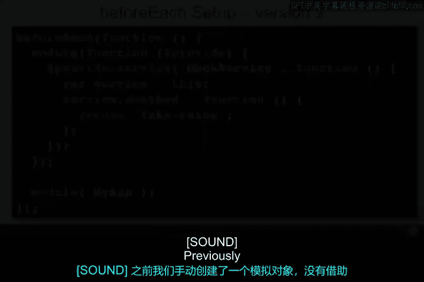
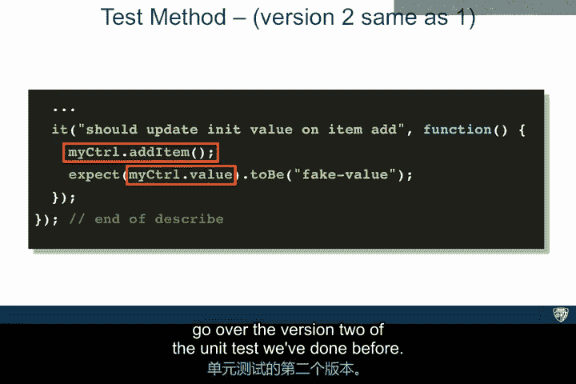

# 095：测试AngularJS控制器 🧪




## 概述
在本节课中，我们将学习如何使用 AngularJS 的 `$provide` 服务来创建模拟对象，并以此为基础测试控制器。我们将对比之前手动创建模拟对象的方法，介绍一种更集成、更符合 AngularJS 依赖注入机制的方式。

---

## 从手动模拟到使用 `$provide` 服务

上一节我们介绍了如何手动创建模拟对象来测试控制器。然而，AngularJS 提供了另一种创建服务、工厂等组件的方式，即使用 `$provide` 服务。

我们通常使用在 Angular 模块实例上直接调用的 `.service()`、`.factory()`、`.directive()` 等方法来创建组件。实际上，这些方法只是底层创建这些组件的真实 API 的快捷方式。这个真实的 API 就是 `$provide` 服务。

以下代码展示了如何注入 `$provide` 服务：
```javascript
angular.module('myModule', [])
  .config(function($provide) {
    // 使用 $provide 服务
  });
```
可以将 `angular.module` 函数视为我们之前注入提供者的 `.config` 函数。与 `.config` 方法类似，你不能在 `module` 方法中注入非提供者组件（如一个真实的服务）。为此，你必须使用一个单独的 Angular 模块注入器。

## 使用 `$provide` 定义模拟服务

接下来，我们使用 `$provide` 服务为我们的模块定义一个名为 `MenuService` 的模拟服务。
```javascript
angular.module('myModule', [])
  .config(function($provide) {
    $provide.service('MenuService', function() {
      // 模拟服务的实现
    });
  });
```
如你所见，我们在一行内就定义了它。一旦服务被定义，我们就可以使用其声明的字符串名称 `'MenuService'` 作为可以注入到其他调用中的依赖项。

在这种设置中，我们不需要使用局部变量来存储新创建的服务引用，以便与创建控制器的代码共享。我们根本不需要这样做，因为我们已经将这个模拟服务作为模块的一部分。现在，我们可以让 Angular 在需要时查找并注入它。

## 注入模拟服务并实例化控制器

下一步是使用 `$injector` 的 `get` 方法（或类似方式）来注入我们新创建的 `MenuService`，然后在实例化控制器时使用它。
```javascript
beforeEach(inject(function($controller, MenuService) {
  $scope = {};
  ctrl = $controller('MyController', { $scope: $scope, MenuService: MenuService });
}));
```
需要注意的是，根据你试图测试的内容，你可能不希望像在 `beforeEach` 中那样在中心位置创建控制器。直接在测试本身中创建控制器没有任何问题。这完全取决于你运行的测试之间共同的起始状态是什么。将测试之间共有的任何内容提取出来是一个好主意。这样，你就不会在多个地方编写相同的代码。

## 编写测试用例

现在，剩下的就是创建测试了，其代码与之前完全相同。

以下是编写测试的步骤：
1.  **设置模块和模拟服务**：使用 `angular.mock.module` 加载包含 `$provide` 配置的模块。
2.  **注入依赖并创建控制器**：在 `beforeEach` 块中，注入 `$controller` 和模拟的 `MenuService`，然后创建控制器实例。
3.  **执行测试断言**：在 `it` 块中，访问控制器的 `$scope` 或属性，验证其行为是否符合预期。

让我们回到代码编辑器，回顾一下我们之前完成的单元测试的第二个版本。

---




## 总结
本节课中，我们一起学习了如何使用 AngularJS 的 `$provide` 服务来定义模拟依赖项，从而更优雅地测试控制器。我们了解了 `$provide` 是创建服务、工厂等组件的底层 API，并通过它直接在模块配置阶段注册模拟服务。这种方法避免了手动管理模拟对象的引用，更好地利用了 AngularJS 的依赖注入系统，使得测试代码更加清晰和可维护。记住，将测试的公共逻辑（如模块加载和控制器实例化）提取到 `beforeEach` 块中，是保持测试简洁和一致性的关键。