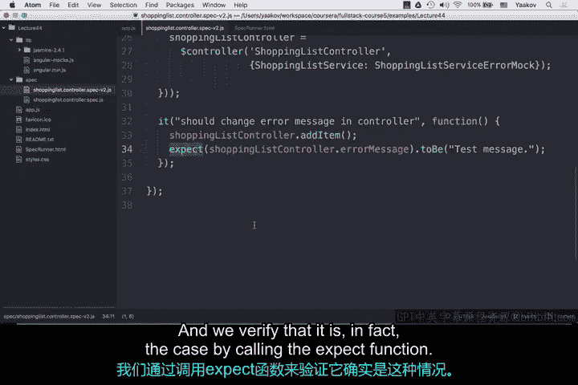
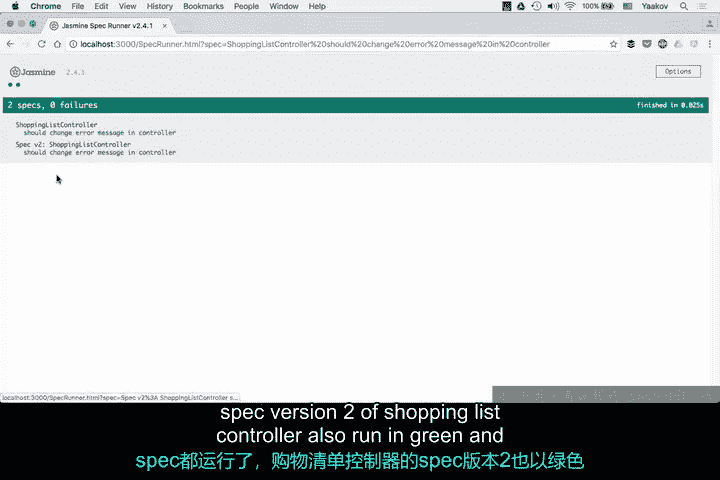
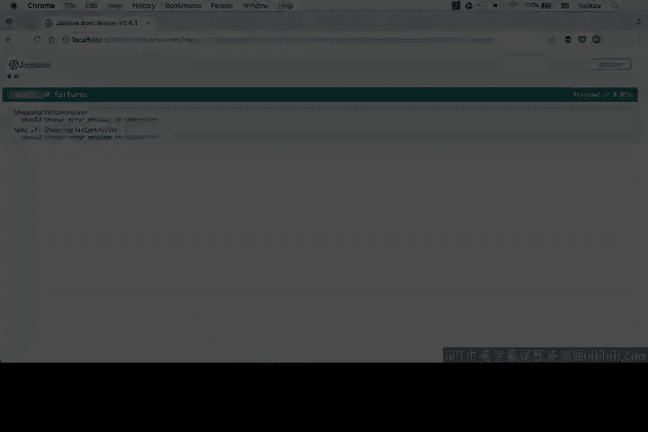
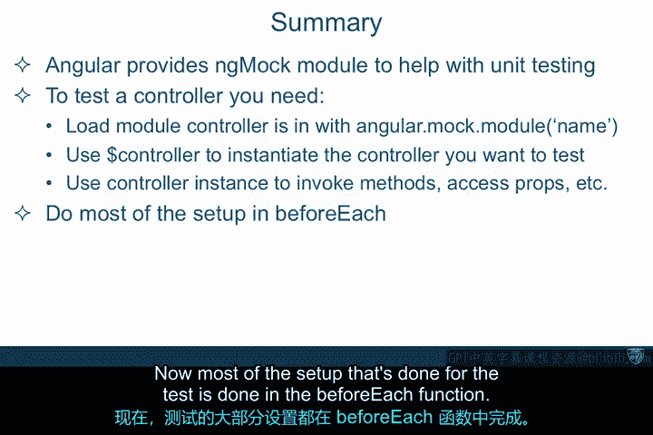

# 096：测试 AngularJS 控制器（第4部分）


在本节课中，我们将学习如何使用 AngularJS 提供的工具来对控制器进行单元测试。我们将重点介绍如何创建和使用模拟服务，以及如何通过 `beforeEach` 函数来设置测试环境。

---

上一节我们介绍了测试的基本概念，本节中我们来看看如何具体实施一个测试，特别是如何处理依赖注入。


我回到了代码编辑器，并仍在第44讲的文件夹中。我正在查看 `shoppingListControllerSpec-v2.js` 文件，这是相同测试设置的第二个版本。我之前不希望这个测试运行，所以在 `describe` 前加了一个 `X` 来临时禁用它。现在我将移除那个 `X`。

我们首先看到的是 `beforeEach` 函数。可以看到我们在这里做了几件事。首先，我们创建了一个名为 `ShoppingListServiceErrorMock` 的模拟服务。其次，我们加载了应用程序模块，以便能够连接并测试我们的控制器。

以下是创建模拟服务的方法：

我们通过让 Angular 注入 `$provide` 服务来创建它。`$provide` 服务有一个 `service` 方法。我们调用这个方法，传入我们服务的名称 `ShoppingListServiceErrorMock`，并内联地为我们之后的使用创建服务。你可以看到，这与创建常规服务时使用的类型相同：我创建了一个服务局部变量，附加了一个名为 `addItem` 的方法，并创建了另一个名为 `getItems` 的方法，该方法返回一个错误消息。

```javascript
$provide.service('ShoppingListServiceErrorMock', function () {
  var service = this;
  service.addItem = function () {
    throw new Error("Test Message.");
  };
  service.getItems = function () {
    return [];
  };
});
```

现在 Angular 知道存在一个名为 `ShoppingListServiceErrorMock` 的服务。

接下来，我们看看注入的内容。当我们注入时，我们不再仅仅注入需要实例化的控制器，我们还注入了 `ShoppingListServiceErrorMock` 模拟服务，就像注入任何其他可用的服务或控制器一样。这个服务不是在 `beforeEach` 内部手动创建的，而是使用 Angular 的 `$provide.service` 方法创建的。

一旦我们注入了它，我们就可以将其作为值提供给 `$controller` 调用，该调用会创建我们的购物清单控制器，并将注入的服务实例传递给它。

```javascript
$controller('ShoppingListController', {
  $scope: $rootScope.$new(),
  ShoppingListService: ShoppingListServiceErrorMock
});
```

这与之前的方法完全相同，只是现在我们让 Angular 在 `beforeEach` 函数中注入它，而不是手动创建。

最后一部分是实际的测试方法。测试函数完全相同：我们调用 `addItem`，这会触发我们的 `ShoppingListServiceErrorMock` 抛出一个错误。该错误被转换，控制器应将错误消息设置为 `"Test Message."`。我们通过调用 `expect` 函数来验证情况确实如此。

保存后，我们可以看到两个测试规范都运行了，`shoppingListController` 的第二个版本测试也通过了，显示为绿色，零失败。







---


## 🧪 总结与要点

Angular 提供了 `angular-mocks` 模块来帮助我们进行 Angular 应用程序的单元测试。

要测试控制器，你需要执行以下步骤：

以下是测试控制器的核心步骤列表：



1.  使用 `angular.mock.module` 加载控制器所在的模块，传入你为应用程序开发的模块名称。
2.  使用 `$controller` 服务来实例化你要测试的控制器。
3.  使用控制器实例来调用方法、访问属性等。

大多数测试设置都在 `beforeEach` 函数中完成。你至少应该调用 `module` 并传入模块名称，但可能还需要为你的测试或测试套件中所有测试共享的准备工作做更多设置。

创建这些模拟对象有几种方法，我们需要它们来控制测试运行的环境：

以下是创建模拟对象的两种主要方法：

*   一种方法是手动创建这些对象。
*   另一种方法是使用可以注入的 `$provide` 服务，但你必须通过之前提到的 `module` 方法来注入它。

对于其他服务，你可以使用常规的 `angular.mock.inject` 方法，它们工作得很好，因为它们类似于常规服务。而 `$provide` 真正涉及的是我们之前在使用 `.config` 方法时讨论过的提供者服务，只有提供者服务才能被注入到那里。


---


本节课中我们一起学习了如何为 AngularJS 控制器编写单元测试，重点掌握了使用 `$provide` 服务创建模拟依赖以及在 `beforeEach` 中设置测试环境的方法。理解这些技术对于构建可靠且可测试的 AngularJS 应用至关重要。