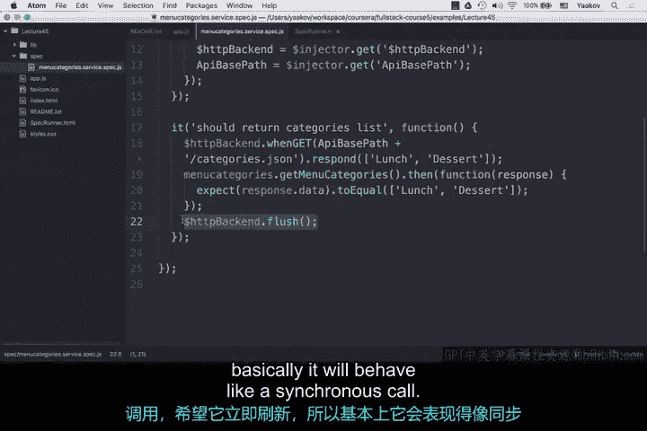
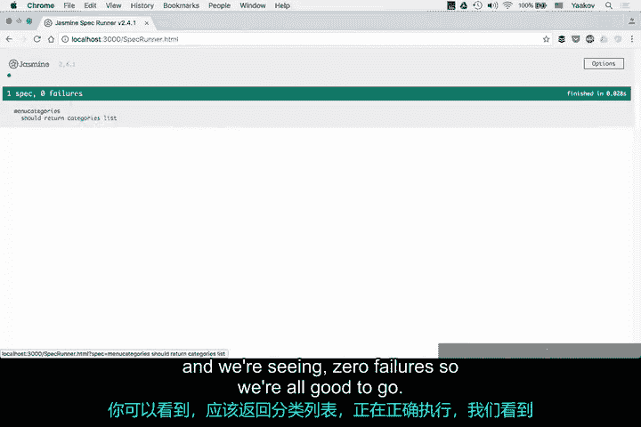

# 098：测试 AngularJS 服务和 $http


在本节课中，我们将学习如何测试一个依赖 `$http` 服务的 AngularJS 服务。我们将通过一个具体的例子，测试一个名为 `MenuCategoriesService` 的服务，该服务负责从服务器获取菜单分类数据。

## 概述

我们将要测试的应用程序代码来自课程的第 25 讲。核心是一个控制器，它使用 `MenuCategoriesService` 服务。该服务通过注入的 `$http` 服务和一个名为 `ApiBasePath` 的常量，向一个特定的 API 端点发起请求以获取菜单分类数据。本节课的目标是编写测试，验证 `MenuCategoriesService` 中的 `getMenuCategories` 方法能够正确设置并返回服务器的响应数据。

## 测试环境与代码结构

我们位于 `lecture45` 文件夹中，该文件夹包含从第 25 讲直接复制过来的完整应用程序代码。我们将在 `menu-categories.service.spec.js` 文件中编写测试。

首先，让我们了解一下待测试的服务。`MenuCategoriesService` 依赖于 `$http` 服务和 `ApiBasePath` 常量。它的 `getMenuCategories` 方法会向 `ApiBasePath + ‘/categories.json’` 这个 URL 发起 GET 请求。

## 测试设置

以下是测试文件 `menu-categories.service.spec.js` 中的初始设置步骤。

我们使用 `beforeEach` 块来初始化测试环境。首先，加载待测试的 AngularJS 模块。

```javascript
beforeEach(module(‘menuCategoriesApp’));
```

接着，我们注入 `$injector` 服务。通过它，我们可以获取 AngularJS 上下文中的各种服务，包括我们要测试的 `MenuCategoriesService` 本身、用于模拟网络请求的 `$httpBackend` 以及 `ApiBasePath` 常量。

```javascript
var $injector;
beforeEach(inject(function(_$injector_) {
  $injector = _$injector_;
}));

var MenuCategoriesService, $httpBackend, ApiBasePath;
beforeEach(function() {
  MenuCategoriesService = $injector.get(‘MenuCategoriesService’);
  $httpBackend = $injector.get(‘$httpBackend’);
  ApiBasePath = $injector.get(‘ApiBasePath’);
});
```

注意，我们不需要手动为 `MenuCategoriesService` 提供其依赖项（`$http` 和 `ApiBasePath`），AngularJS 的依赖注入系统会自动处理。

## 编写测试用例

上一节我们完成了测试环境的设置，本节中我们来看看如何编写具体的测试用例。我们将测试 `getMenuCategories` 方法。

我们计划测试一个场景：当服务调用 `getMenuCategories` 方法时，它应该向正确的 URL 发起请求，并成功返回我们预设的模拟数据。

以下是具体的测试步骤：

1.  使用 `$httpBackend` 的 `whenGET` 方法，拦截对特定 URL 的 GET 请求，并定义其返回的模拟响应数据。
2.  调用待测试的 `MenuCategoriesService.getMenuCategories()` 方法。
3.  由于 `$http` 返回的是 Promise，我们在其 `then` 回调中验证返回的响应数据是否与模拟数据一致。
4.  最后，调用 `$httpBackend.flush()` 立即执行所有挂起的模拟请求，使异步调用表现得像同步一样，便于断言。

```javascript
it(‘should return list of categories’, function() {
  // 1. 设置模拟响应
  var mockResponse = [‘Lunch’, ‘Dessert’];
  $httpBackend.whenGET(ApiBasePath + ‘/categories.json’).respond(mockResponse);

  // 2. 调用待测试方法
  MenuCategoriesService.getMenuCategories().then(function(response) {
    // 3. 验证响应数据
    // 注意：此服务返回的是整个响应对象，数据在 response.data 属性中
    expect(response.data).toEqual(mockResponse);
  });

  // 4. 触发模拟请求的响应
  $httpBackend.flush();
});
```

保存测试文件后，在浏览器中运行测试运行器（例如 Karma），可以看到测试 “should return list of categories” 执行成功，没有失败。

## 总结

本节课中我们一起学习了如何测试一个 AngularJS 服务，特别是当它依赖 `$http` 服务进行网络请求时。我们掌握了以下关键点：

*   使用 `beforeEach` 和 `module`、`inject` 函数来设置测试模块并注入所需服务。
*   利用 `$httpBackend` 服务来模拟（Mock）HTTP 请求和响应，避免在测试中发起真实的网络调用。
*   编写测试用例来验证服务方法是否向正确的 URL 发起请求，并能正确处理返回的 Promise 和响应数据。
*   使用 `$httpBackend.flush()` 来立即处理模拟的异步请求。






通过这种方式，我们可以独立、快速且可靠地测试 AngularJS 服务的业务逻辑。