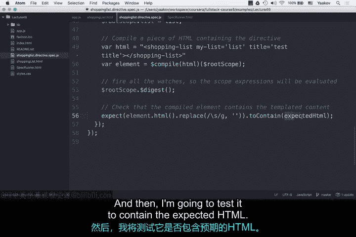
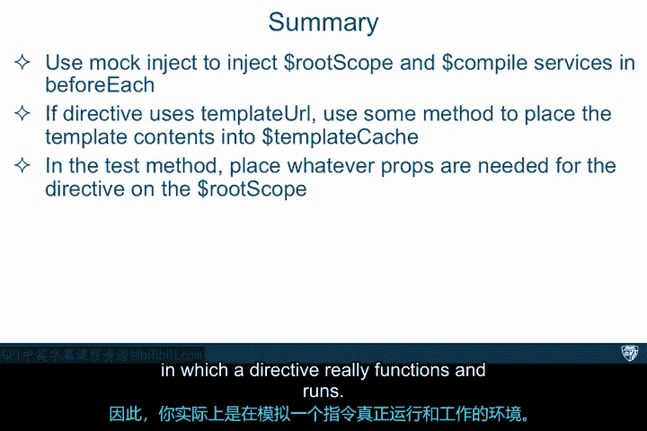

# 100：测试 AngularJS 指令


在本节课中，我们将学习如何为 AngularJS 指令编写单元测试。我们将通过一个具体的例子，演示如何模拟指令的依赖环境、编译指令模板，并验证其最终生成的 HTML 是否符合预期。

## 概述

我们将测试一个名为 `shoppingList` 的指令。该指令使用一个外部模板文件，并依赖于父作用域中的 `title` 和 `list.items` 数据。我们的目标是编写一个测试，确保指令能正确地将这些数据渲染到最终的 HTML 中。

## 测试环境搭建

首先，我们需要在测试文件中设置必要的 AngularJS 服务和模块。

以下是测试的基本结构，我们在 `beforeEach` 块中注入了 `$compile` 和 `$rootScope` 服务，并加载了应用模块。

```javascript
describe('shoppingList Directive', function() {
  var $compile, $rootScope;

  beforeEach(module('shoppingListDirectiveApp'));

  beforeEach(inject(function(_$compile_, _$rootScope_) {
    $compile = _$compile_;
    $rootScope = _$rootScope_;
  }));
});
```

上一节我们介绍了测试的基本结构，本节中我们来看看如何处理指令使用的外部模板。

## 处理外部模板

由于我们的指令使用了 `templateUrl` 属性，AngularJS 在测试时会尝试通过 Ajax 请求获取模板文件。为了避免这种真实的 HTTP 请求，我们需要将模板内容预先存入 `$templateCache` 服务中。

以下是使用一种方法（同步 Ajax）将模板内容存入缓存：

```javascript
beforeEach(inject(function($templateCache) {
  var directiveTemplate = null;
  // 这是一个同步请求，用于获取模板文件内容
  $.ajax({
    url: 'shopping-list.html',
    success: function(data) {
      directiveTemplate = data;
    },
    async: false // 使其同步
  });
  // 将模板内容存入缓存，键名必须与 templateUrl 匹配
  $templateCache.put('shopping-list.html', directiveTemplate);
}));
```

**注意**：在生产测试中，更推荐使用命令行测试运行器（如 Karma）来预加载模板文件，而不是使用这种同步 Ajax 的“技巧”。

## 编写测试用例

现在，我们可以编写具体的测试逻辑。测试的核心步骤是：创建作用域数据、编译指令、触发数据绑定，最后验证生成的 HTML。



以下是测试用例的具体实现：

```javascript
it('应使用正确的内容替换元素', function() {
  // 1. 设置指令所需的作用域数据
  var list = {
    items: [
      { name: 'item1', quantity: 'quantity1' },
      { name: 'item2', quantity: 'quantity2' }
    ]
  };
  $rootScope.list = list;
  $rootScope.title = '测试标题';

  // 2. 编译指令。指令字符串应与在 HTML 中使用的方式一致。
  var element = $compile('<shopping-list title="title" list="list"></shopping-list>')($rootScope);

  // 3. 触发所有监听器，将作用域数据应用到编译后的元素上
  $rootScope.$digest();

  // 4. 获取最终生成的 HTML 并进行断言
  var generatedHtml = element.html().replace(/\s+/g, ' ');
  var expectedHtml = '<h3>测试标题</h3>...'; // 此处应为预期的完整HTML字符串
  expect(generatedHtml).toContain(expectedHtml);
});
```

## 测试步骤总结



本节课中我们一起学习了测试 AngularJS 指令的完整流程。为了清晰地回顾，以下是测试指令通常需要遵循的步骤：

1.  **注入服务**：在 `beforeEach` 中使用 `inject` 方法注入 `$rootScope` 和 `$compile` 服务。
2.  **缓存模板**：如果指令使用 `templateUrl`，需将模板内容预加载到 `$templateCache` 中。
3.  **设置作用域**：在测试方法内，将指令运行所需的数据属性附加到 `$rootScope` 上。
4.  **编译与绑定**：使用 `$compile` 服务编译指令字符串（即 HTML 标签），然后调用返回的函数，并传入 `$rootScope` 以绑定数据。
5.  **触发更新**：调用 `$rootScope.$digest()` 来触发数据绑定，更新编译后的 HTML 内容。
6.  **进行断言**：从编译后的元素中获取 `.html()`，与预期的“基准”HTML 字符串进行比较，以验证指令渲染是否正确。

通过遵循这些步骤，你可以为任何 AngularJS 指令创建可靠且可维护的单元测试。