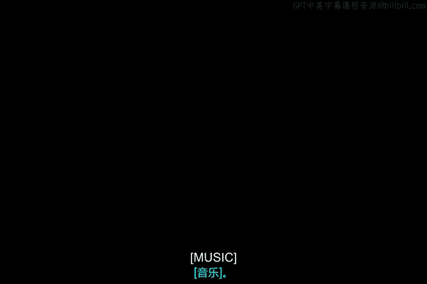
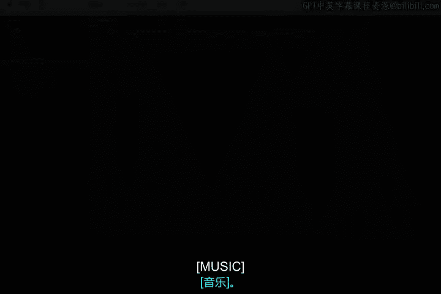
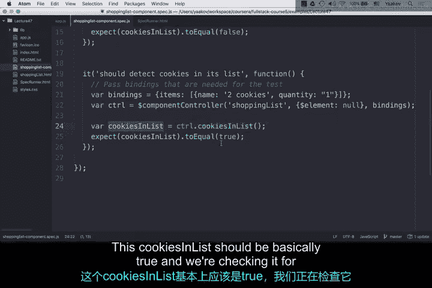
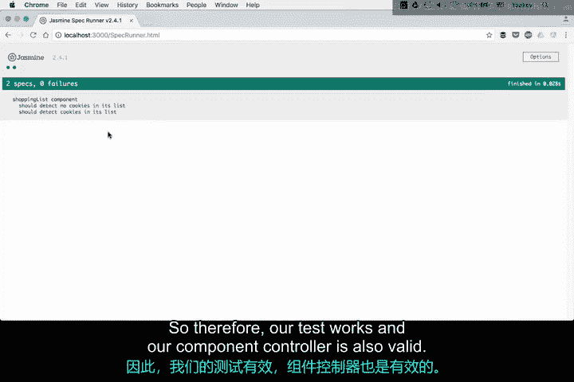
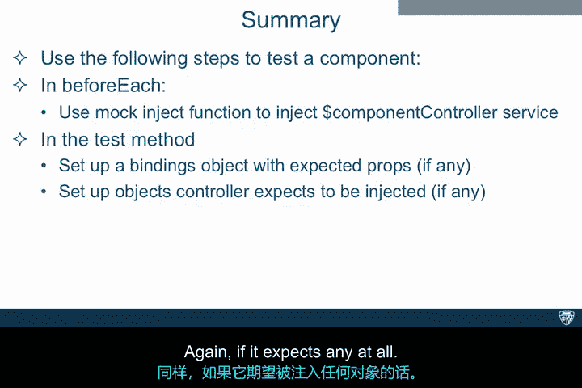

# 102：测试 AngularJS 组件





在本节课中，我们将学习如何为 AngularJS 组件编写单元测试。我们将通过一个具体的例子，测试一个购物清单组件中的方法，以确保它能准确检测列表中的特定项目。

---

我们回到代码编辑器，位于第 47 讲的 `fullstack-course5/examples` 文件夹中。从 `readme.txt` 文件可知，此处的代码源自第 33 讲，当时我们将 AngularJS 版本从 1.5.7 升级到 1.5.8，以便使用 Angular 在控制器和组件控制器中引入的生命周期方法。现在可以关闭这个文件。

让我们查看 `app.js` 文件。这里有一个名为 `shoppingList` 的组件，其控制器是 `ShoppingListComponentController`。如果你查看控制器，会发现一个名为 `cookiesInList` 的方法。这个方法的作用是检查所有项目，并判断是否有任何项目的名称中包含单词 “cookie”。如果存在，则返回 `true`，否则返回 `false`。我们需要测试这个方法，以确保它能精确地检测到 “cookie”。

接下来，我们查看 `shopping-list.component.spec.js` 文件。

以下是测试的准备工作。首先，我们将组件控制器服务保存到变量 `componentController` 中。然后，加载包含我们组件的模块 `ShoppingListComponentApp`。最后，注入 `$componentController` 服务，这让我们能方便地获取组件控制器服务。

```javascript
var componentController;
beforeEach(module(‘ShoppingListComponentApp‘));
beforeEach(inject(function (_$componentController_) {
    componentController = _$componentController_;
}));
```

现在，我们准备开始测试。测试分为两部分：一部分测试不含 “cookie” 的情况，另一部分测试包含 “cookie” 的情况。

以下是测试不含 “cookie” 情况的代码。我们首先创建一个 `bindings` 对象，因为我们的组件期望一个名为 `items` 的单向绑定属性。我们提供一个项目，其名称为 “item 1”，数量为 1。接着，我们通过 `componentController` 服务创建控制器实例，传入组件名称 ‘shoppingList’、它期望注入的服务（这里我们传入一个空对象 `{}` 以避免错误）以及绑定对象。最后，我们调用 `cookiesInList` 方法，并期望它返回 `false`。

```javascript
it(‘should detect no cookies in list‘, function () {
    // 设置绑定对象
    var bindings = {
        items: [{ name: ‘item 1‘, quantity: 1 }]
    };
    // 创建控制器实例
    var ctrl = componentController(‘shoppingList‘, {}, bindings);
    // 执行方法并断言
    expect(ctrl.cookiesInList()).toBe(false);
});
```

第二个测试与第一个类似，但不同之处在于我们提供的项目名称是 “2 cookies”。因此，当我们调用 `cookiesInList` 方法时，期望它返回 `true`。

```javascript
it(‘should detect cookies in list‘, function () {
    // 设置绑定对象，包含“cookie”
    var bindings = {
        items: [{ name: ‘2 cookies‘, quantity: 1 }]
    };
    // 创建控制器实例
    var ctrl = componentController(‘shoppingList‘, {}, bindings);
    // 执行方法并断言
    expect(ctrl.cookiesInList()).toBe(true);
});
```

回到浏览器并运行这些测试，可以看到两个测试都通过了：一个检测到不含 “cookie”，另一个检测到包含 “cookie”。这表明我们的测试有效，组件控制器也工作正常。

---



上一节我们完成了具体的测试案例，本节我们来总结测试 AngularJS 组件的一般步骤。




以下是测试组件的基本流程：

1.  在 `beforeEach` 方法中，使用 `module` 函数加载包含待测组件的模块。
2.  在另一个 `beforeEach` 方法中，使用 `inject` 函数注入 `$componentController` 服务。
3.  在具体的 `it` 测试块中，首先设置组件期望的绑定对象（如果有的话）。
4.  然后，设置组件控制器期望被注入的服务对象（如果有的话）。
5.  接着，使用 `$componentController` 服务创建控制器实例，传入组件名称、注入对象和绑定对象。
6.  最后，获取控制器实例，执行其方法或检查其属性，并根据你的预期进行断言。

---




本节课中，我们一起学习了如何为 AngularJS 组件编写单元测试。我们通过一个购物清单组件的例子，演示了如何设置测试环境、创建控制器实例以及测试组件方法。掌握这些步骤，你就能为自己的 AngularJS 组件编写有效的单元测试了。