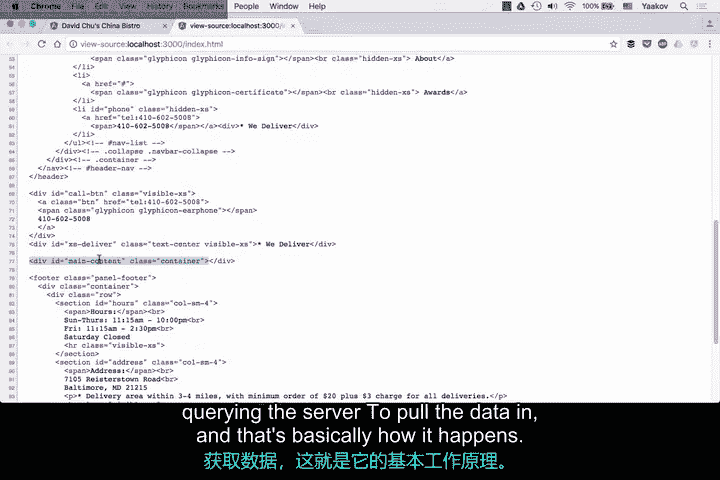
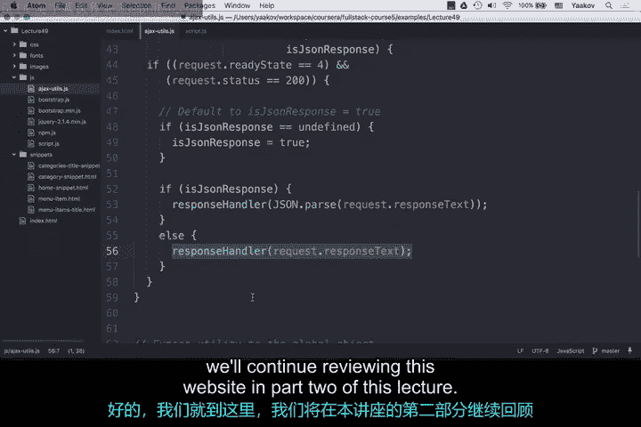

# 105：非AngularJS网站概览 🎯


在本节课中，我们将回顾一个在之前的课程中构建的、未使用AngularJS的网站。我们将分析其功能实现，特别是如何通过原生JavaScript和Ajax来动态加载内容，为后续使用AngularJS重构打下基础。

## 网站概览与回顾

在开始使用AngularJS构建整个网站之前，我们先来看看在上一门课程（《面向Web开发者的HTML、CSS和JavaScript》）中完成的网站版本。该课程的重点是HTML、CSS、响应式设计以及JavaScript和Ajax的基础知识。虽然我们构建的网站并不复杂，但其效果良好，客户也很满意。

我已将上一门课程中该网站的最新版本复制到了本讲座（第49讲）的文件夹中，并启动了浏览器同步服务。现在，让我们在浏览器中查看这个网站。

## 网站功能演示

网站是完全响应式的。当我们缩小浏览器窗口时，页面元素会重新排列，图标和图片会变小，某些元素会隐藏。最终，在移动端视图中，会出现一个“汉堡包”菜单按钮。

点击该按钮可以展开完整菜单。我们可以点击任意菜单项，查看特定菜品的价格、图片以及餐厅内部使用的ID（例如，可以点“2个A1”表示两份汤）。

观察URL地址栏，你会发现网站几乎没有路由功能。点击浏览器的后退按钮，URL中的`#`号会消失，但页面实际上仍停留在汤类菜单的界面。要返回主页，必须点击页面上的主页按钮或Logo链接。这表明，当前的路由功能是缺失的。

## 页面结构分析



接下来，我们查看页面的HTML源代码。除了`<head>`和页眉部分，在页眉之后有一个用于移动端视图的大电话按钮，接着是一个ID为`main-content`的`<div>`占位符，最后是页脚。

页眉和页脚之间的所有内容都动态插入到这个`main-content`容器中。这是通过Ajax技术实现的：先向服务器请求数据，然后找到页面中的这个特定元素并插入内容。

## 核心功能代码解析

现在，让我们将注意力从布局和CSS转移到功能实现上，即我们使用原生JavaScript编写的代码。

在代码编辑器中，可以看到两个关键文件：`ajax-utils.js`和`script.js`。这两个文件是我们为实现网站功能而编写的。

### Ajax工具函数

`ajax-utils.js`文件的核心是一个名为`sendGetRequest`的方法，其余代码主要是为了支持这个方法。

以下是该函数的核心逻辑（用伪代码表示其结构）：
```javascript
function sendGetRequest(requestUrl, responseHandler, isJsonResponse) {
    // 1. 创建XMLHttpRequest对象
    // 2. 设置onreadystatechange事件处理程序
    // 3. 发起异步请求 (open(..., true))
    // 4. 在回调中检查状态 (readyState == 4 && status == 200)
    // 5. 根据isJsonResponse标志决定是否将响应文本解析为JSON对象
    // 6. 调用传入的responseHandler回调函数，并传入处理后的数据
}
```

该函数接收三个参数：
1.  `requestUrl`：要发起网络请求的URL。
2.  `responseHandler`：当服务器响应返回时需要执行的处理函数。
3.  `isJsonResponse`：一个标志，指示响应是否为JSON格式。有时我们请求的是数据（JSON），有时请求的是HTML模板。对于后者，我们需要将此标志设为`false`。

在函数内部，我们创建了一个闭包来包装`responseHandler`，以确保在异步请求完成时能正确调用它。如果`isJsonResponse`参数未定义，则默认设为`true`，这使得调用代码更简洁。

处理响应的逻辑是：
*   如果`isJsonResponse`为`true`，则使用`JSON.parse()`将响应文本转换为JavaScript对象，然后传递给`responseHandler`。
*   如果为`false`，则直接将响应文本（HTML内容）传递给`responseHandler`。

我们将利用这个机制来为应用程序中的特定视图检索HTML模板。

## 本节总结

在本节中，我们一起回顾了之前构建的非AngularJS网站。我们查看了其响应式界面，分析了其通过一个`<div>`容器和Ajax调用来动态加载内容的基本架构，并深入了解了实现该功能的`sendGetRequest`工具函数的核心逻辑。这个函数负责处理异步请求，并根据需要解析JSON或直接返回HTML。




在下一部分，我们将继续审查`script.js`文件，看看如何利用这个工具函数来具体实现网站的各项功能，从而更清晰地理解在AngularJS中这些功能将被如何替代和优化。