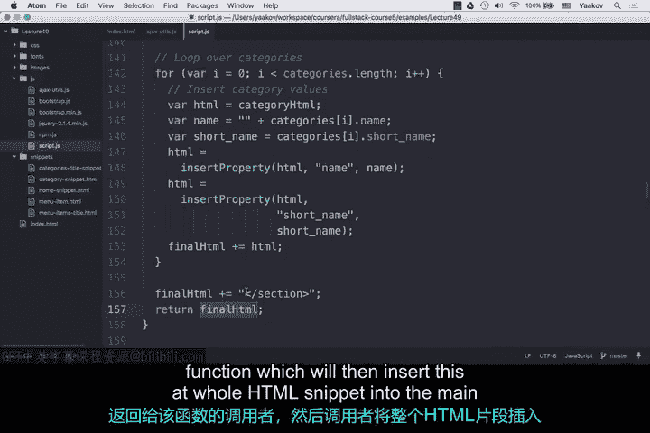

# 106：非AngularJS网站概览（第2部分）


在本节课中，我们将继续分析一个非AngularJS实现的单页应用网站，了解其手动处理数据、模板和导航的复杂过程。我们将重点关注其JavaScript代码如何模拟现代框架的功能。

上一节我们查看了网站的基本HTML结构，本节中我们来看看其核心的JavaScript逻辑是如何工作的。

## 代码结构与初始化

首先，我们打开 `script.js` 文件。代码被包裹在一个立即执行函数表达式（IIFE）中，并将 `window` 对象作为参数 `global` 传入。这样做的目的是将内部定义的函数暴露给全局作用域。

```javascript
(function (global) {
    // ... 所有代码
}(window));
```

在函数内部，我们定义了一个名为 `$dc` 的对象（代表餐厅名 David Chu‘s），所有功能都将作为该对象的方法。

```javascript
var dc = {};
```

接下来，代码初始化了一些关键的URL变量。这里有一个重要的命名模式：
*   以 `HTML` 结尾的变量指向本地HTML模板片段（snippets）。
*   以 `URL` 结尾的变量指向远程服务器API，用于获取JSON数据。

```javascript
var homeHtmlUrl = "snippets/home-snippet.html";
var allCategoriesUrl = "https://.../categories.json";
```

## 工具函数

以下是几个为了简化操作而创建的工具函数：

**1. insertHtml 函数**
此函数用于将给定的HTML字符串插入到指定选择器匹配的元素中。

```javascript
function insertHtml(selector, html) {
    var targetElem = document.querySelector(selector);
    targetElem.innerHTML = html;
}
```

**2. showLoading 函数**
此函数在页面内容切换时，在主要内容区域显示一个加载动画，以提升用户体验。

```javascript
function showLoading(selector) {
    var html = "<div class='text-center'>";
    html += "</div>";
    insertHtml(selector, html);
}
```

**3. insertProperty 函数**
此函数实现了一个简单的“插值”功能，用于将模板字符串中的占位符（如 `{{propertyName}}`）替换为实际的值。这模拟了AngularJS中数据绑定的一个基础功能。

```javascript
function insertProperty(string, propName, propValue) {
    var propToReplace = "{{" + propName + "}}";
    var newHtml = string.replace(new RegExp(propToReplace, "g"), propValue);
    return newHtml;
}
```

**4. switchMenuToActive 函数**
此函数管理导航菜单的激活状态，通过添加或移除 `active` CSS类来高亮当前选中的菜单项。

## 核心流程：页面加载与导航

当页面（DOM）完全加载后，会触发主要的事件处理逻辑。

**加载首页**
首先，代码调用 `showLoading` 显示加载图标，然后通过Ajax请求获取 `home-snippet.html` 模板文件的内容，并将其插入到ID为 `#main-content` 的主容器中。

```javascript
document.addEventListener("DOMContentLoaded", function () {
    showLoading("#main-content");
    $ajaxUtils.sendGetRequest(
        homeHtmlUrl,
        function (homeHtml) {
            document.querySelector("#main-content").innerHTML = homeHtml;
        },
        false // 表示响应是HTML文本，不是JSON
    );
    // ... 其他事件绑定
});
```

**加载菜单分类**
当用户点击“Menu”链接时，会调用 `loadMenuCategories` 函数。这个函数的流程更复杂：
1.  显示加载图标。
2.  发送Ajax请求到 `allCategoriesUrl` 获取所有菜单分类的JSON数据。
3.  在成功回调中，再发起两个并行的Ajax请求，分别获取分类列表的标题模板（`categories-title-snippet.html`）和每个分类项的模板（`category-snippet.html`）。
4.  所有数据（分类JSON和两个HTML模板）都获取成功后，调用 `buildCategoriesViewHtml` 函数来构建完整的视图HTML。
5.  最后，使用 `insertHtml` 函数将构建好的HTML插入到主容器中，并调用 `switchMenuToActive` 更新菜单状态。

## 构建视图：手动模板渲染

`buildCategoriesViewHtml` 函数是手动渲染逻辑的核心。它接收分类数据、标题模板和项目模板，然后通过循环遍历每个分类，使用 `insertProperty` 函数将数据“注入”到项目模板字符串中，最终拼接成一个完整的HTML字符串。



```javascript
function buildCategoriesViewHtml(categories, titleHtml, itemHtml) {
    var finalHtml = titleHtml;
    finalHtml += "<section class='row'>";
    for (var i = 0; i < categories.length; i++) {
        var html = itemHtml;
        var name = "" + categories[i].name;
        var shortName = categories[i].short_name;
        html = insertProperty(html, "name", name);
        html = insertProperty(html, "short_name", shortName);
        finalHtml += html;
    }
    finalHtml += "</section>";
    return finalHtml;
}
```

## 总结

本节课中我们一起学习了这个非AngularJS网站的核心工作机制。我们看到，开发者需要手动处理许多繁琐的任务：通过多个Ajax调用分别获取数据和模板、手动实现字符串插值来渲染视图、自行管理页面状态和导航高亮。整个过程虽然可行，但代码结构复杂，且不易维护和扩展。


相比之下，AngularJS等现代框架通过**数据绑定**、**依赖注入**和**路由**等机制，将这些底层操作抽象化，让开发者能更专注于业务逻辑。在接下来的课程中，我们将开始使用AngularJS重建这个网站，体验框架带来的高效与便捷。