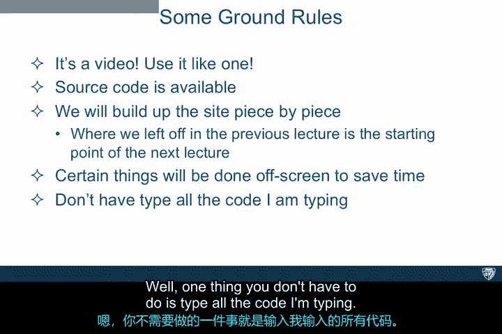
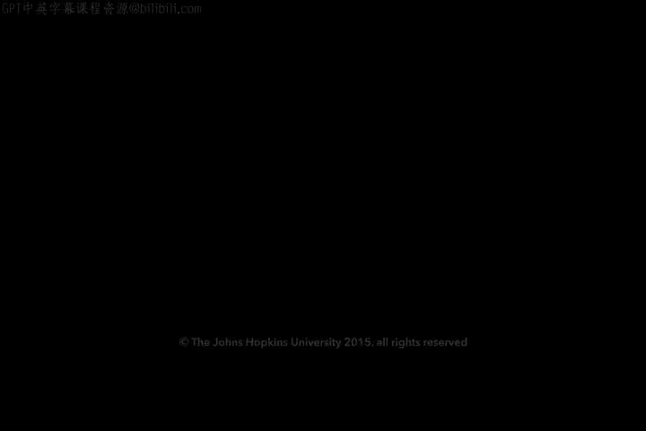

# 109：餐厅应用的基本结构 🏗️

在本节课中，我们将开始着手编码，构建一个名为“David Chu's China Bistro”的餐厅网站。我们将首先了解课程的基本设置和学习方法，为后续的实际编码工作做好准备。

## 课程设置与学习方法概述

在开始编写代码之前，我们需要明确一些基本规则和课程框架，以便你更好地理解我将如何呈现代码。

### 视频学习指南

本课程以视频形式呈现，你可以灵活地控制学习节奏。如果你觉得我讲得太快，可以暂停视频；如果想重温某个部分，可以回放。在 Coursera 视频播放器中，你还可以调整播放速度。如果觉得太慢，可以加速播放；如果觉得太快，可以减速播放。核心是你可以按照自己的节奏来学习。

### 源代码的获取与使用

我将展示的源代码会像常规的课程文件夹一样提供给你。这意味着你不必完全依赖视频来查看代码，可以随时查阅源代码。

### 项目的渐进式构建

我们将一步步地构建“David Chu's China Bistro”网站。每一讲的终点将是下一讲的起点。我会将每一讲完成后的完整代码复制到下一讲，作为新的起点。这种安排能让你清晰地看到项目是如何从一讲发展到下一讲的。

### 编码演示方式说明

为了提升学习效率，避免因大量的打字和纠错过程导致课程冗长乏味，许多代码我会在录制前预先编写好，然后在视频中进行讲解。当然，部分关键代码我仍会现场编写。这样能确保我们专注于核心概念，而不是打字过程。

## 如何从本课程中高效学习

在开始之前，我们还需要探讨如何从构建网站的过程中获得最大收益。

以下是关于学习方法的一些建议：

*   **无需逐字抄写代码**：源代码已经提供，你不必暂停视频来逐行输入代码。
*   **主动探索与修改**：我的建议是，在每节课后，你可以获取该讲的代码文件，然后对其进行一些修改和尝试。例如，改变某些内容，使用 Browser Sync 部署，或发布到你自己的 GitHub Pages 上进行实验。
*   **熟悉代码结构**：与代码“亲密接触”，尝试修改并观察结果，是深入理解这些课程内容的最佳方式。你可以随时撤销更改，或者重新下载代码仓库，原始代码始终可用。

通过这种方式，你不仅能理解代码是如何工作的，还能通过实践巩固知识。

---

本节课中，我们一起学习了本实践课程的设置框架与高效学习方法。我们明确了视频学习的灵活性、源代码的可用性、项目的渐进构建方式以及通过主动修改代码来深化理解的学习策略。下一节，我们将正式打开代码编辑器，开始构建餐厅应用的基础结构。