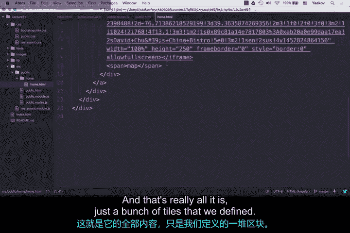
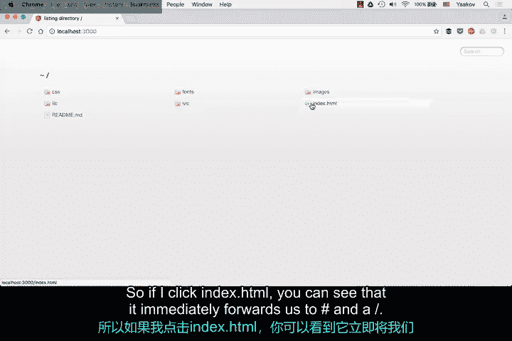

# 110：餐厅应用的基本结构 🏗️


在本节课中，我们将学习如何将一个非 AngularJS 构建的网站，重构并拆分成适合 AngularJS 单页应用（SPA）架构的组件。我们将重点关注项目的基本结构设置，包括模块划分、路由配置以及模板的组织方式。

---

## 项目入口：`index.html`

首先，我们来看项目的入口文件 `index.html`。与之前的版本相比，主要变化在于 `<body>` 标签上添加了 `ng-app` 属性，用于声明应用的起始模块。

```html
<body ng-app="restaurant" ng-strict-di>
```

这里出现了一个新属性 `ng-strict-di`。它启用了 AngularJS 的**严格依赖注入**模式。这意味着，如果我们尝试注入一个未经保护（防止代码压缩混淆）的依赖项，AngularJS 将会抛出错误。保护依赖的方式，正如我们在所有课程中一直使用的，是通过 `$inject` 属性或一个包含依赖名称字符串的数组。

文件其余部分基本保持不变：包含响应式页头、一个巨大的“呼叫”按钮（在移动端视图下显示）、页脚，以及最重要的——`ui-view` 指令。

`ui-view` 指令是 `ui-router` 插入模板的占位符。在 `ui-router` 将具体模板插入之前，`<ui-view>` 标签内的内容（例如“加载中…”）会显示给用户。这提供了良好的用户体验，尤其是在网站加载较慢时。

以下是页面中引入的脚本文件：

*   **jQuery 2.1.4**：为了与使用的 Bootstrap 3.3.6 版本兼容。
*   **AngularJS**
*   **Angular UI Router**：用于处理应用状态和路由。
*   **`restaurant.module.js`**：应用的主模块。
*   **`public.module.js`**：公共模块的声明和路由。

---

## 核心模块：`restaurant.module.js`

现在，让我们深入查看主模块 `restaurant.module.js`。

```javascript
angular.module('restaurant', ['public'])
```

这里声明了名为 `restaurant` 的主模块，并注入了 `public` 模块作为依赖。模块的配置函数中，我们使用 `$urlRouterProvider` 设置了一条规则：将所有未匹配的 URL 重定向到应用的根路径 `/`。

```javascript
.config(['$urlRouterProvider', function($urlRouterProvider) {
  $urlRouterProvider.otherwise('/');
}])
```

我们将路由直接写在模块文件中，这是因为目前配置非常简单。在实际项目中，根据组织习惯，你也可以选择将路由分离到独立的文件中。

---

## 公共模块：`public.module.js` 与 `public.routes.js`

接下来，我们看看 `public` 模块。将功能拆分为 `public`（公开）和未来的 `admin`（管理）模块是一个重要的架构决策。这样做是因为网站的公开部分（顾客浏览菜单）和管理部分（店主更新菜单）在功能、界面和权限上截然不同。它们共享公共的页头和页脚，但内部结构彼此独立。

`public.module.js` 文件非常简单，仅声明模块并注入 `ui.router` 依赖。

真正的路由逻辑定义在 `public.routes.js` 中。我们使用 `$stateProvider` 来定义应用的状态（states）。

以下是定义的状态：

1.  **`public` 状态**：这是所有公开状态的父状态。它有两个关键属性：
    *   `abstract: true`：表示这是一个**抽象状态**，用户不能直接导航到此状态。它充当容器，为其子状态提供共享的模板和属性。
    *   `templateUrl: ‘src/public/public.html’`：指定了该状态的模板文件。这个模板将被注入到主 `index.html` 的 `<ui-view>` 中。

2.  **`public.home` 状态**：这是网站的主页状态。
    *   `url: ‘/’`：对应的URL是根路径。
    *   `templateUrl: ‘src/public/home/home.html’`：其模板将被注入到父状态 `public` 模板中的 `<ui-view>` 里。

这种嵌套结构形成了“洋葱式”的模板组织：`index.html` 包含一个 `<ui-view>`，`public.html` 模板被注入其中；而 `public.html` 内部又包含一个 `<ui-view>`，`home.html` 模板再被注入其中。这允许我们对界面的每一层进行独立控制和组合。

---

## 模板与样式文件

现在，我们来查看相关的模板和样式文件。

`public.html` 模板的核心作用是提供一个嵌套的 `<ui-view>` 占位符，并引入公共部分的样式表。

样式文件分为两类：
*   **`restaurant.css`**：应用于整个网站（包括未来的管理部分）的全局样式。
*   **`public.css`**：仅针对网站公开部分的样式，例如主页、分类页的特定样式。



`home.html` 模板是从之前非 AngularJS 版本的网站中直接迁移过来的“主页片段”，包含了展示给用户的各个功能区块。

---

## 应用运行与状态验证

当我们运行应用并访问 `index.html` 时，浏览器会被重定向到 `/#/`，即 `public.home` 状态。页面正常显示，并且保持了响应式布局。



如果尝试点击主页上尚未配置完整路由的链接（例如“查看菜单”），控制台会显示明确的路由解析错误，例如“无法从状态 ‘public.home’ 解析 ‘public.menu’”。这证明我们的路由机制正在正常工作，只是对应的子状态尚未实现，这为后续开发提供了清晰的指引。

---

## 总结


本节课中，我们一起学习了餐厅单页应用的基本结构搭建。我们了解了如何设置主入口文件、配置严格依赖注入、划分主模块与功能模块（如 `public` 模块），并使用 `ui-router` 定义嵌套的抽象状态和子状态来组织模板。我们还看到了如何将旧网站的代码片段整合到新的 AngularJS 组件结构中。这个结构为后续开发分类页面和详情页面奠定了坚实的基础。