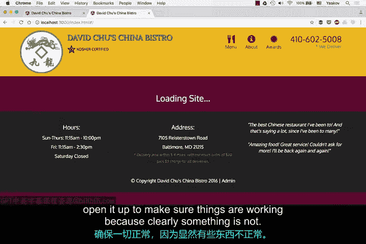
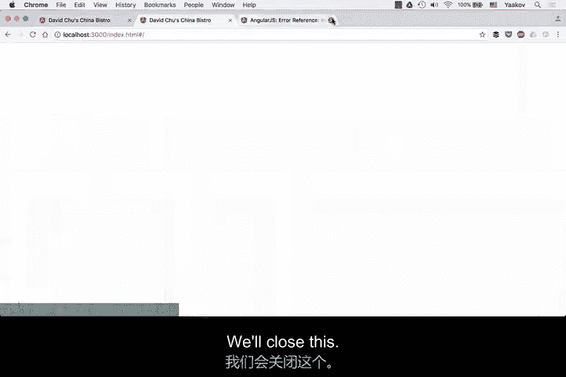

# 111：编写加载旋转器 🌀


在本节课中，我们将学习如何编写一个加载旋转器（Loading Spinner）。这个旋转器用于在系统处理异步操作时告知用户需要等待。我们将创建一个可被网站公共部分和未来管理部分共同复用的模块。

---

## 概述

我们将创建一个名为 `common` 的独立模块，用于存放公共组件。本节重点是在该模块中创建加载旋转器组件，并通过事件机制控制其显示与隐藏。

---

## 创建公共模块

上一节我们完成了应用的基本结构。本节中，我们来看看如何构建一个可复用的公共模块。

我们首先在 `src` 目录下创建了一个 `common` 文件夹，并在其中定义了一个 AngularJS 模块。

```javascript
// common.module.js
angular.module('common', []);
```

这个 `common` 模块将被公共模块和未来的管理模块共同依赖。

---

## 创建加载器组件

接下来，我们在 `common` 模块下创建加载器组件。以下是该组件的核心代码：

```javascript
// loading.component.js
angular.module('common')
.component('loading', {
  template: '',
  controller: LoadingController
});

function LoadingController($rootScope) {
  var $ctrl = this;
  var listener;

  $ctrl.$onInit = function() {
    $ctrl.show = false;
    listener = $rootScope.$on('spinner:activate', onSpinnerActivate);
  };

  $ctrl.$onDestroy = function() {
    listener();
  };

  function onSpinnerActivate(event, data) {
    $ctrl.show = data.on;
  }
}
```

让我们分析一下这个组件：
*   **模板**：包含一个图片，仅当控制器的 `show` 属性为 `true` 时通过 `ng-if` 指令显示。
*   **控制器**：`LoadingController` 负责控制旋转器的状态。
*   **事件监听**：控制器在初始化时 (`$onInit`) 监听名为 `spinner:activate` 的根作用域 (`$rootScope`) 事件。事件数据中的 `on` 属性决定显示 (`true`) 或隐藏 (`false`) 旋转器。
*   **销毁监听器**：在组件销毁时 (`$onDestroy`)，移除事件监听器以防止内存泄漏。

---

## 集成到主应用

创建好组件后，我们需要将其集成到主应用中。

首先，更新公共模块的依赖，声明依赖我们新建的 `common` 模块。

```javascript
// public.module.js
angular.module('public', ['ui.router', 'common']);
```

然后，在 `index.html` 主页面中，添加加载器组件的标签。

```html
<!-- index.html -->
<body>
  <div ui-view></div>
  <loading class="loading-indicator"></loading>
</body>
```

最后，引入相关的 JavaScript 文件和 CSS 样式，确保组件能正常工作和显示。

```html
<script src="src/common/common.module.js"></script>
<script src="src/common/loading/loading.component.js"></script>
<link rel="stylesheet" href="src/common/common.css">
```


---



## 测试与验证

完成以上步骤后，我们回到浏览器刷新应用页面。如果一切配置正确，页面底部会出现加载旋转器的占位位置（初始状态为隐藏）。目前旋转器还不会显示，因为我们尚未触发 `spinner:activate` 事件。在下一讲中，我们将创建触发此事件的机制。

---

## 总结

本节课中我们一起学习了：
1.  创建了一个独立的 `common` 公共模块。
2.  在该模块中编写了 `loading` 组件，它通过监听 `spinner:activate` 事件来控制一个旋转图片的显示与隐藏。
3.  将公共模块注入主应用，并在主页面上添加了加载器标签。



现在，加载旋转器的静态部分已经就绪。下一讲我们将实现动态控制它显示和隐藏的逻辑。