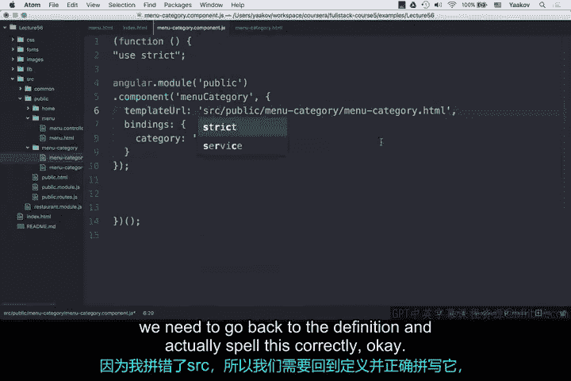
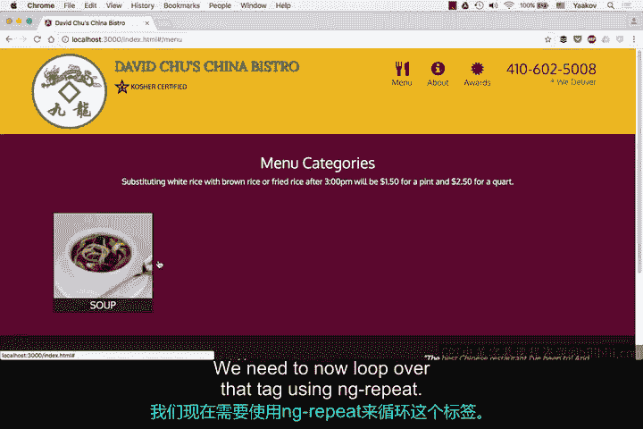
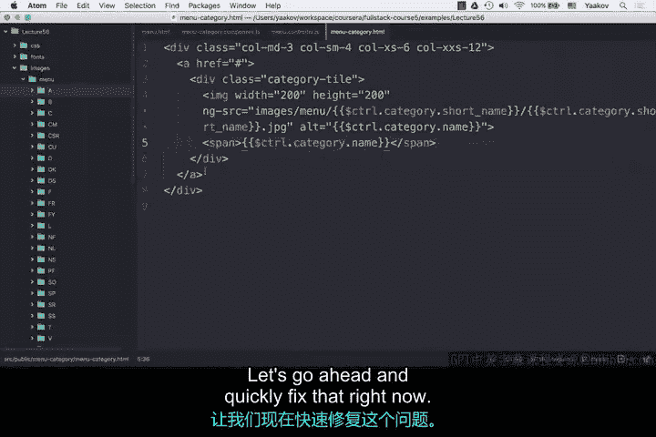

# 115：编写菜单分类视图（第3部分）


## 概述
在本节课中，我们将继续构建菜单分类视图。我们将创建一个可复用的组件来展示每个菜单分类，并使用 `ng-repeat` 指令循环显示所有分类。同时，我们还将修复导航菜单的激活状态问题。

---

## 验证数据并移除调试信息
上一节我们成功地将分类数据传递到了 `menu.html` 模板中，并通过直接插值的方式在网页上以 JSON 格式显示了数据。

现在我们已经验证数据存在，可以移除这个调试信息了。保存文件并刷新页面，确认 JSON 数据已不再显示。

## 创建可复用的分类组件
显然，我们不想手动逐个列出每个分类。我们需要能够循环遍历这个标签集合。技术上，我们可以直接在 HTML 中放置一个 `ng-repeat` 指令。

但是，如果我们为这一小块 HTML 创建一个独立的组件，页面会更加清晰。我们可以将其命名为 `menu-category`，这样在语义上也更明确。

让我们开始创建这个组件。

1.  进入 `public` 文件夹，创建一个新文件夹，命名为 `menu-category`。
2.  在 `menu-category` 文件夹内，创建一个文件，命名为 `menu-category.component.js`。

以下是组件的基本结构：
```javascript
(function () {
  'use strict';
  angular.module('public')
  .component('menuCategory', {
    templateUrl: 'public/menu-category/menu-category.html',
    bindings: {
      category: '<'
    }
  });
})();
```
*   `templateUrl` 指定了组件模板的位置。
*   `bindings` 定义了组件的输入属性。这里我们有一个单向绑定的 `category` 属性，用于接收单个分类的数据。

## 创建组件模板
接下来，我们需要创建组件的模板文件 `menu-category.html`。



1.  从 `menu.html` 中复制用于显示单个分类的 HTML 代码块。
2.  将其粘贴到新创建的 `menu-category.html` 文件中。

现在，我们可以用 `<menu-category>` 标签替换 `menu.html` 中那一大段 HTML 代码。



## 导入组件并初步测试
在 `index.html` 中，我们需要导入新创建的组件文件。在 `public` 模块的脚本引入部分添加：
```html
<script src="public/menu-category/menu-category.component.js"></script>
```
保存所有文件并在浏览器中查看。此时页面上应该只显示一个分类卡片，因为我们还没有使用循环。

## 使用 `ng-repeat` 循环显示分类
为了显示所有分类，我们需要在 `menu.html` 中使用 `ng-repeat` 指令来遍历数据。

首先，查看 `menu.controller.js` 控制器，确认数据属性名称为 `menuCategories`。

然后，在 `menu.html` 中，为 `<menu-category>` 标签添加 `ng-repeat` 指令和属性绑定：
```html
<menu-category
  ng-repeat="menuCategory in $ctrl.menuCategories"
  category="menuCategory">
</menu-category>
```
*   `ng-repeat="menuCategory in $ctrl.menuCategories"` 会遍历控制器中的 `menuCategories` 数组。
*   `category="menuCategory"` 将每次迭代中的 `menuCategory` 对象传递给子组件的 `category` 输入属性。

## 完善组件模板的数据绑定
现在，我们需要更新 `menu-category.html` 模板，使其能够动态显示每个分类的信息。

我们需要根据传入的 `category` 对象来设置图片的 `src`、`alt` 属性以及分类名称。

以下是更新后的模板关键部分示例：
```html

<span class="menu-item-title">{{$ctrl.category.name}}</span>
```
*   使用 `ng-src` 指令来安全地绑定图片路径。
*   使用 `{{ ... }}` 插值表达式来显示分类的名称。

保存后刷新浏览器，现在应该能看到所有分类都正确地以其各自的图片和名称显示出来了。

## 修复导航菜单激活状态
我们注意到，当点击进入“菜单”页面时，顶部的“菜单”导航按钮并没有高亮显示激活状态。

这可以通过为对应的 `li` 元素添加 `ui-sref-active` 指令来修复。该指令会在状态激活时自动添加指定的 CSS 类。

在 `index.html` 中找到“菜单”对应的列表项，修改如下：
```html
<li ui-sref-active="active">
  <a ui-sref="public.menu" ...>菜单</a>
</li>
```
现在，当用户处于 `public.menu` 状态（即菜单页面）时，`active` 类会被添加到 `li` 元素上，从而实现高亮效果。



保存并测试，导航菜单的激活状态现在应该能正常工作了。

---

## 总结
本节课中我们一起学习了：
1.  **创建 AngularJS 组件**：我们将显示单个分类的代码封装成了一个独立的、可复用的 `menu-category` 组件。
2.  **使用数据绑定**：通过组件的 `bindings` 属性，实现了从父控制器向子组件的数据传递。
3.  **应用 `ng-repeat` 指令**：在父模板中使用 `ng-repeat` 循环遍历分类数组，并为每个分类动态生成一个组件实例。
4.  **完善模板插值**：在组件模板中，使用 `ng-src` 和插值表达式 `{{}}` 来动态绑定分类的图片和文字信息。
5.  **管理UI状态**：使用 `ui-sref-active` 指令自动管理导航菜单的激活状态，提升了用户体验。


至此，我们的菜单分类视图已经基本完成，用户可以浏览餐厅菜单中的所有分类。