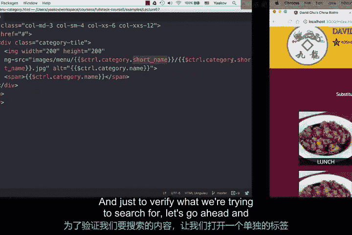
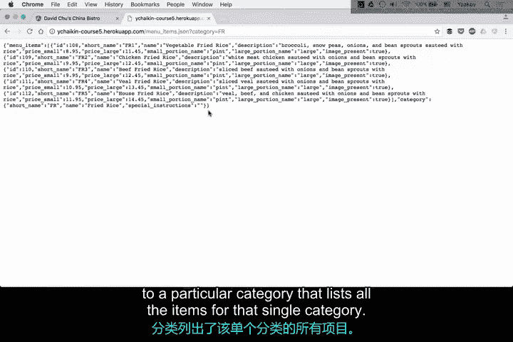
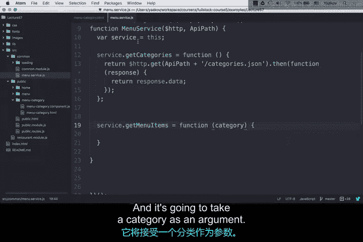
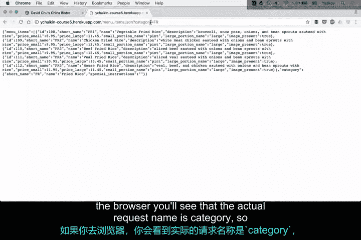
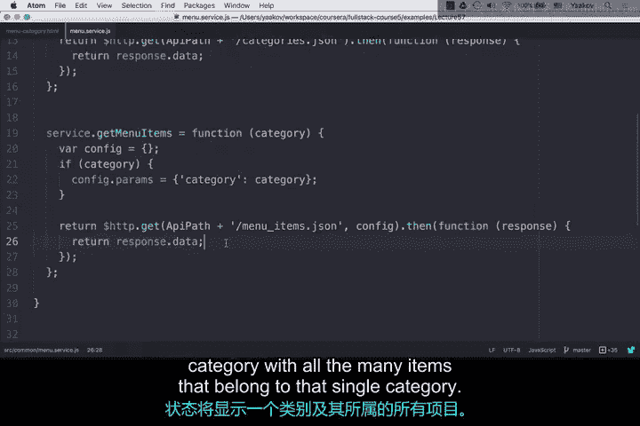

# 116：单个分类视图（第1部分）


在本节课中，我们将学习如何为单个分类创建视图，该视图将展示属于该分类的所有菜单项。我们将从修改菜单服务开始，添加一个用于获取特定分类菜单项的新方法。

---

我们回到代码编辑器，位于 `lecture57` 文件夹中，该文件夹在 `fullstack-course5` 的 `examples` 目录下。现在，让我们查看菜单分类的 HTML 模板。如果回到浏览器（因为浏览器同步已启动），可以看到每个分类磁贴都是由这个 HTML 模板生成的。

目前，我们已经列出了所有分类，但还缺少一个关键页面：单个分类页面，用于展示该分类下的所有菜单项。用户通过点击整个磁贴（或其中的锚点标签）来访问这个页面。目前，锚点链接只是一个 `#`，因为我们尚未对其进行编程。



为了实现这个功能，我们需要将其编程为跳转到一个不同的状态（state），这个状态将列出单个分类的所有菜单项。在此之前，我们必须先获取单个分类的数据。

目前，我们拥有的数据是包含名称和描述的分类列表，但还没有单个分类的菜单项数据。这意味着，在配置下一个视图状态之前，我们需要先修改菜单服务，添加一个能从服务器获取特定分类菜单项的新方法。



为了确认我们要查询的数据，让我们打开一个新标签页，查看服务器上的菜单项接口。访问 `/menu_items.json` 会返回所有菜单项。但我们真正需要的是通过查询参数来筛选，例如 `?category=L`。这样会返回短名（short name）为 `L` 的分类下的所有菜单项。我们需要能够动态地获取这类数据，以便在用户访问特定分类时展示其所有项目。

让我们回到代码编辑器，进入 `common` 文件夹下的 `menu.service.js` 文件。我们将编写一个新方法，命名为 `getMenuItemsForCategory`。这个方法将接收一个分类短名作为参数。





以下是该方法的代码实现：

```javascript
service.getMenuItemsForCategory = function(category) {
  var config = {};
  if (category) {
    config.params = {'category': category};
  }
  return $http.get(ApiPath + '/menu_items.json', config)
    .then(function(response) {
      return response.data;
    });
};
```

在这段代码中：
1.  我们创建了一个 `config` 对象来存储请求配置。
2.  如果传入了 `category` 参数，我们将其设置为 `config.params` 对象的一个属性，这将被 `$http` 服务自动转换为 URL 查询参数（例如 `?category=L`）。
3.  我们使用 `$http.get` 方法向 `/menu_items.json` 接口发起请求，并传入 `config` 对象。
4.  请求返回一个 Promise，我们使用 `.then` 方法处理响应，并返回 `response.data`，即我们需要的菜单项数据。

保存文件后，我们就为配置下一个视图状态做好了准备，该状态将用于显示单个分类及其所有菜单项。

---




本节课中，我们一起学习了如何扩展菜单服务，使其能够根据分类短名获取特定的菜单项列表。我们创建了 `getMenuItemsForCategory` 方法，该方法能构建带有查询参数的 HTTP 请求，并返回处理后的数据。这是构建单个分类视图功能的第一步。在接下来的课程中，我们将利用这个新方法来配置路由和视图，完成单个分类页面的展示。