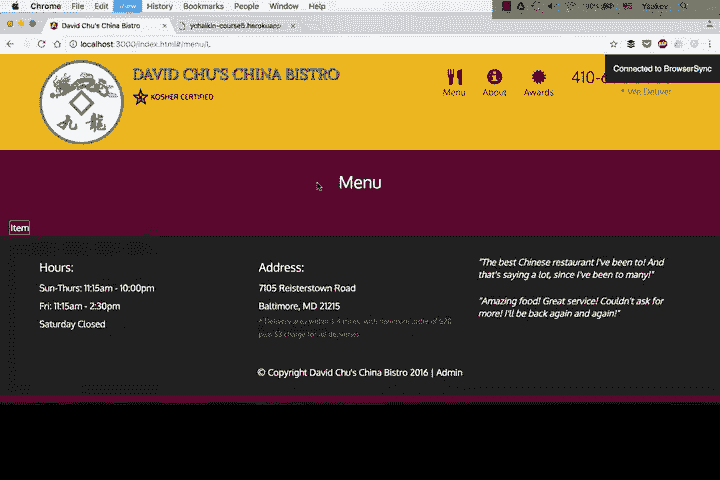
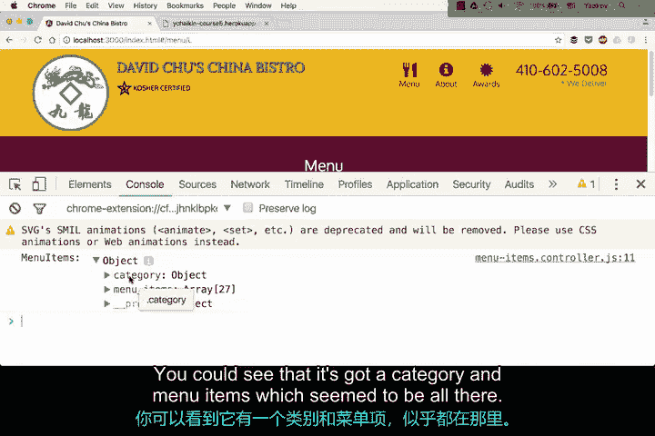
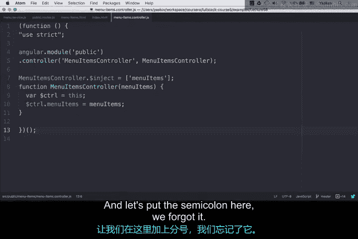

# 117：单个分类视图（第2部分）


在本节课中，我们将继续构建单个分类视图。我们将创建一个新的路由状态，用于显示特定分类下的所有菜单项，并为其配置控制器和模板，最终实现数据的动态展示。

---

回到代码编辑器，我位于第58讲的文件夹中，具体路径是 `fullstack/course5/examples`。

在继续之前，需要说明一点。在常规开发中，我通常会在添加新功能前停下来进行单元测试。例如，`getMenuItems` 方法就需要测试，以确保没有拼写错误或逻辑问题。然而，本课程内容较多，如果详细演示每个测试，课程时长会大大增加，也会打断我们构建功能的连贯性。因此，我必须提醒你：**在你自己的项目中，编写完代码后，务必先进行测试，再继续开发**。虽然我在这里没有演示测试，但我会在课程最后提供包含管理部分在内的所有单元测试代码，供你参考。

现在，让我们回到代码。接下来需要为单个分类的菜单项创建另一个路由状态。

我们打开 `public.routes.js` 文件，向下滚动，在现有状态下方添加一个新状态。

我们调用 `state` 方法，将这个新状态命名为 `public.menuItems`，因为它将是 `public` 状态的子状态，专门用于显示特定分类的菜单项。

我们这样配置这个状态：其 URL 为 `/menu/:category`。这里需要一个参数 `:category`，即分类的短名称，以便确定要显示哪个分类的菜单项。

接下来，我们需要为这个状态指定一个模板。设置 `templateUrl` 为 `src/public/menu-items/menu-items.html`。这个文件我们尚未创建，但马上就会创建。先保存这个路由文件。

现在，我们来创建模板文件。在 `src/public/` 目录下创建 `menu-items` 文件夹，并在其中创建 `menu-items.html` 文件。暂时，我们只在文件中写一个简单的标题：

```html
<h1>Yum!</h1>
```

保存文件。接下来，我们需要配置一个链接来导航到这个新状态。这个链接位于显示所有分类的页面上，即 `menu-categories` 组件的模板中。

我们找到 `menu-category.html` 模板，将原来的 `href` 链接替换为 `ui-sref` 指令，指向我们刚创建的状态 `public.menuItems`。同时，我们需要传递 `category` 参数。我们通过传递一个对象来实现：`{ category: category.short_name }`。这里的 `category.short_name` 就是我们要传递的分类短名称。

保存更改，回到浏览器，点击“Menu”链接。现在，点击“Lunch”分类，页面应该会显示“Yum!”，并且URL会变为 `/menu/l`。返回后，再点击“Appetizers”分类，URL会变为 `/menu/b`，但页面仍然显示“Yum!”，因为我们还没有为特定分类编程显示实际内容。

让我们回到代码编辑器。现在，我们不再需要 `menu-category.html` 模板中的占位符内容。既然路由工作正常，我们需要将之前用于显示单个分类菜单项的HTML片段移植过来。

参考第49讲中的旧版网站，我们需要移植两个部分：
1.  菜单项的标题部分。
2.  实际的菜单项列表片段。

首先，复制标题部分的HTML，粘贴到我们的 `menu-items.html` 文件中。**注意**：这次需要将它包裹在一个 `container` div 中，因为每个子视图需要自己的容器，而之前没有是因为它被插入到了一个已有容器的上下文中。

然后，复制菜单项列表的HTML片段，也粘贴到 `menu-items.html` 文件中。显然，现在其中的插值表达式（如 `{{item.name}}`）还无法工作。

我们可以在浏览器中尝试一下，可以看到页面结构加载了，但图片和内容没有正确显示，因为我们还没有将控制器与这个状态关联起来。

在关联控制器之前，我们先创建这个控制器。新建一个文件 `menu-items.controller.js`。

我们使用 IIFE 和严格模式，并在 `public` 模块中定义控制器：

```javascript
(function () {
  'use strict';

  angular.module('public')
  .controller('MenuItemsController', MenuItemsController);

  MenuItemsController.$inject = ['menuItems'];
  function MenuItemsController(menuItems) {
    var $ctrl = this;
    $ctrl.menuItems = menuItems;
  }
})();
```

这个控制器需要注入 `menuItems` 数据，这些数据将来自我们稍后在路由状态中配置的 `resolve` 属性。控制器的作用很简单：将注入的 `menuItems` 数组暴露给视图。

接下来，我们需要将这个控制器关联到路由状态。回到 `public.routes.js` 文件，在刚才定义的状态配置对象中，添加 `controller` 和 `controllerAs` 属性。同时，添加 `resolve` 属性来异步获取菜单项数据。

在 `resolve` 中，我们定义一个返回 Promise 的函数。这个函数需要 `MenuService` 来调用 `getMenuItems` 方法，并且需要 `$stateParams` 来获取URL中的 `category` 参数。

```javascript
resolve: {
  menuItems: ['$stateParams', 'MenuService', function ($stateParams, MenuService) {
    return MenuService.getMenuItems($stateParams.category);
  }]
}
```

保存路由文件和控制器文件。现在，回到 `menu-items.html` 模板，我们可以尝试通过插值表达式 `{{ $ctrl.menuItems | json }}` 来输出获取到的数据，以便调试。

保存后刷新浏览器，但发现页面没有按预期显示JSON数据。检查控制台，可能会看到“MenuItemsController is not defined”的错误。这是因为我们忘记在HTML中引入新创建的控制器文件。

我们需要在 `index.html` 中引入这个控制器。找到引入其他脚本的地方，添加一行：

```html
<script src="src/public/menu-items/menu-items.controller.js"></script>
```

再次刷新浏览器，现在页面应该能显示出一大串JSON数据了，这证明数据获取和绑定成功了。



我们可以回到控制器，暂时添加一个 `console.log` 语句来确认数据格式，确认无误后将其移除。



最后一步，我们需要修改 `menu-items.html` 模板，使用 `ng-repeat` 等指令来遍历 `$ctrl.menuItems`，并正确绑定每个菜单项的属性（如名称、描述、价格、图片等），替换掉之前硬编码的HTML，从而实现动态渲染。

至此，单个分类视图的核心数据流和展示框架就搭建完成了。在下一讲中，我们将完善这个页面的样式和细节。

---




本节课中，我们一起学习了如何为特定分类创建子路由状态，如何通过 `resolve` 属性在路由激活前异步获取数据，以及如何创建控制器将数据暴露给视图。我们还修复了因未引入脚本文件导致的控制器未定义错误，并初步验证了数据绑定的正确性。