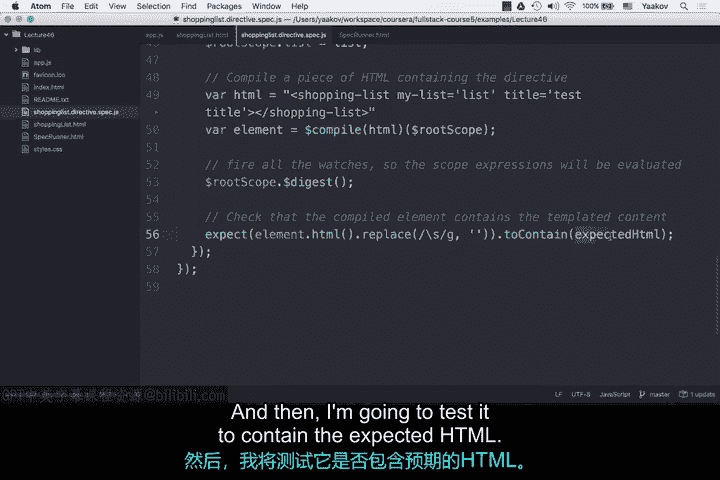
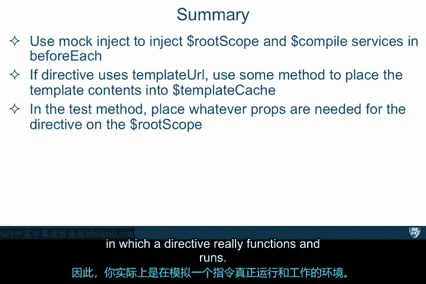

# 约翰霍普金斯大学《使用 AngularJS 开发单页 Web 应用｜Single Page Web Applications with AngularJS》中英 - P100：99_第46讲（第2部分）：测试AngularJS指令.zh_en - GPT中英字幕课程资源 - BV1dsFDeZEQr

🎼。

Okay， we're back in our code editor and we're located in lecture 46。

 which is located in fulltag dash Course 5 examplesles folder。

 and you can see the app that we're testing out directly from was copied directly out of lecture 28。

😊，Okay so let's close this readme file and here's our app it's called shopping list directive app and in it we have a directive that we declared called shopping list and you could see the Ddo set up right here the directive data definition object and you can see it's using a template URL and if we look at this template it's basically just an h3 with a title and then we're looping over something that is sitting inside list that items so we need a title and list that items in order to have our directive output this properly So let's go ahead and take a look at our shopping list that directive that specjs so here you can see in a describe function we're saying shopping list component that's just announcing what we are and we're also storing the dollar sign compile and dollar sign rootcope for later using our test and here I've set up the expected HTML and you can see here it's a whole bunch of HTML which I'm actually replacing。

The spaces inside of it using a regular expression with an empty space meaning I want to remove all the spaces because the spacing keeps changing depending on you know how it's actually displayed or how I copyied it from my Chrome console so it's not gonna to matter the spacing I just want to make sure that the content is basically exactly the same and as you could see these slashes right here I need it if I remove one it doesn't really know how to let the string wrap around so these backslashes I needed it so the jascript interpreter will know how to read this as one long string okay so next thing we're doing is we're getting this module will' loading the module which is shopping list directive app or by the way the way I got the string is simply by running the code and running the supplication and then looking in the Chrome developer tools and copying what I thought was the correct answer so to speak what I thought was produced correctly so now I can use。

Reuse this over and over because I can control the specific things inside of this list that's getting generated by basically mocking things out when I run the test so let's go ahead and look at the another before reach where I'm basically just injecting the compile service and the Dallas science scopepe service there's literally nothing else to it here just making sure that they're saved off so I could later use them somewhere else。

😊，Okay the last thing I'm doing here is taking care of my template since my template is not just a regular template but it's a template URL。

 Angular will try to reach out and grab this shopping list HTML using Ajax and I don't want that to happen so in order to avoid that I'm using this dial assigned template cache which is a template cache service and what I'm doing here is basically using regular Ajax and you could look through this code it's very standard Ajax to place it or to grab the contents of that HTML file and I'm using false here。

 which is admittedly a hack to make sure that it's not an asynchronous call。

 but it actually is a synchronous call and once I grab all the contents of that and they get saved into this directive template variable I take my template cache and I put it into in other it's like a map that has keys and storage associated with those keys。

😊，And I associate the key shopping list that HTML， which is the name of our template right here。

 which is what it's going to get reached out to。 I'm associating that with the directive template。

 which is what the contents of the template。😊，A once I pulled them out using just regular Ajax well not really Ajax。

 more like just a regular request to be able to pull the contents of that file okay that's really all it is to it and now the actual test so here we're checking that it replaces the element with the appropriate content。

OkayThe first thing we're going to do is we're going to set up our list。

 remember if you look at shopping list at HTML， it's expecting this list that I could grab items out of so it's expecting that from the surrounding content right the content that's going to be surrounding list is going be some other HTML maybe index that HTML that this is going to get placed into and we're expecting that list is going to be one of the objects I can access So I'm going to go ahead and make sure that that's available so I'm going to create this list object and I'm going to place a couple of items in it or an array of items here one is going have item1 and quantity1 the other one name is item 2 Qua2 and what I'm going do next is create a list property directly on the scope object and equal it to that list that I created right here once that's done I'm going to create the HTML the same way I would have placed it inside of indexex that HTML or some other template I'm going to create my directive which is shopping list。

😊，And I'm going call my list because apparently that's what it is requiring， let's go take a look。

 you can see my list is what it's expecting and I'm going to also give it a title and it's expecting let's go back to the code here it's expecting just a regular string right here so since it's an et sign so I'm going to give it a string called test title and after I'm done with that I could take that HTML right here that HTML and I could pass it directly into the compile function which is going to produce a function that expects another argument that is a scope that I could bind things from meaning the HTML is going to look for certain things like this list property on some scope that I give it right here so therefore so this is going to produce a function that is when you execute this function which is what we're doing basically in line immediately is going to use this scope as the data holder for whatever this directive need so it's going to bind the data to the directive。

😊，From the scope that I provide right here and that's how we get this element compiled bound with the data element right here and the next thing I need to do is I need to fire all the watches such that the scope expression will actually get evaluated and whatever data that I bound to this compiled HTML will actually get inserted inside of our HTML automatically for us by Angular once that's done I can now start testing so what I'm doing here is I'm calling element that HTML and since I don't really know all the different classes on whatever else that Angular will insert into my HTML I'll go ahead and replace all the spaces because I don't know how it's going to space things out with basically just an empty space and then I'm going to test it to contain the expected HTML which if you look I also basically grabbed from the Chrome developer tools and I also replace all the spaces in there so in it is going to be the same thing。

😊。

Without all these spaces。 and all I want to know is， is it the same exact string or not。

 So let's go ahead and go to the browser。 and I have this already started。 So if I click。

Spec run of HTML， you could see shopping list component。

 which is actually a mistake it really should say shopping list directive。

 let's go back and quickly change that， let's put it that describe shopping links directive。😊，Okay。

 and let's go back and now it's now going to say shoppingly is directive and it replaces the element with the appropriate content I can see it's green I have one back with zero failures。

 so therefore our tests succeeded and the strings match exactly。

Okay so let's summarize in order to test the directive。

 you should roughly follow the following steps The first thing you would do is you would use a mock inject method to inject the dollar sign rootcope and the dollar sign compile services in before each function if the directive you're testing is using template URL property。

 you use some method to place the template contents into the dollar sign template cache Now the two available methods are the hacky way that we did it in this lecture which is making kind of a asynchronous colon and kind of turning off the asynchronous part of it and making it synchronous or you could use the command line car or test runner and this is really what's more recommended than what we did in this lecture。

In the test method， you place whatever properties are needed for the directive on the dollar sign rootcope。

 therefore you're really simulating in an environment in which a directive really functions and runs。

The next step is for you to use the compile service to compile the directive string。

 which is what your directive is declaring itself to be in your regular HTML and then using the return function of that compile service to bind with the data by passing it the Do sign rootcope service the final step to prepare you to be able to test things is for you to call the Do sign rootcope that digest and that updates the compile HTML with whatever data you bound to that particular scope and HTML is now ready to be tested for what it would look like when it shows up to the end user and now all you really need to do is to grab that HTML with the dot HTML method on that element that you compiled and bound the data to and just compare it with some data or some string that you know to be kind of the ground truth and what you expect the end result to be。

😊。