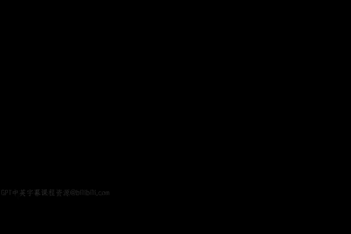
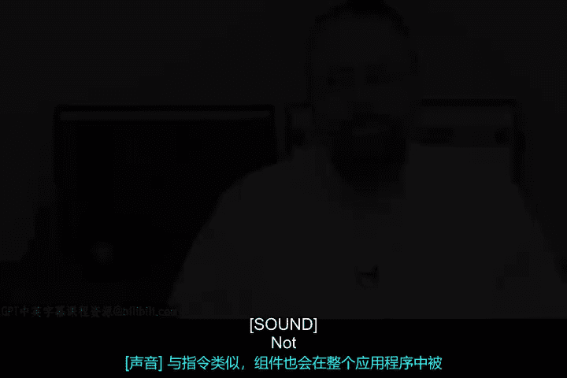
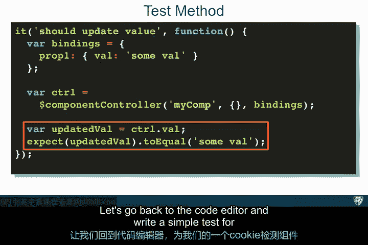
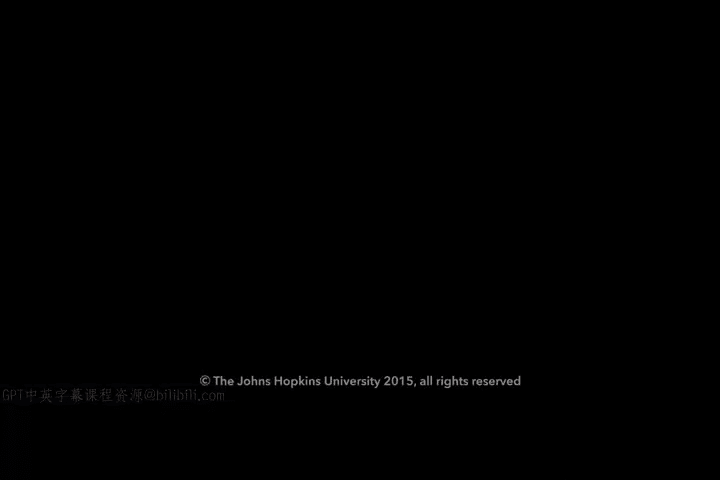

# 约翰霍普金斯大学《使用 AngularJS 开发单页 Web 应用｜Single Page Web Applications with AngularJS》中英 - P101：100_第47讲（第1部分）：测试AngularJS组件.zh_en - GPT中英字幕课程资源 - BV1dsFDeZEQr

🎼。

Not unlike directives， components also get reused throughout the application。

Not that component based architecture is becoming very popular。

 we need to get used to testing angular componentsLuckily the NGM module provides a helper service called Dasign component controller that allows us to create our component controllers in such a way that they're easy to unit test Let's go ahead and take a look at the syntax。

The first thing we have to do after using the Mac module method to load our My app module is to use the Mac inject method to inject the dollar sign component controller service once we have a handle on the reference to the dollar sign component controller service we'll save it off in a variable that will be accessible to all of our test methods Now we're ready to write our test methods。

First， we'll set up our bindings if our component controller is expecting any。 in this case。

 we'll assume that the component controller is expecting an object referenced by a bound property called Pro 1。

 Next， will create the controller responsible for our component using the Mac dollar sign component controller service。

 The first argument is the name of our component， as we declared it in our application module。

 The second argument are the injections our component is expecting。 In this case。

 you could see that our example component is not expecting any injections。😊，Finally。

 we pass the bindings object， which is the mock bindings object we just created specifically for this test。

 The last step is easy。 We can call the controller's logic or simply check that one of its properties initialize correctly。

 which is what we're doing in this case。 Now we just need to verify an expectation regarding that property and we're done。

😊，That's it， let's go back to the code editor and write a simple test for one of our cookie detection components。

