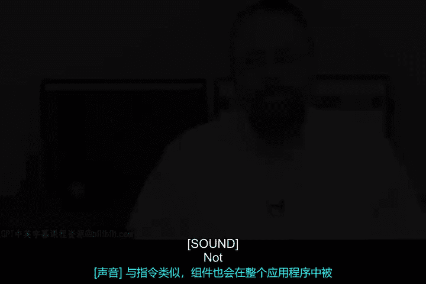
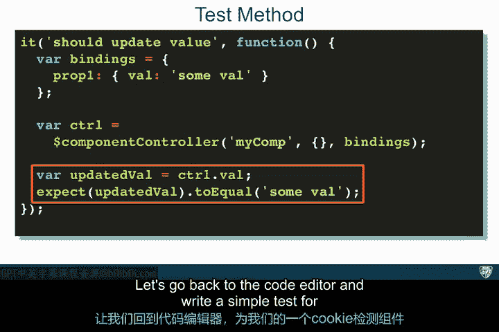

# 使用 AngularJS 开发单页 Web 应用：P101：测试 AngularJS 组件（第1部分）




在本节课中，我们将要学习如何为 AngularJS 组件编写单元测试。与指令类似，组件在应用程序中也会被重复使用。鉴于基于组件的架构正变得越来越流行，我们需要习惯测试 Angular 组件。幸运的是，`ngMock` 模块提供了一个名为 `$componentController` 的辅助服务，它允许我们以一种易于进行单元测试的方式来创建组件控制器。接下来，让我们看看具体的语法。

## 测试设置与语法

上一节我们介绍了测试组件的重要性，本节中我们来看看如何使用 `$componentController` 服务来设置测试。

首先，在使用 `module` 方法加载我们的应用模块（例如 `myApp`）之后，我们必须使用 `inject` 方法来注入 `$componentController` 服务。

```javascript
beforeEach(module('myApp'));
beforeEach(inject(function(_$componentController_) {
  $componentController = _$componentController_;
}));
```

一旦我们获得了 `$componentController` 服务的引用，我们会将其保存在一个变量中，以便所有测试方法都能访问它。现在，我们就可以编写测试方法了。

## 创建组件控制器实例

以下是创建组件控制器实例并进行测试的步骤。

首先，如果我们的组件控制器期望任何绑定属性，我们需要设置这些绑定。在本例中，我们假设组件控制器期望一个通过名为 `prop1` 的绑定属性引用的对象。

```javascript
var bindings = {prop1: {}};
```

接下来，使用 `$componentController` 服务创建负责我们组件的控制器。第一个参数是我们在应用模块中声明的组件名称。第二个参数是我们的组件期望的依赖注入项。在本示例中，我们的组件不期望任何注入项。

```javascript
var ctrl = $componentController('myComponent', null, bindings);
```

最后，我们传递绑定对象，即我们专门为此测试创建的模拟绑定对象。

## 执行测试与验证

最后一步很简单。我们可以调用控制器的逻辑，或者简单地检查其某个属性是否正确初始化，这正是我们在这个案例中所做的。

```javascript
expect(ctrl.someProperty).toBeDefined();
```

现在，我们只需要验证关于该属性的期望，测试就完成了。让我们回到代码编辑器，为我们的一个组件编写一个简单的测试。

## 课程总结




本节课中我们一起学习了如何为 AngularJS 组件编写单元测试。我们介绍了使用 `ngMock` 模块中的 `$componentController` 服务来实例化组件控制器、设置模拟绑定属性以及执行基本断言的方法。掌握这些技巧对于确保基于组件的应用程序的可靠性至关重要。