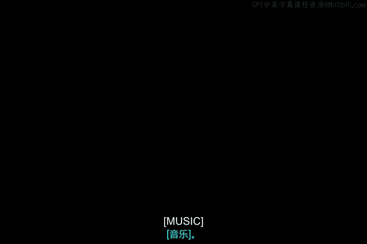
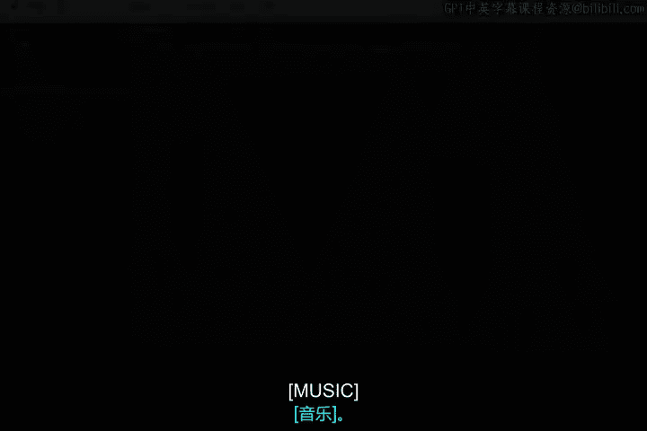
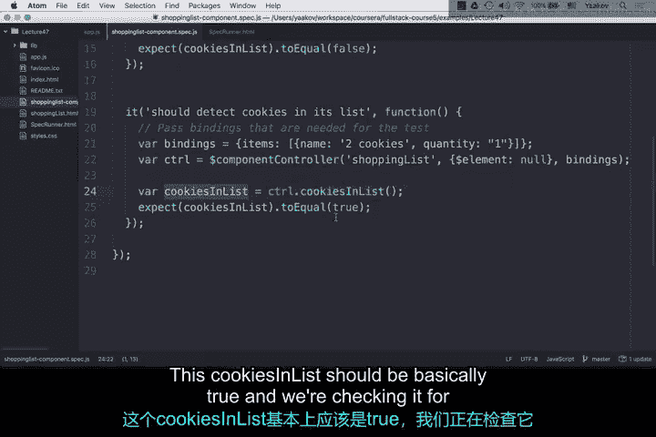
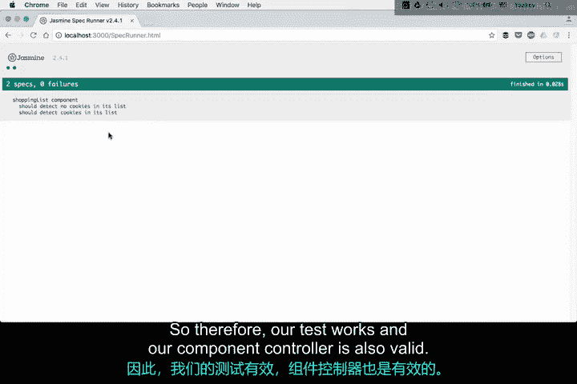
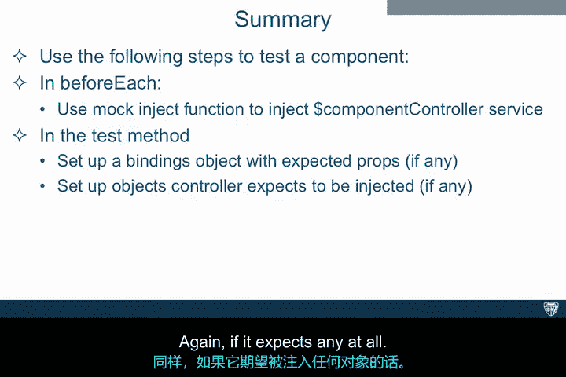

# 约翰霍普金斯大学《使用 AngularJS 开发单页 Web 应用｜Single Page Web Applications with AngularJS》中英 - P102：101_第47讲（第2部分）：测试AngularJS组件.zh_en - GPT中英字幕课程资源 - BV1dsFDeZEQr

🎼。

Okay we're back in our code editor and we're located in lecture 47。

 which is located in fulltag dash course 5 examples folder and you can see from this readmi txt that we took all of this code from the lecture 33 1。

5。8 That's the lecture where we switched our version of Angular for 1。5。7 to 1。5。

8 in order to use the lifecycle methods that Angular introduced on the controllers and the component controllers we could close this file。

 let's take a look at the Abdotjs we have a component here called shopping list and its controller shopping list component controller if you take a look here has this method called cookies inlist and basically what this method method does is just checks all the items and checks to see whether or not any of the item names have the word cookie inside of it If any of the items have the word cookie inside of one of its names then it returns true。

Otherwise， it returns false。 we want to make sure to test this method to make sure we detect the cookies with absolute precise accuracy。

 So let's go take a look at our shopping list component that speced that Js。

So the first thing we're doing is we're going to save off our component controller service in this variable component controller。

 data sign component controller， we're going to load in the module shopping list component app。

 that's the module that houses our component。And we're going to inject the underscore theign component controller underscore。

 which just lets us easily save off this component controller service。😊。

And now we're ready for the test。 and the test goes like this。 First。

 we're going to create these bindings and the bindings is going to be really going to have two tests。

 One is going to be without cookies， and one is going to be with cookies。

 So this one is without cookies and the bindings， we're going to create an items inside the bindings because if you look at our component。

 it is looking for these items property， and it's going to be a one way binding here。😊。

And all we care here is that we provide one particular item and it's going to have an item name item one and quantity is going to have one。

 and then what we're doing is we're creating our controller the creating our component controller by passing it the name of the component which is a shopping list and then we need to pass it anything that our component expected to be injected with if we take a look at our component controller we're expecting to inject dollar sign element service into it Well we don't care about this because we're not testing anything with it but we still need to provide some kind of object because Angular will look for it and if it doesn't find it it will go ahead and give us an error。

 So in order to avoid the error we're going ahead and provide it。

 we're going to provide the property but we're gonna just give it a no because we don't care about it and the last thing actually let's just move this code a little bit over So it spans the whole line and last thing is going to be the bindings this component controller is expecting。

😊，These bindings that it will go ahead and put into our component。Once that's done。

 we have the CTRL as the component controller that is controlling that component called shopping list In this case。

 we could just call cookies andlist method on it directly and get either true or false in this case we're expecting it to be false so we test it for equality to false in the second test that we have is exactly the same thing except in this case。

 the name that we provide is two cookies， even though the quantity is one So anyway and then we create our component controller and in this case when we call cookies is in list or cookies and list。

😊，This cookies enlist should be basically true and we're checking it for equality to true let's go back to our browser and let's go ahead and run this spec test and you see we have two specs。

 one shopping list component should detect no cookies enlist and that is green to past and the shopping list component should detect cookies in its list so that's also green and it detected both things properly。

 so therefore our test works and our component controller is also valid。

Okay， so let's summarize。Use the following steps to test the component。In the before each method。

 you use the Mac inject function to inject the Doign component controller service。

 This is what's going to create our component controller for us。😊。

Inside the test method first you set up the bindings object with the expected properties if there are any at all。

 then you set up objects controller expects to be injected with again if it expects any at all and the last thing is you create the controller with the component controller service and you give it the component name that your main application declare this component with。

 you pass it the injections and you pass it the binding object then you take that controller instance and you basically execute methods and check its properties just like you would any other controller and then check it for the expectations that you have out of that controller。

😊。

