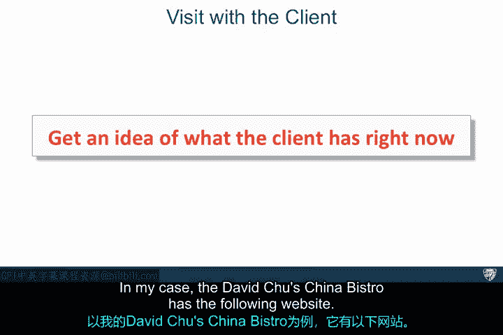
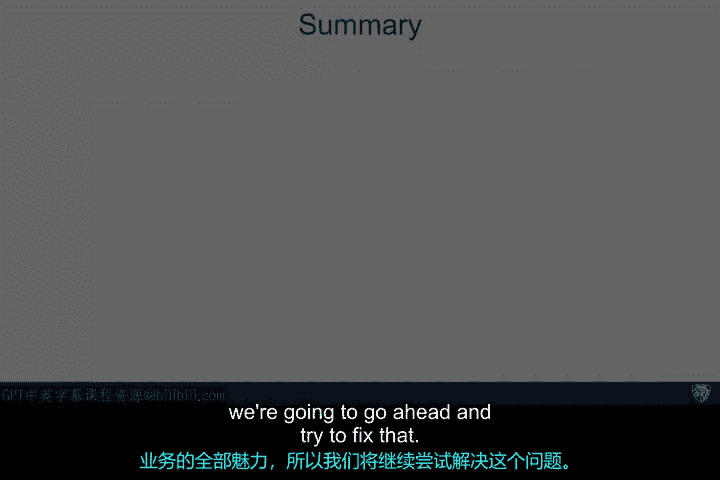
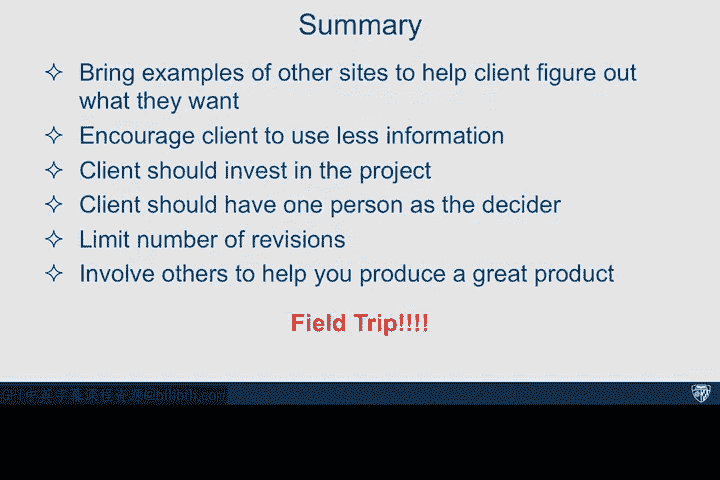

# 使用 AngularJS 开发单页 Web 应用：P103：可选讲座48（第1部分）：客户拜访 📝

在本节课中，我们将学习如何为真实客户进行需求访谈。这是构建网站项目的第一步，我们将探讨与客户沟通的核心原则和实用技巧，以确保项目顺利启动。

接下来的讲座（第一部分和第二部分）摘自我之前的课程《面向 Web 开发者的 HTML、CSS 和 JavaScript》。如果你已经上过那门课并看过这些视频，或者只想继续编写代码，可以跳过它们。这些内容对本课程并非必需，但它们具有相关性，因为你会见到我们将为之制作网站应用的餐厅老板，学习一些自由职业者进行客户访谈的技巧，但主要还是观看过程很有趣。

在第一节中，我将介绍进行客户访谈的一些原则。在第二节中，我们将实地探访餐厅。希望你喜欢。

现在，我们准备开始为真实客户创建真实网站的冒险。在我的案例中，我联系了一家名为“David Chu‘s China Bistro”的本地餐厅，我们将为他们建立一个餐厅网站。在去拜访客户之前，我们先来了解一些规则和基本思路，这样你就不会完全摸不着头脑。显然，这不会是全面的商业策略或全面的客户应对指南，而是一些基本规则，帮助你理解我们的出发点。

你需要记住的第一个概念是：**大多数客户并不知道他们想要什么**。这不是因为他们无知，事实上，他们对自己的业务非常了解，但他们通常确实不知道网站上应该有什么，以及整个事情如何运作。因此，你的工作实际上是提出问题，最重要的是提出正确的问题，以帮助客户弄清楚他们想要什么，并将其传达给你。

一个很好的方法是，你带来一些已有网站的类似企业的网站示例，让客户对这些网站做出反应。你可以向他们展示几个网站，看看他们是否喜欢这个，是否喜欢那个，他们喜欢这个网站的哪些方面，不喜欢那个网站的哪些方面。当你把足够多的例子摆在他们面前时，你就会开始感觉到他们会满意什么，以及他们实际上为自己的产品网站寻找什么。

作为一般规则，每个客户都希望在页面上放置大量关于其业务的信息。这是有道理的，因为作为客户，你应该了解他们业务的许多方面，其中很多都非常重要。他们会告诉你这个也很重要，他们希望这个非常醒目、放在前面；那个也很重要，但他们希望放在侧边；还有更多事情很重要。这是一个非常重要的提醒：一切都会变得非常重要。这是客户相当常见的做法。

这完全是人之常情。唯一的问题是，**当一切都重要时，就没有什么是真正重要的了**。所以，这又是你的工作，你要鼓励客户遵循一个非常简单的规则：**少即是多**。你放上的信息越少，这些信息的影响力就越大。关键是，你应该鼓励你的客户不要在网站上塞满信息。事实上，你应该努力帮助客户做的是，识别出最关键、最重要、最有冲击力的信息，而不是把所有可能知道的关于业务的信息都塞进去。

我想与你分享的另一个快速技巧是，你应该始终尝试找到一种方法，让客户对项目进行投资。如果你只是为了建立作品集而免费做这件事，这一点尤其正确。客户需要感觉到他们自己也投入了一些东西。如果他们不投入，最终会发生的情况是，你将成为他们并不太关注的某个次要项目，你将花费和投入自己的所有时间，却不一定能从他们那里得到多少合作。所以，即使你是免费做这件事，也要让他们做点什么，至少承诺支付产品摄影费用（如果适用的话），或者承诺提供你需要用于演示的产品。或者，如果你找到一位愿意免费做这件事的摄影师（我稍后会谈到），至少他们会提供产品，并且他们将在项目中投入一些实际的、真实的资金，即使金额不是特别巨大。

只要他们实际上在花费一些东西，他们至少会有一些投资，他们会更认真地对待整个项目。

另一个重要规则是：**确保客户指定一个人负责决策**。如果你不这样做，会发生的情况是，这个人会告诉你他们真的想要这样，而企业里的另一个人会告诉你他们想要不同的东西。如果你有一个指定的人，你总是可以告诉其他提建议的人，这是一个很好的建议，但我对这个特定的人负责，我会把这个建议带给那个人，如果那个人批准了，我将很乐意采纳它。这引出了另一点：**预先限制修改次数**。

确保你提前与客户沟通，甚至可以签订合同，让他们签字同意你愿意进行的修改次数。因为显然，客户可以无休止地要求修改，而你的时间是有限的。如果是有报酬的工作，不要直接限制修改，但要限制免费修改的次数。例如，你可以说，我将在合理范围内（不是完全推翻重做）免费修改网站最多三次，之后将按小时收费。你可以根据自己的情况来安排结构。

关于具体要问客户什么，我强烈建议你谷歌搜索“Web development client questionnaire”（网站开发客户问卷），你会看到大量资源，可以从中学习如何提出这些问题以及寻找什么样的答案，只是为了了解一下这种互动是什么样的，如果你以前从未自己做过这件事的话。

我想与你分享的另一个快速技巧是，如果需要，你应该尝试让其他人参与进来。例如，如果你不是一个超级厉害的平面设计师，而我们真正专注于编码，而不是设计本身，你可以联系当地大学，看看是否有平面设计专业的学生愿意加入你，提供一些免费的设计服务，并把这段经历放在他们的简历上。你将负责编码，他们将负责设计，等等。如果你正在尝试创建的网站需要一些摄影，比如产品摄影，你也可以做同样的事情。你可以找一位愿意免费工作的年轻、崭露头角的摄影师，只要他/她被提及和署名，并且能够把这段经历放在他/她的简历上。这样，你将能够收集一些专业资源，而不会觉得你必须自己完成所有事情才能制作出看起来相当专业的东西。

在我的案例中，对于 David Chu‘s China Bistro，我相当幸运。我的妻子恰好是一名平面设计师，所以她将帮助我进行网站布局的初步设计。我的儿子恰好是一名摄影师，至少是初出茅庐的摄影师，他非常愿意提供食物摄影服务。现在，我将遵循我自己的建议。我仍然会让餐厅老板对这个项目进行投资，他们投资的方式是同意提供菜单上的每一道菜，以便我们能为这些菜品拍摄合适的照片。这是一项相当可观的投资，因为他们必须在营业时间后让员工留下来，基本上烹饪菜单上的每一道菜并提供给我们。所以这是他们数小时的工作，但这表明客户参与其中并且客户是投入的，这非常重要。

现在，另一件事是，在与客户会面之前，一定要先了解客户目前拥有什么，他们有什么样的网站，他们展示了什么信息，只是为了稍微了解一下这个业务。在我的案例中，David Chu‘s China Bistro 有以下网站，让我们来看一下。

好的，这就是他们的网站。它显然是放在某个免费服务上的，也许不是免费的，但直接看他们的电话号码，那就是他们的域名。你可以看到，它实际上就是一张图片。如果我们看一下，看起来是的，就是一张图片，是他们菜单的图片。我一眼就能看出他们的菜单有不同的类别，我想这很标准。

但这个网站在用户体验方面肯定相当糟糕，当然也没有展现出这个业务及其全部魅力。所以，我们将继续努力解决这个问题。

那么，让我们总结一下。首先，**不要忘记带一些其他网站的示例**，以帮助你的客户弄清楚他们想要什么。客户通常真的不明白他们自己想要什么，给他们一些例子将有助于引发讨论，并确定他们真正想要的方向。

同时，**鼓励你的客户使用更少的信息**。对于几乎所有非业内人士来说，试图塞入尽可能多的信息是一种本能反应，但这几乎总是错误的方式。拥有更少但更切中要害的信息，比拥有大量信息但所有信息都迷失在其中要好。

想办法让你的客户对项目进行投资，无论是支付你一点费用，还是预先承诺支付某些费用，比如摄影费或提供他们的产品。但必须是他们所谓的“skin in the game”（利益共享），这样他们也会认真对待这个项目。如果你只是为了建立作品集而免费做这件事，这一点尤其正确。

非常重要的一点是，**客户应该指定一个人作为网站内容（或非内容）以及项目中一切事务的决策者**。如果你有不止一个人，混乱就会开始，你将花费太多时间处理与编码和网站无关的事情，而只是管理这些本不该存在的关系。就让一个人，让客户指定一个人作为最终决策者。

同时，**限制修改次数**。不要让客户不断地修改再修改。如果你是免费做这件事，当然要限制在一个合理的次数，比如三次。但如果你是有偿服务，那么限制免费修改三次，之后任何额外的修改，客户实际上必须付费。

另一件事是，**让他人参与进来，以帮助制作出优秀的产品**。很少有人能一个人包揽所有事情，既懂产品摄影，又懂布局设计。让其他人参与进来，让他们帮助你，这样你就可以专注于编码。

接下来，让我们去拜访实际的餐厅，见见老板，弄清楚他们想要什么样的网站。这意味着实地考察。

本节课中，我们一起学习了与客户进行初次访谈的关键原则。我们了解到客户往往不清楚自己的具体需求，因此需要开发者通过展示示例、提出引导性问题来帮助他们明确目标。核心要点包括：遵循“少即是多”的原则，避免信息过载；确保客户对项目有所投入以增加其重视程度；指定唯一的决策联系人以提高效率；以及预先设定修改次数以避免无休止的改动。我们还讨论了在必要时引入其他专业人士（如设计师、摄影师）合作的可能性。这些步骤为项目的顺利启动和高效沟通奠定了基础。下一节，我们将实地探访餐厅，应用这些原则进行真正的客户访谈。