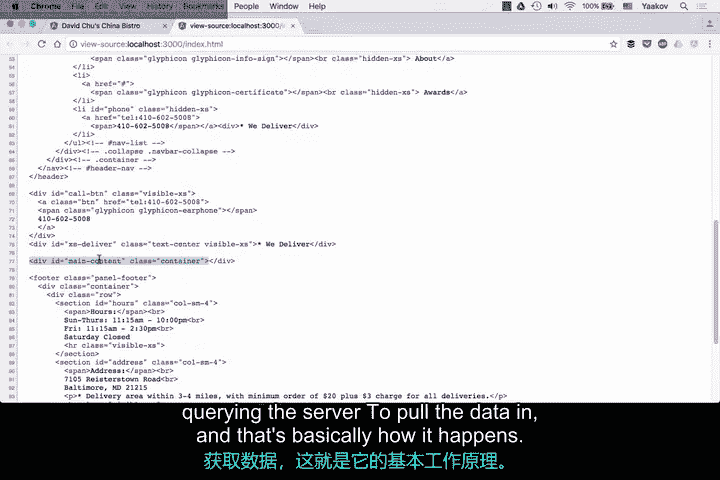
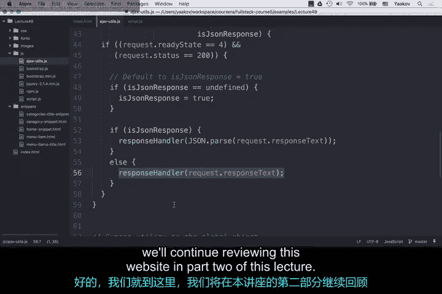

# 约翰霍普金斯大学《使用 AngularJS 开发单页 Web 应用｜Single Page Web Applications with AngularJS》中英 - P105：104_可选讲座49（第1部分）：非AngularJS网站概览.zh_en - GPT中英字幕课程资源 - BV1dsFDeZEQr

🎼。

Okay so before we embark ourselves on building this entire website in Angular JS。

 let's take a look at the built website that we left tough with in the previous course。

 which is HTML CSS and jascript for web developers the concentration of that course was HTML CSS and in particular responsive design using CSS and basics of JavaScriptscript and AjaX and while we didn't build anything super duper fancy but the website came out to be pretty good and the customer was happy as well So what I did here is I copied the very latest version of the website from the previous course and I placed the contents of that folder directly into lecture 49。

 which is located in fulltag dash course 5 examples folder and I already have my browser sync started up inside the lecture 49 folder so let's go to the browser and check out the website so here's the website it's fully responsive if we squeezed the browser a little bit you'll see that things get rearranged icons get small。

And the pictures get smaller。 Some things just simply go away。

 and eventually we get to the mobile view where we have this， you know burger button。

 so to speak that you it could be clicked。 and you could see the whole menu go to the menu and actually。

 let's expand it。And now you could click any particular menu you want and you could see prices for a particular menu item as well as the picture and the ID that the restaurant knows about that you could call with that particular I say I want two a1s meaning two soups so let's go back to the homepage and you could see if you take a look at the URL。

 there isn't much routing going on。 So if I click the back button really I'm not really going anywhere the pound sign went away but I'm still sitting inside of the soup menu category。

 So I have to click this button right here or this link and it will take me back to the homepage and basically the routing is obviously not here。

 So if I click on the menu I go back to all the categories click back on the logo get back to the home page and here's a homepage and here's another way to basically click on the menu So let's take a look quickly at the HTML that gets served over here let's take look at the view page source not what the dumb things is going on but the page source and what we have here is besides the head and the header。

 which。😊，A whole bunch of things for CSS and the look of it so to speak。

 And right now we're trying to concentrate on functionality。

 if you take a look here after the headers is done and we have this cold button that's the giant telephone button that shows up only in the mobile view we have this placeholder the div with the ID content dash main and after that we have the footer So everything you see other than the footer and the header is actually contained in this empty main dash content and the way we put content in here is using Ajax and then finding this particular element in our page and then inserting the content。

 obviously first querying the server to pull the data in and that's basically how it happens Now don't get confused by the way by this fve icon that's showing Angular Js that's just I don't have a fave icon for this website and that's just my browser caching the Angular Js fve icon from all the other local host。

hou that I've been doing throughout the course。 Okay。

 so let's go back to the code editor and let's take a look at this code and if we scroll down。

 you can see this is all just part of the head。 this is index that HTML and we finally get to this code button and there's our div with the main content class container。

 but basically the main content。 that's where we're going to be inserting the content of the page。

 basically manually coding what our UI router was going to do for us with the UI dash view tag。

So what I want to do in this lecture is really concentrate on the functionality。

 not necessarily on the layout or the CSS， but on the functionality that we coded using a regular JavaScript。

😊，As you can see here on the left we have AJXutils。

js and that's a script we wrote ourselves and there's a whole bunch of bootstrap jQury and PMm。

js and Scri。gs so those two files AJxutils。js and Scri。

js are the files that we ourselves wrote in order to make this website functional Let's take a look at AJX Uils。

And AGS U really is mainly about this one method， which is send get request， that AGS U。

 the rest of it is basically all to support this particular method。

And I'm not going to go over the standard get request object functions where it gets this XmL HtP request。

 you could take a look at it yourself， but I do want to go over the send get request。

 It basically is a function that takes a request URL that's what we're going to make the actual network call to the response handler which is the function who is going to handle the response once it comes back from the server and a flag is JSsonN response In other words。

 sometimes we're going to get some data and we might want to preprocess that data since we're assuming it's going to be JSON preprocess it and turn it into a regular jascript object but sometimes we're going to be requesting a template or partial or basically a piece of HTML that's needed for our view and we're also going to use an AS request for that as well so for that we're going to need to say that JSON response I don't want you to preprocess that is JSON just turn it in as false and you can see here that we're calling get request object and we're setting it on ready state。

And we're wrapping our handle response function inside of an anonymous function。

 making a closure here。 And hopefully by now， you really know what that is。

 And in the previous course， we did discuss what that is。😊。

And we're finally making that request and making sure to pass true because we do want this request to be aynchronous request Now the handle response function if you take a look at it is something that basically just checks ready state 4 checks that status is 200 so there's no errors coming back from the server and then it basically checks whether JSON response is JON response flag that we pass in right here when we called handle response is JON response flag there or not if it's not there we're going to assume that it's true because most of the cases we're going to be actually requesting data and not HTML templates So we'll just assume it's true in whoever is using this library which is going to be us can then simply call the function。

 this function send get request without the last parameter making you the coding a little bit cleaner。

Okay so all we're doing here is making sure if it's not defined。

 we're going to set it to true if it is in fact defined。

 we create a regular JavaScript object using the JSN parse method and we're going to pass that object directly into the function response handler and the response handler function if we scroll down or scroll up is the response handler function that the user of this library provided to us so they're passing in a function value we're propagating that function value to our handle response function and the handle response function finally executes or invokes that function with the return of the request but first if JSN is what comes back as the payload or the response to that request we're going to turn that JN into a regular JavaScript object first and then pass it to the response handler function that the user of our AJx U passes in to us otherwise if it's not JSON which is going to go ahead and pass in。

The straightforward text that got returned from the server to the handle or the response handler function that the user of AXETs passed into us and obviously this line is what we're going to use when we retrieve template HTML for a particular view in our application。

Okay， so let's stop here and we'll continue reviewing this website in part two of this lecture。😊。

