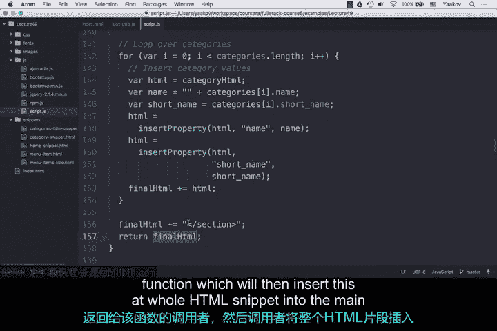

# 约翰霍普金斯大学《使用 AngularJS 开发单页 Web 应用｜Single Page Web Applications with AngularJS》中英 - P106：105_可选讲座49（第2部分）：非AngularJS网站概览.zh_en - GPT中英字幕课程资源 - BV1dsFDeZEQr

🎼。

Okay， so let's continue reviewing the website from where we left off in part one of this lecture。

Now as you remember， we had this placeholder right here。

 main dash content with the ID main dash content and let's take a look at the home snippet。

 let's open up the home snippet and it's basically you could see it's a div。

 it's got a Juotron that's a giant image that you saw when we first came to the website and has a whole bunch of things including the regular menu link also a menu for specials which is just really a category within our menu categories and you could see we assigned the special on click with a dollar sign DC。

 which we're going to talk about in a second and this method called load menu items with an S meaning for specials。

 the ID or the short name of the specials category。So we could close that。

 Let's just remember our dollar sign Dc and let's go to the scriptjs and scriptjs is where basically everything happens。

 Let's go through is line by line。 first of all， at the very top。

 we have a couple of things that have to do with bootsottrap so we could just really ignore them including this little hack to make things function a little bit better with a dropdown menu so the first thing we're doing is we're declaring this iffy and passing it as global and if we scroll down all the way sorry for the scrolling here scroll down all the way you see that our global that's being passed in is the window。

 So every time we refer to global， we're actually referring to window and the only time we're really gonna refer to global is at the very end when we take our object with our functions and we simply expose it to the global which is exposing it to the window which means anywhere else like inside of our HTML on click method we could say dollar sign Dc by the way Dc stands for David Cho that's the name of the restaurant。

😊，Daas sign D and whatever dot， whatever method that we coded up inside of this ify Let's go back to the very top。

 And let's go through it。 So Dc is a function we're going to attach some methods to Okay so first we're going to initialize some variables and note the pattern here when we say home HTML or category HTML。

 it's actually pointing to a URL of a snippet that is sitting inside of the snippets folder。

 when we say something and ended with URL that means it's an actual URL that we're going to reach out to our David's restaurant herorokuab do co that's going to be a remotely hosted restaurant server that's going to get us our menu data So anything URL is actually something to request over Ajax for data and anything that is regular HTML is to request our template HTML or snippet of HTML So the first thing we're going go over is homeage。

😊，l and the category HTMLtl and we'll go over how we pull that in into our main view。

 You can see here we created a couple of convenience methods。 One is insert HTMLl。

 and if you give it a selector and HTML it will go ahead and find that selector and just insert HTMLl into it and that's very convenient because I use insert HTMLl function instead of having to code up a few lines of code the next convenience method here is show loading and show loading basically insert this Ajax loader that g in the middle of the page when I click between one view and another it will go ahead and show that to show the user that something is going on and after we load whatever we want to load into our view will go ahead and turn that off So this is what that's for to show the loading icon the next convenience function that we created here is basically a way to simulate what an angular we know is interpolation basically we're saying if you give us a string a proper name and a property value will go。

😊，Take that string and find every occurrence of that property name with double curly braces around it without any spaces because we're not that fancy and it will go ahead and substitute that property name and those curly braces for the value of that property so basically we're stimulating or actually implementing interpolation here all by ourselves This regular expression looks a little scary。

 but really all it's doing is making sure that we're going to replace this property name in multiple locations if there are multiple locations within this string that this particular setup is noted。

Also we have the switch menu to active and basically all that's doing is inserting active class into an element and then removing the active class from that element if the user navigates away from the menu okay here's where the main functionality actually lives this is our event handler for DO content loaded meaning when the page is completely loaded this is what we're going do the first thing we're going to do is we're going to call show loading and we're going to insert that showloading icon inside of our main content if you remember that this guy right here。

😊，And then we're going to use our AxU to call sendend get request， we're going to grab the home HTML。

 which is our HTML snippet right here， the template as the URL for our request that's going to be getting our HTML and we're going to pass a function to process that in a function we're going just use an inline function which is basically going to find again that main dash content again that main placeholder and grab its inner HTML property and just place the content of the home HTML inside of it and also not to forget to pass false in here because we don't want this process as JO and attempt to create a regular JavaScript project out of it。

So that's really how we load our home view。When we click on the menu it's going to call load menu categories and what that's going to do is once again it's going to replace the contents of the main content with this loading icon and we're using that show loading function and then it's going to send a get request using the all categories URL and that's the URL that's going to get the data all the categories data as JSON and the function that we want that data processed with is called build and show categories HTML note that we're not passing an extra parameter here and that's because we're relating AJx U assume that what's going to come back from this all categories URL is J adjacentJson string that we want to process and build into a regular JavaScript object and that's actually correct So if we go to this function let's go ahead and look for it and jump to it right there this function expects categories and that's the object that's going to get passed in from the response。

Of the Ax us， as you remember， we passing that to whatever function we're passing into the Ax u。

 it's going to get executed with whatever the object javascript object we build based on the Jsound string and that's what it's going be the categories that got returned from the server So once we get that the next thing we need to do is we need actually retrieve the template。

 the HTML template that corresponds to the category HTML Well there's our HTML template and we're making yet another hx request in order to get that once we get it and there's our categories title HTML which I guess is just a title portion of the categories and once we get that。

 we need to one more time make yet another request called category HTML。

 which is now corresponds to the category snippett and the previous one was categories title snippet snippett and once we get that once we finally get that we could call the switch menu to active which basically just。

the active class on the menu button and we finally can start building our HTML and we call this build categories view HTML。

 we pass it the categories object that contains all of our categories in our menu。

 pass it to categories title HTML and the actual category HTML。Once we build that string。

 we can insert it using this insert HTML function that we've used before。

Now the last thing I'll go over is this build categories of view HTML， how do we actually build it。

 let's go ahead and search for it so we could jump to it。And there it is。

 so what we're doing here is we're taking our categories object and we're looping over that categories object and we're creating snippets of HTML for that at the same time using this insert property function which basically simulated or implemented a simple interpolation algorithm which is grabbing the name the short name and other things here and we're finally closing the section and we're producing this final HTML that will get returned to the color of this function which will then insert this whole HTML snippet into the main content that is marked right here by the index that HTML I close it by Ex but here it is the main content right here。

 so that's how a piece of content makes it inside of our index that HTML。😊。

Very complicated if you think about it， comparing it to how we can do this in Angular so much faster and so much easier Angular Now I obviously did not go over every single line of code。

 we devote a whole module in the previous course that goes over this website actually step by step coding it sort of like we're about to do with the Angular JS version of this website but you get the general idea as to how we move around and how we navigate within the page and also how we pull the data into the page and insert it using our own custom implementation of interpolation but with Angular。

 we obviously can build this website faster and easier for us as developers because there's so many tools that are available in Angular that we are not really utilizing here at all plus we'll have the routing which will let the user click the back and forward button and actually have them work So in the next lecture let's begin that process of building this website in Angular Js。

