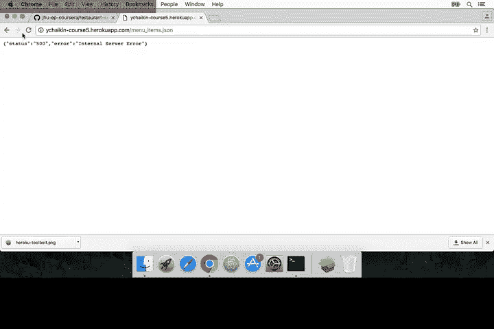

# 约翰霍普金斯大学《使用 AngularJS 开发单页 Web 应用｜Single Page Web Applications with AngularJS》中英 - P107：106_第50讲：餐厅服务器设置（Mac版）.zh_en - GPT中英字幕课程资源 - BV1dsFDeZEQr

Yeah。

In the previous course， since our website did not have a feature to update the menu of the restaurant。

 we could get away with having a central server to request menu for all the students in the class。

 However， in this course， we're going to be adding a feature for the owners of the restaurant to be able to update the menu。

 Since each deployed application will' be able to update the data on the server。

 we can no longer get away with just having one central one。

 Each student will have to set up their own server where their own copy of the data to mess with and to use for assignments and so on。

 and I'm going have to interrupt this lecture for a little bit of an update on November 28，2022。

 Heroku is going to be discontinuing their free tier plan。

 What that means for us is that we're no longer going to be able to deploy our app，100% free。

 So we need a new solution for this course。 While the reasons I gave you for why we need a custom application are still true for the full app that will be。

😊，For clientThose parts of the app that require that functionality are outside of the course。

Therefore， instead of hosting the data through the rest API over Rubyion Rails custom application。

 starting November 2022， we're going to host our app on Google Firebase。

 which already provides the rest API as part of their database So for the rest of the course whenever you see me using Hiroku app co URL you should instead use Firebase io co URL that's displayed in your screen right now As you watch the course lectures。

 please make sure to reference the real code that is in the Github repository as there minor differences in how we're going to use the new URL that is the Firebase io co URL then we use to use the Heroku app co URL I will also update the FAQ for this course for this information so you can always look there for the updated URL instead of trying to reference back to this video Also note that the current code is updated such that all of the images for each individual menu item is now part of the Github。

😊，Repository and GitHub deployment those images are not going to be retrieved from the Heroku app anymore。

One last point。While all the example code has been updated to use the Google Firebase URL lecture 60 and above are still using the Heroku URLs。

 This is because lectures 60 and above are not presented as part of this course。

 and their example code just shows the completed restaurant website which is fully deployed to Heroku。

 but it's not using a paid plan to do that。 You do not need to do that to complete the course。

 but it's there for you for your reference should you choose to play around with the completed app。

So the bottom line for you right now is that if you want。

 you could skip this lecture video for how to set things up with Heroku and simply move on to lecture 51。

 which is the next lecture after this。 If you do not want， you simply do not have to set anything up。

 All you need going forward， is that Firebase URL， which serves to you all the data through the rest API that we discussed。

 With that said， I wish you luck for the rest of the course。However。

 not to worry we made this process for you super simple。

 the first thing need to do is open your browser and go to the repository that houses the restaurant server code。

 so we'll go to http Github。com it's jheppcosera/restaurant server。Dash server。

So what comes up is the restaurant server Github repository。 Now。

 besides for housing the functionality of the restaurant server。

 we also provide the guide as to how to deploy this restaurant server on a Heroku server instance。

 We you' gonna to use the Heroku because it's free and it's pretty good and basically serves us fairly well。

 So what I'm going to do in this video is go step by step together with you through this guide and show you how to set this up。

 The very first thing we need to do is check our prerequisites and the prerequisite。

 the only one here is that we have Gi installed on our machine。 Well。

 we did that way before at the beginning of the course， So we should be good to go。

 Note that we don't need to install Ruian rails， even though this restaurant server is。😊。

Coated in ruben rails。 We don't need it in our local machine。

 This is something the Heroku will have already。 The first step is。

 is to go to our terminal app since we're in a Mac and go ahead and clone this repository to our local machine。

 We'll go ahead and copy that。 We'll open the launch pad and we'll open the terminal。😊。

Could we make it full screen？And let's go ahead and do an LS to see what's in here and we have the Coursera test。

 let's go ahead and make a directory called Coursera Project and we'll seed into Coursera projects。

Let's go ahead and clear the screen and let's go ahead and paste the Git clone command that we copied from our guide that's press enter and at this point it's going to go ahead and download and clone our repository。

 let's go back to the guide and the second step here is for us to set up Heroku。

com account Well it's very simple。 you just use this link right here we can open it in a new tab。

And Heroku。com account， you just click this big purple sign up for free button。

 provide whatever it is it' asking you for， probably just the email address， password and so on。

 and you're good to go。 Now I already signed up for Heroku。

com account so I don't need to go through this and I don't need to log in right now either so we'll close this tab and you'll go ahead and do that on your own。

Step number three is for us to download and install Heroku command line interface。

 This is a tool that's going to help us deploy our local repository with all of our code for restaurant server to Heroku。

 co Now note that sometimes this Heroku a CI or Heroku command line interface is called Heroku tool belt simply because that's what it used to be called So here's the link to the instructions of how to install it。

 let's go ahead and open it in a new tab。And if we scroll down。

You could see that it's asking us to download the Heroku 4。

 let's click this down arrow and choose MacOS and I will go ahead and download the install program。

Once it's done， we're going to go ahead and tell it yes to keep it， that it is something we trust。

We'll show it in Finder and we'll double click to install。We'll click continue。Could continue again。

And then install， it's probably going to ask us for the administrator credentials。

 and I'm going to go ahead and give them here， click install。😊，And once it's done。

 we could click Close。Go back to the instructions where it tells us to verify that it actually got installed。

 we should run the Heroku dash dash version on the terminal， let's go ahead and copy that。

Go back to our terminal can even clear the screen and let's go ahead and paste that command and when we enter it。

 you can see that it's actually part of the installation process a little bit because it's now actually installing what is's doing it's downloading the CI and then installing it on our system and as long as we get these two lines right here。

 Heroku tool belt with a version number and then Heroku Ci with the version number It means that we actually install it properly and everything is working。

 let's go back to the guide and we can actually close the tab right here and this next thing is for us to log into Heroku using the Herokuli well in order to do that we just need to run this Heroku logan command let's go ahead and copy that go back to our terminal clear the screen paste the command。

😊，And press enter。 and the email is the email address you registered with Heroku。com。

 I'll go ahead and enter my email address。Press enter and then the password that you registered with Heroku。

com note that it's actually not going to show you the password or even the little bullet points that you're typing typing is hidden and that's normal Once we're done。

 it will tell us that we're logged in as our email address and it means we're good to go。

 Let's go back to the guide。And the next step here。

 step5 is to create the Heroku domain Well Heroku domain is the subdomain actually of the Herokuab。

com domain name and that's something you're gonna to be able to choose yourself assuming it's going to be available and that's how you're going to deploy your application when you access it later through a URL or through the browser In this case this is gonna to be the restaurant server that's the restaurant server application that we deploying not our frontend application there's a couple of options that we have in order to choose our subdomain name The first one is is if we just issue a command Heroku create it will go ahead and randomly pick a subdomain name for us However。

 I'd like to pick my own subdomain name and this is the alternative right here you say Heroku create and give it some subdomain name that is a valid string to be a subdomain In this case you could see I picked my Github username dash course 5 and you could pick whatever you want obviously do not pick。

This particular one since I'm going to be using it so it's probably not going to be available anyway and you probably want to pick something that is associated with you not with my username so I'm going to go ahead and copy this。

😊，Command right here， but before I go note this bold statement here it says here from this step forward。

 we want to make sure that you're located in the restaurant dash server directory。 In other words。

 we need to be inside our Git repository for restaurant server and if not we need to navigate there using the C server Let's go back to the terminal let's do a Pwd which tells us where we are and we're inside the Cosera project we'll do NlS to see and we see that the restaurant server is a directory right beneath that So let's go ahead and Cd into that directory let's go ahead and clear the screen。

😊，And now we're able to paste that command of Heroku create in order to create the subdomain with that particular name we press enter。

😊，And you can see that Heroku Ci actually created the subdomain name with the subdomain name that I wanted。

 Let's go back to the guide and go to step 6。 step 6 is where we get to upload the code for our restaurant server to Heroku co and the way we're going to do that is using Git we're going to actually use Git push command and we're going to upload from Heroku to master。

 If we go back to our command line and do a Git remote dash V you'll see that we have a couple of remote repositories that our local on our machine repository is connected to The first one that we' probably we've seen before is the origin one and that's connected to Github repository or at least the remote version of it and the second one has a keyword Heroku。

On it。 And that's a result of this command that when we executed Heroku C。

 it plays this URL into our remote that makes this our local repository connected to the repository on Heroku co So now if we go back to the guide it's going tell us we could use this Git push command and basically what it says Git push meaning upload Heroku Heroku meaning one of these keywords right here。

 which means we want to upload to Heroku， which means to this URL really that's just what Heroku here means and we want to upload the branch called master。

 which is the branch we're sitting on right now inside of our restaurant server repository Let's go ahead and copy this command。

😊，Let's go back to the terminal。 We'll paste it， enter it and。Kit is going to push it to thekaroku。

com and as you could see， it immediately detected that this is a ruby on Ras app。

It's going to install the needed gems and whatever else it needs to run our application。

 and it will deploy it to the subdomain that we asked it to create。Okay， so once that's done。

 let's go back to our guide and it's telling us that we can actually verify that at least something got deployed by using this URL right here。

 let's go ahead and copy it， except obviously we'll copy that right here。

Except obviously we're going to use our own subdomain name not as generic one and what we should expect is to see internal server error at this point with error code 500。

 let's go and open up a separate tab。😊，Paste that there， and we'll substitute this generic one with。

My subdomain course 5 and you can see it does in fact say internal server error and the reason it's saying that is because even though we deployed the app and we want to make sure that Heroku actually knows the app exists now on Heroku what we haven't done is giving it a database or populate the database with any data so the way we do that is by using this commands that the guide provides for us。

 we'll go ahead and copy that。Go to our command prompt and go ahead and paste that command。

And what this is going to do is going to create the database instance and it's going to create the schema for the database that is needed for our application as you can see that's done。

 the next step is to actually populate it or see it with data and this is the command right here that's given we'll copy that we'll go back to the terminal we'll paste that。

😊，And now you could see is going to go ahead and seed the database with the data that we gave it in our repository and some of the things you're gonna to see here is looks like a whole bunch of characters that's perfectly normal that's just the images that the menu items have that we base 64 encode it and place it straight in database because that was the most convenient for us for this use case okay so now that is done let's go back to our guide and there' one more step that we need to do and that is set up username and password for the admin portion of the restaurant site Since we obviously don't want the whole world to be able to access our administrative portion of the site that's going to be able to change the data and our database we need to set up this username and password that only will be known to us so use the student you set up your own username and password and I'll set up my own and the way to do that is first is to run the rails console remotely on Heroku we'll go ahead and copy that command。

Let's go and clear our terminal。 We'll paste that。And we'll wait for a command prompt。

 a remote command prompt to appear。Okay， so once the remote command prompts appears。

 we could go back to the guide and we'll go ahead and take this line of code right here。😊。

And we'll copy that line。We'll go back to the command prompt。

 we'll paste it and except obviously we don't want to say some username and some password will actually want to go scrolling all the way to where that is。

And actually set up whatever the password or username password I want in this case I'll be。

I'll say yaov is my username。And the password， I'll just say hello，1，2，3。

 obviously I'm going to change this since I am recording this for the whole world to see。

 I'm obviously going to change this password later。But for now， this is gonna enough， for example。

 hello on to three。 and now we're able to enter。 and once that's done。

 we've committed that username and password and now we're good to go。

 we'll go back to the guide and you could see that that's it。 that's really the end of the guide。

 So at this point， we have the restaurant server deployed and now we could write our frontend code。

 And when we make requests to the server。 this is the URL that we're going to make requests to。

 In fact， we go back to that app that we open that had an internal error and just do a refresh。

 We should see now that all the data basically the JSson for all the menu items here。

 this is the menu items rest endpoint is showing up as regular Json which means our application is working and we're ready to code against it。

😊。

