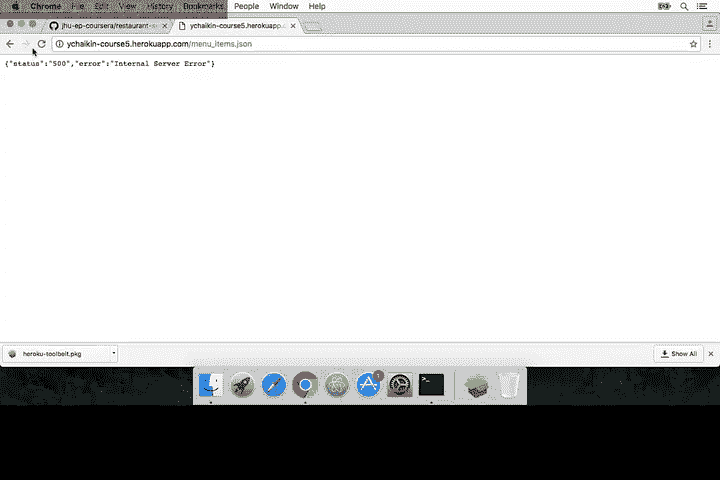

# 使用 AngularJS 开发单页 Web 应用：P107：第50讲：餐厅服务器设置（Mac版）🍎


在本节课中，我们将学习如何为餐厅网站项目设置一个独立的服务器。由于课程新增了允许餐厅所有者更新菜单的功能，每个学生都需要部署自己的服务器实例来操作数据，而不能共享一个中央服务器。

## 概述

上一节我们介绍了为何需要独立的服务器。本节中，我们将一步步指导您在 Mac 系统上，使用 Heroku 平台部署餐厅服务器代码。请注意，自2022年11月起，Heroku 已取消免费套餐，因此课程已改用 Google Firebase 作为数据源。本教程作为历史参考，您可以直接使用提供的 Firebase URL 继续学习，无需自行部署服务器。

## 准备工作

以下是设置服务器前需要完成的步骤。

**第一步：获取服务器代码**
首先，在浏览器中访问餐厅服务器代码的仓库：`https://github.com/jhu-ep-coursera/restaurant-server`。这个仓库包含了服务器功能以及部署指南。

**第二步：创建 Heroku 账户**
访问 Heroku 官网 (`heroku.com`) 并注册一个免费账户。您需要提供邮箱和设置密码。

**第三步：安装 Heroku 命令行工具 (CLI)**
访问 Heroku CLI 安装页面，根据 MacOS 的指示下载并安装。安装完成后，在终端运行 `heroku --version` 来验证安装是否成功。

**第四步：登录 Heroku**
在终端中运行 `heroku login` 命令，然后输入您注册时使用的邮箱和密码（输入密码时不会显示，这属于正常现象）。成功登录后，终端会显示确认信息。

## 部署服务器

完成准备工作后，现在可以开始部署服务器代码。

**第五步：创建 Heroku 应用**
在终端中，首先使用 `cd` 命令进入您克隆的 `restaurant-server` 项目目录。然后运行 `heroku create [您的自定义子域名]` 命令来创建一个新的 Heroku 应用实例，并为其指定一个唯一的子域名。

**第六步：推送代码到 Heroku**
Heroku 会自动为您的本地仓库添加一个名为 `heroku` 的远程地址。运行 `git push heroku master` 命令，将本地代码推送到 Heroku 进行部署。系统会自动识别这是一个 Ruby on Rails 应用并安装所需依赖。

**第七步：设置数据库**
代码部署后，应用还无法正常工作，因为数据库尚未初始化。依次运行以下两个命令：
1.  `heroku run rake db:migrate`：在 Heroku 上创建数据库结构。
2.  `heroku run rake db:seed`：向数据库填充初始的菜单数据。

**第八步：设置管理员凭证**
为了保护管理功能，需要设置一个管理员用户名和密码。运行 `heroku run rails console` 进入远程控制台，然后执行以下代码（请替换 `your_username` 和 `your_password` 为您自己的凭证）：
```ruby
User.create(username:'your_username', password:'your_password')
```

## 验证部署

完成所有步骤后，您可以在浏览器中访问您的 Heroku 应用 URL（格式为 `https://[您的子域名].herokuapp.com`）。如果看到返回的 JSON 格式菜单数据，而不是错误信息，则表明餐厅服务器已成功部署并运行。

## 总结




本节课中我们一起学习了如何在 Heroku 上部署餐厅服务器。核心流程包括：获取代码、安装工具、创建应用、推送代码、初始化数据库以及设置安全凭证。虽然课程现已转向使用 Firebase，但通过此流程您能了解将应用部署到云平台的基本方法。现在，您的后端服务器已准备就绪，可以开始编写前端代码与之交互了。