# 约翰霍普金斯大学《使用 AngularJS 开发单页 Web 应用｜Single Page Web Applications with AngularJS》中英 - P108：107_第50讲：餐厅服务器设置（Windows版）.zh_en - GPT中英字幕课程资源 - BV1dsFDeZEQr

Yeah。

In the previous course， since our website did not have to have a feature to update the menu of the restaurant。

 we could get away with having a central server to request the menu data for all the students in the class。

 However， in this course， we are going to be adding a feature for the owners of the restaurant to be able to update the menu Since each deployed application will be able to update data on the server。

 we can't really get away with just having a one central server Each student will have to set up their own server with their own copy of the data that they can mess with and write assignments and frontend applications against。

However， don't worry， this setup is actually very straightforward。

 and I'm going to have to interrupt this lecture for a little bit of an update On November 28，2022。

 Heroku is going to be discontinuing their free tier plan。

 What that means for us is that we're no longer going to be able to deploy our app100% free。

 So we need a new solution for this course。 While the reasons I gave you for why we need a custom application are still true for the full app that will be deployed for the real client。

 Those parts of the app that require that functionality are outside of the course。Therefore。

 instead of hosting the data through the rest API over Rubyion Rails custom application。

 starting November 2022， we're going to host our app on Google Firebase。

 which already provides the rest API as part of their database So for the rest of the course whenever you see me using Heroku app co URL you should instead use Firebaseo。

 co URL that's displayed in your screen right now As you watch the course lectures please make sure to reference the real code that is in the Github repository as there are minor differences in how we're going to use the new URL that is the Firebaseo。

 co URL then we use to use the Herokuab。 co URL。I will also update the FAQ for this course for this information so you can always look there for the updated URL instead of trying to reference back to this video。

 Also note that the current code is updated such that all of the images for each individual menu item is now part of the Gitthub repository and Github deployment。

 Those images are not going to be retrieved from the Hiroku app anymore。One last point。

While all the example code has been updated to use the Google Firebase URL。

 lecture 60 and above are still using the Heroku URLs。

 this is because lectures 60 and above are not presented as part of this course and their example code just shows the completed restaurant website which is fully deployed to Heroku but it's not using a paid plan to do that。

You do not need to do that to complete the course， but it's there for you for your reference。

 should you choose to play around with a completed app。

So the bottom line for you right now is that if you want。

 you could skip this lecture video for how to set things up with Heroku and simply move on to lecture 51。

 which is the next lecture after this。 If you do not want， you simply do not have to set anything up。

 All you need going forward is that Firebase URL， which serves to you all the data through the rest API that we discussed。

 With that said， I wish you luck for the rest of the course。

We'll start to setup by going through the guide that we put together for you。

 I actually already have it loaded inside the Chrome browser and in order to get to it。

 you have to go to github。com jchap coursesera restaurant server and basically this repository houses the functionality that is going to be the backend the server of our Chinese restaurant this David Choosech Bitro restaurant right here however in the very front page and the readme。

md which gets posted right here we have the guide for you as to how to go step by step and set up your own server without ever having to install that match on your own local machine So let's go ahead and go through this guide I'm going go through this guide on Windows and I'll have another video going through this guide for the Mac。

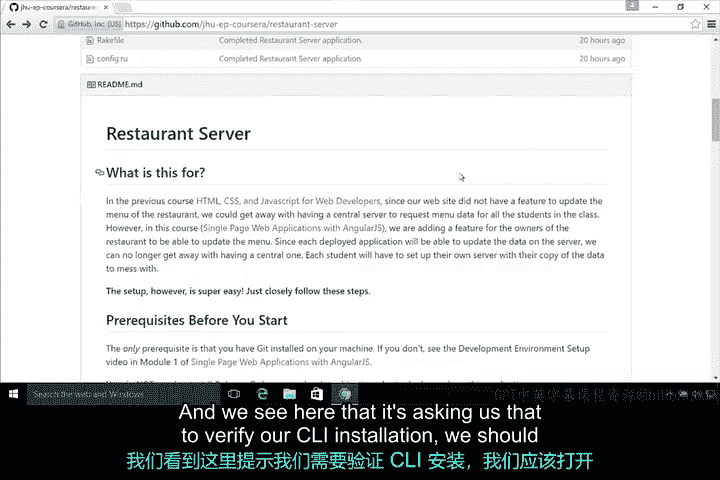

The first thing we notice here is a prerequisite before you start。 Well。

 the prerequisites are there's only one is that we have gi installed on our machine。

 And since we already have that installed from the beginning of the course， we're really good to go。

 let's go to step1。 Step1 is for us to actually clone this repository that we're working with。

 and here's the command right here。 It's given to us。 We'll go ahead and copy that command。

 we'll go to CMD。 I'll command prompt and here if I do a Dr。

 I'll see it already have Coursera projects here。 So maybe we'll go in there。😊，We'll clear it。

 Let's see what's inside with D Ir。 just Cosera test。 That's fine。

 We'll paste the command that we copied on the webpage and press enter。

 and then we'll go ahead and clone our restaurant server to our local machine right here。

 It's actually make this full screen so let's go back to the guide The next thing to do is to sign up with Heroku and it gives us the URLl here to sign up with Heroku do co I can open that up in the separate tab。

 And once it loads， you can see here the big button here says sign up for free。

 which is what you could do。 I already have mine signed up So I don't really need to go through the step again。

 but it's very basic signup email password， so on。 Let's go on to the next step。

 And the next step is for us to download and install Heroku command line interface。

 This is what we're going to use to remotely control our Heroku deployment with this restaurant server。

 Now this tool also used to be called Heroku toolbell。😊。

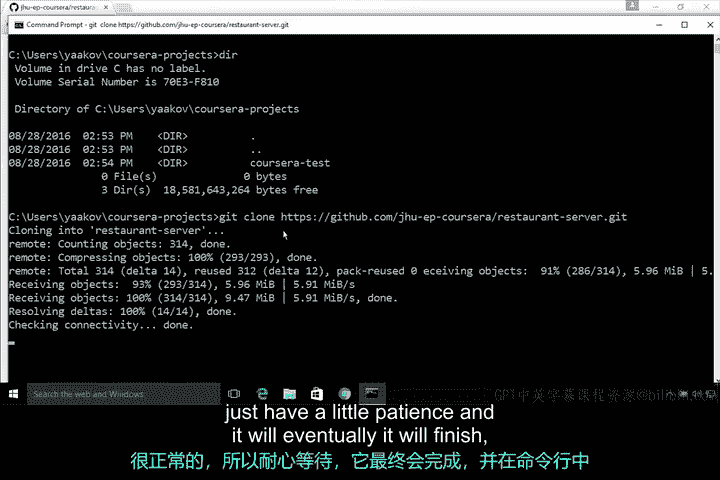

So if you ever see this name anywhere， don't get confused it's one and the same thing in order to install it。

 we'll go to this provided URL， we'll open that in a separate tab。

 we could close the previous tab for now。😊，And it tells us here that we scroll down。

 download and install， the page automatically recognize that we're running Windows。

 we'll go ahead and click to download。And you could see that what it's downloading is actually Heroku dash tool belt that exy。

 so it's still bearing the old name。 Let's go ahead and click that to install it。We'll say， yes。

 we do want to install it。And we'll click next， next。And install it。

 And this is going to take a little bit， but it will get done and we can move on to the next step。

Okay， so now that we've done we could click finish and we see here that we it's asking us that to verify our CLI installation。

 we should go ahead and go to the command prompt and use a command Heroku dash version。

 we'll copy that in fact， we'll go to the command prompt it's clear the screen paste it and execute it and it says heroroku is not a recognized as an internal command。

 Well， the reason that's happening and Windows this happens a lot is because we've installed something while our command prompt was open。

 So the best way to fix this is just to close the command prompt and go and open it up again。

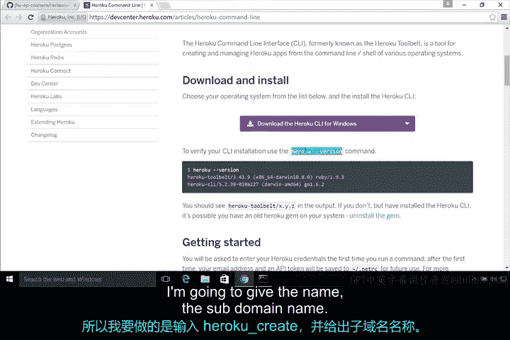

Let's make it full screen again and we'll C to Coursera project。

 we'll do a clear screen and we'll paste that command again and this time you'll see it does recognize the command。

As you can see it's actually downloading the command line interface our CLI。

 and this will take a little bit after it download it to sit here and think and try to install it into our system。

😊，If yours takess a while， don't worry it's actually pretty normal。

 so just have a little patience and will eventually it will finish and give you a couple of logging statements on the command line。

Okay so it's finally done and you could see that it gave us a couple login statements saying Heroku tool belt with a version number and Heroku Cli with a version number that means we've installed it properly and we're ready to go to the next step let's go back to the browser we can now close this tab and go to step number four and step number four is for us to log in to Heroku using the Heroku CI well the way to do that is to copy this command right hereku Heroku login I'll go ahead and copy that go to command line and we'll go ahead and clear the screen and we'll do we'll actually copy it so I could just paste it Heroku Logan it's going to ask me for my email I'll enter my email address。

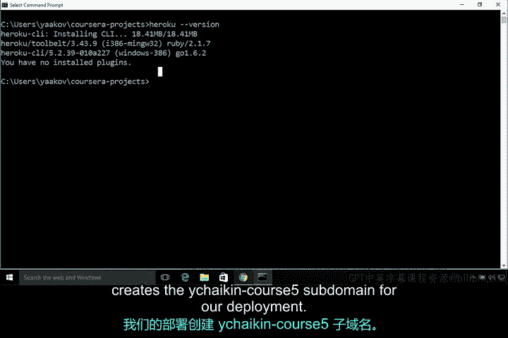

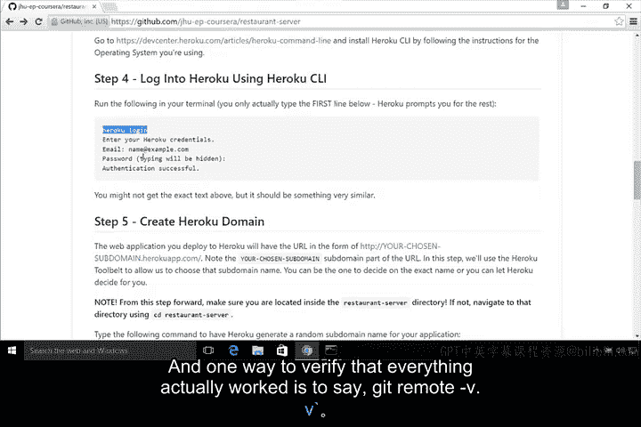

And then the password that we gave when we registered for the Heroku account should go here and notice that as I type my password。

 it is not actually showing me anything that's perfectly normal and that's how it should be and there we go。

 so now we are logged in。

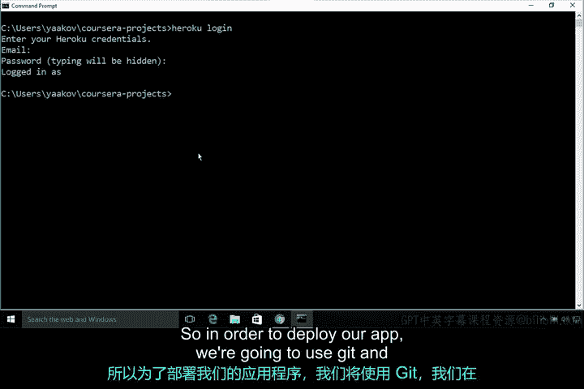

Let's go back to our guide and see step number five。

Step number5 is for us to choose the subdomain that is going to be part of our website and we deploy it as you can see when we're done it's going to be something like htp call your chosen subdomain herorokuab co Well your chosen subdomain is something we need to choose and we have a couple of options we can have heroroku choose it for us and just give us a random name and if we just do heroroku create that's what's gonna to happen。

 However， what wouldd like to do at least I would like to do is to give it my own custom name if it's available。

 So what I'm going to do is say heroroku create and I'm going give the name of the subdomain name and the name here is I'm going to just use my Github username course5 obviously do not use the same one that I'm using first of all by the time you're doing it it's going to be unavailable and second of all you want to do something that you remember so I suggest you use something like your Github ID or some other I it doesn't make any difference just as long as it's a valid。

String that can go inside the URL。 So I'm going to go ahead and copy this command right here。

 let's go back to the command line and the one thing we skip right here that I should go back for is this huge note here that it's telling us very important that from this step forward。

 we want to make sure that we're located inside the restaurant server directory。

Meaning inside of our local Git repository， that is the restaurant server repository and if not we should navigate to that repository using CDd restaurant server Well let's go ahead and check where we are。

 You can see we're in Courra projects if we do a Dr you'll see that the restaurant server is a directory underneath of us。

 So let's go ahead and do a C restaurant server and now we are inside of it let's go ahead and clear the screen and now we could paste that command which creates the y hike dash course 5 subdomain for our deployment。

 let's go ahead and press enter。😊。

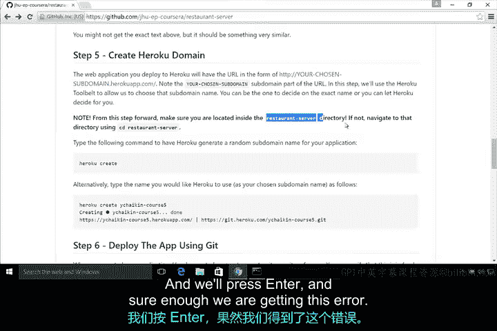

And we're done and one way to verify that everything actually worked is to say git remote dash V and what that will show us is all the remote repositories that this local repositor and arm machine is connected to and you could see it really used to be just these two but after our command to create subdomain。

 you could see that we have a couple more entries here with the keyword Heroku。Okay。

 let's go back to our guide。And the guide says step6。

 we need to deploy the app It's actually giving us the step right here to verify that things actually worked。

 So in order to deploy our app， we're going to use Git and what we're doing here is using Git push otherwise known as really upload and we're saying it Git pushush go ahead and upload Heroku to Heroku meaning to whatever Heroku keyword is pointing to here which is this URL right here and what I want you to upload I want you to upload the master branch which is what we local is sitting up So I'm going to go ahead and copy this command go to my command prompt paye state right here and upload is as you could see it's starting to upload stuff to Heroku。

 co。And once it's uploaded， you're going to see a whole bunch of remote logging and the remote logging is basically telling us that it detected a Ruby on railils application。

 it's going to install a whole bunch of gems that it needs in order to run our restaurant server and finally deploy the app for us。

Okay， and it's done。Let's go ahead and go back to the guide and one of the things it tells us to do is go ahead and verify that it actually got deployed and it's warning us that we're going to see an internal server arrow of 500 code。

 Let's go ahead and copy this right here。

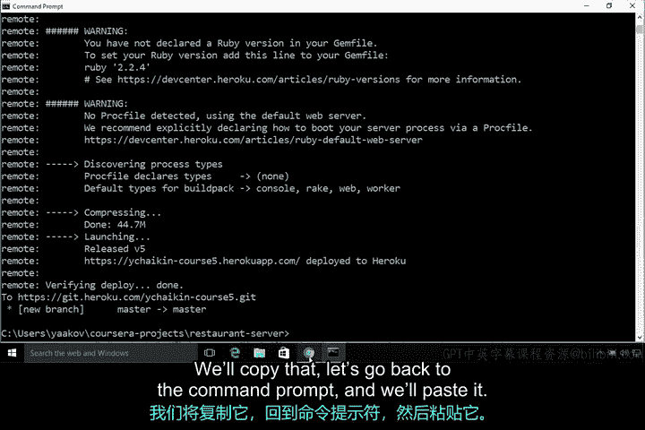

Copy this URL， let's go up to a new tab and obviously we don't want to fake domain name。

 we want the domain name that I chose， which is why hiking dashash Coursera or course。

5 and we'll press enter and sure enough we're getting this error and that's a good thing at this point because we know that at least our app got deployed and the reason we're getting this error actually is because we haven't really put any data or really even connected the database to our application and that's really step 7 step 7 is telling us Heroku runr to be migrate。

 we'll copy that go back to command line， let's go ahead and clear that we'll paste that code right there or that command and at this point we're creating a schema creating a database and a schema remotely on Heroku。

com for our particular application。

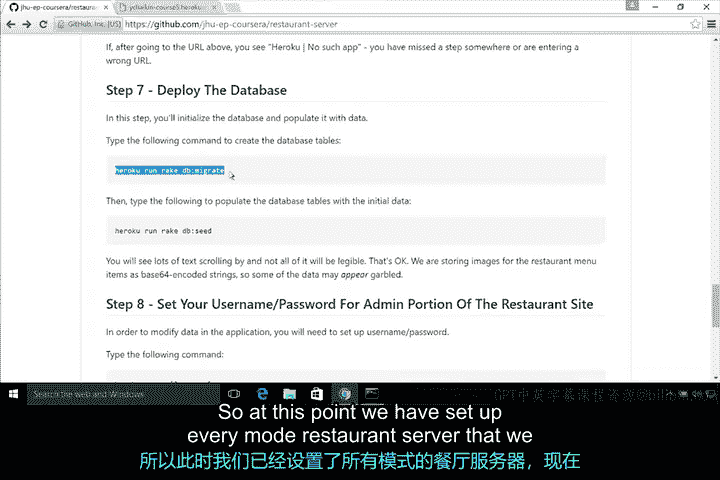

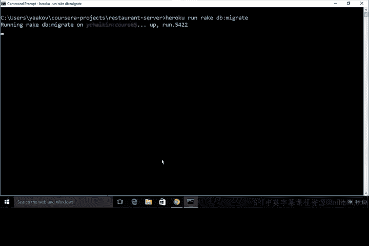

Okay so once that's done， we'll go back to the guide and it's telling us to do one more thing which is see the database。

 this command sees the database， meaning it's going to place some data inside of the database for us to use well clear to the screen paste the command for a center and this point is going to run for a little bit is going to take a little bit of time and you'll see a whole bunch of statements here and at some point you're going to see this just bunch of characters not to worry this is perfectly normal and what you're actually seeing is the menu item images that we base 64 encoded and place directly in the database。

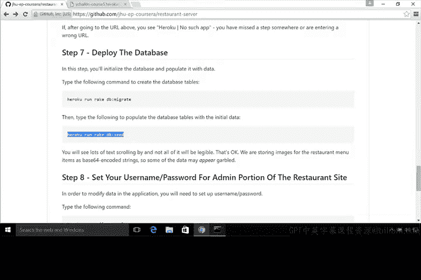

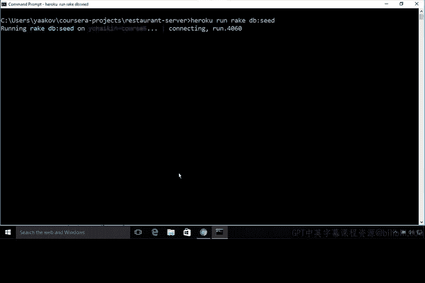

Okay， so now that we're done， let's go back to the browser。

 initially let's go ahead and try this one more time。

And you can see now we're seeing the JON that we're supposed to be seeing。

 so things are working well。 We could go ahead and close that。😊，And let's go to step number8。

 at some point， we're going to be messing with the admin portion of our restaurant website For that。

 obviously we don't want the whole world to be able to log into that portion of the site。

 So we need to set up a username and password for the administrator over the restaurant website。

 So for that， we're gonna again execute a few commands。 first one we'll run the rails console。

 Let's go ahead and clear the screen here and we'll paste the command and execute it。

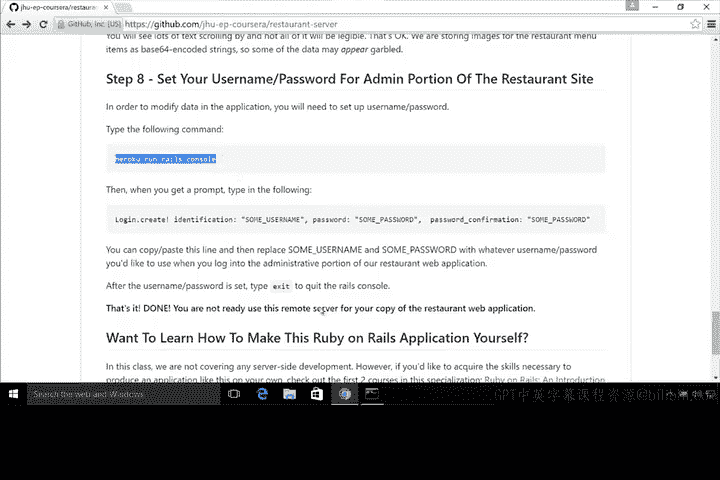

And once we get the command prompt， let's go back to the guide and see what it's telling us to do。

 it's telling us to then execute this following command， let's go ahead and copy that whole command。

 we'll copy that。Let's go back to the command prompt and we'll paste it And obviously we don't want towards word some password or some username。

 Let's go ahead and erase the some username some password and let's go ahead and give it some name。

 So let's say yaov is going to be my username and。And the password。

 I'll put a password called hello123。 Don't worry I'm going to change this password once we deploy and password confirmation again is the same thing of hello 123。

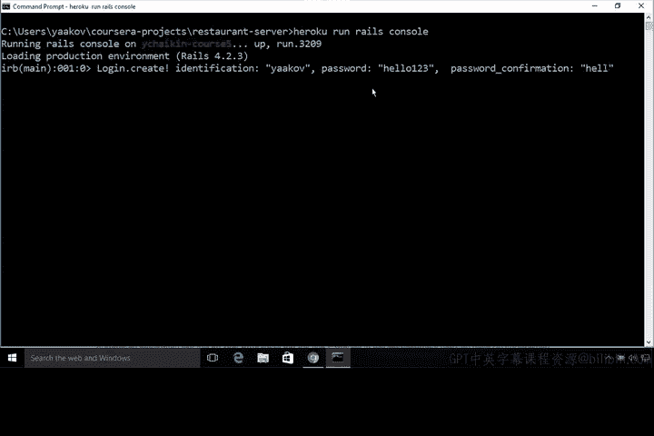

Okay all that's left here is to press enter as you can see things look like they've committed just fine let's go back to the guide and we see here that we're done there's really nothing else to do except maybe exit the actual command prompt we go ahead and type exit and once that's done we're back to the restaurant server so at this point we have set up a remote restaurant server that we can now use in our frontend development as our backend server。

😊。

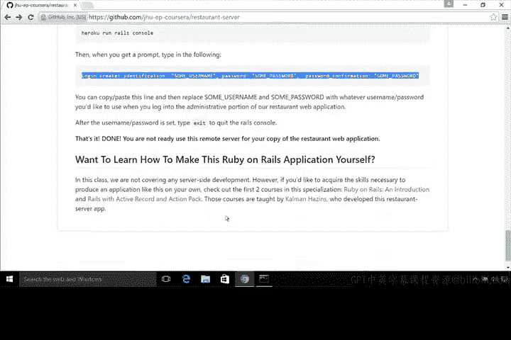